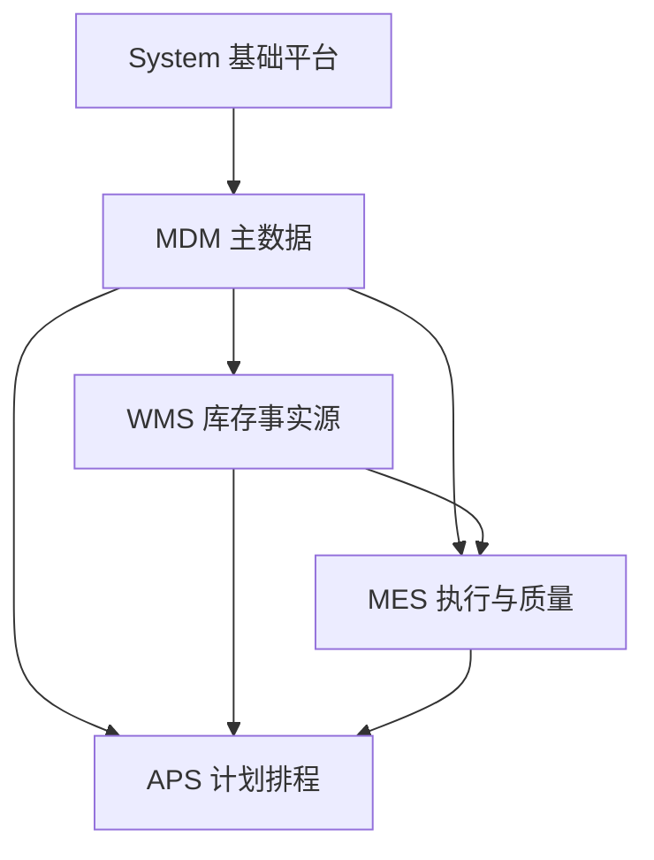

# 跨模块 API 门面开发总览

- 版本：v1.0.0
- 日期：2026-08-30
- 状态：待实施
- 适用范围：`iboot-module-mdm`、`iboot-module-wms`、`iboot-module-mes`、`iboot-module-aps`
- 关联依据：`业务建模/衡枢智造平台概要设计-v1.0.0.md`、`业务建模/衡枢智造平台架构基石-v3.0.0.md`

---

## 1. 目标

本轮只建设四个业务模块的**内部 API 门面包**，不是 HTTP Controller，也不是前端接口。目标是把跨模块访问收敛到稳定契约上：

1. MDM 对 WMS / MES / APS 提供只读主数据门面。
2. WMS 对 MES / APS 提供库存事实源和库存作业门面。
3. MES 对 APS / UI / 后续 Integration 提供生产执行与质量事实门面。
4. APS 对 UI / MES / WMS 提供排程场景、版本与结果门面。

本轮不重复建设 admin CRUD，不新增页面，不做完整业务闭环。若现有 Service 方法不足，允许在模块内补 Service 方法，但 Mapper 和 DO 仍不得跨模块暴露。

## 2. 总体架构



依赖方向固定为：

| 模块 | 允许依赖 | 禁止依赖 |
| --- | --- | --- |
| MDM | system、infra | WMS、MES、APS |
| WMS | system、infra、MDM | MES、APS |
| MES | system、infra、MDM、WMS | APS |
| APS | system、infra、MDM、WMS、MES | 反向被任何核心模块依赖 |

反向协作一律走 Hook / 领域事件 / 后续 Integration 防腐层，不走反向 Maven 依赖。这样做的根因是避免模块间互相编译依赖，保持微服务拆分可能性。

## 3. 统一包结构

每个模块使用相同结构：

```text
com.iboot.pf.module.<module>.api
├── package-info.java
├── <domain>
│   ├── <Domain>Api.java
│   ├── <Domain>ApiImpl.java
│   └── dto
│       ├── <Domain>RespDTO.java
│       └── Create<Domain>ReqDTO.java
```

示例：

```text
com.iboot.pf.module.mdm.api.material
├── MaterialApi.java
├── MaterialApiImpl.java
└── dto
    ├── MaterialRespDTO.java
    └── MaterialQueryReqDTO.java
```

### 3.1 类命名

| 类型 | 规则 | 示例 |
| --- | --- | --- |
| 查询接口 | `XxxApi` | `MaterialApi` |
| 实现 | `XxxApiImpl` | `MaterialApiImpl` |
| 响应 DTO | `XxxRespDTO` | `MaterialRespDTO` |
| 创建命令 DTO | `CreateXxxReqDTO` | `CreateInOrderReqDTO` |
| 查询 DTO | `XxxQueryReqDTO` | `InventoryQueryReqDTO` |
| 状态命令 DTO | `ChangeXxxStatusReqDTO` | `ChangeQualityStatusReqDTO` |

### 3.2 方法命名

| 场景 | 命名 | 语义 |
| --- | --- | --- |
| 单查 | `getXxx(Long id)` | 不存在返回 `null` |
| 批量查 | `getXxxList(Collection<Long> ids)` | 不存在返回空集合，不抛异常 |
| Map 查 | `getXxxMap(Collection<Long> ids)` | 供批量补全，避免 N+1 |
| 校验 | `validateXxxList(Collection<Long> ids)` | 缺失或停用直接抛业务异常 |
| 生效版本 | `getEffectiveXxx(Long ownerId, LocalDate date)` | 按日期取当前有效版本 |
| 创建命令 | `createXxx(CreateXxxReqDTO reqDTO)` | 必须幂等 |
| 状态命令 | `reserveXxx` / `releaseXxx` / `lockXxx` / `unlockXxx` / `confirmXxx` / `publishXxx` | 必须幂等 |

批量集合参数统一使用 `Collection<Long>`，允许 `Set` / `List`。空集合返回空结果，不抛 NPE。

## 4. DTO 契约

### 4.1 字段原则

1. DTO 只暴露跨模块需要的业务字段，不复制完整 DO。
2. 不暴露 `deleted`、`creator`、`updater` 等审计字段，除非业务明确需要。
3. 每个字段必须有中文 Javadoc，枚举值必须在注释中列全。
4. 状态使用 `Integer`，业务代码使用 `String`，不把内部枚举类暴露给调用方。
5. 金额、数量、效率、损耗率使用 `BigDecimal`；日期用 `LocalDate`；时间用 `LocalDateTime`。
6. 列表查询 DTO 必须给出明确的过滤条件，不提供万能查询。

### 4.2 命令幂等

所有跨模块命令 DTO 必须包含以下字段：

| 字段 | 类型 | 必填 | 说明 |
| --- | --- | --- | --- |
| `idempotencyKey` | `String` | 是 | 全局唯一，建议格式：`sourceModule:sourceBizNo:action:lineNo` |
| `sourceModule` | `String` | 是 | 调用方模块：`MES`、`APS`、`INTEGRATION`、`UI` |
| `sourceBizNo` | `String` | 是 | 调用方业务单号 |
| `sourceBizLineNo` | `String` | 否 | 行级业务号，有明细时必填 |

实现要求：

1. 命令入口先按 `idempotencyKey` 查询是否已受理。
2. 已受理则直接返回原结果，不重复执行。
3. 未受理则落库唯一约束后再执行业务。
4. 查询方法不需要幂等键。

## 5. 实现规范

### 5.1 分层

```text
跨模块调用方 Service
    ↓ 调用
提供方 XxxApi
    ↓ 委托
提供方 XxxService
    ↓ 访问
提供方 Mapper
```

规则：

1. API 实现类只做参数转换、批量补全和 Service 委托，不写 SQL。
2. 事务注解优先放在 Service 方法上，API 实现类不主动开事务。
3. 跨模块查询方法在 API 实现上加 `@DataPermission(enable = false)`，避免内部调用被当前用户数据权限过滤。
4. 命令实现类加 `@Validated`，DTO 入参用 Jakarta Validation。
5. API 不加 `@PreAuthorize`，因为它是内部 Spring Bean，不是 HTTP 接口。

### 5.2 转换

简单对象转换沿用 `BeanUtils.toBean`。复杂嵌套对象可新建 MapStruct Converter，但不允许把 Controller VO 直接当 API DTO 复用。

### 5.3 批量查询

1. 调用方必须先汇总 ID，再调用批量 API，禁止循环单查。
2. API 实现内部使用一次 SQL `IN` 查询。
3. 单次批量建议不超过 1000 个 ID，超出时由调用方分批。

## 6. 错误码

| 模块 | 错误码段 | 建议文件 |
| --- | --- | --- |
| MDM | `1-062` | `iboot-module-mdm/src/main/java/com/iboot/pf/module/mdm/enums/ErrorCodeConstants.java` |
| WMS | `1-063` | `iboot-module-wms/src/main/java/com/iboot/pf/module/wms/enums/ErrorCodeConstants.java` |
| MES | `1-064` | `iboot-module-mes/src/main/java/com/iboot/pf/module/mes/enums/ErrorCodeConstants.java` |
| APS | `1-065` | `iboot-module-aps/src/main/java/com/iboot/pf/module/aps/enums/ErrorCodeConstants.java` |

每个模块只定义自己的错误码，不允许跨模块引用对方 `ErrorCodeConstants`。

## 7. 工作拆分

| AI | 模块 | 交付物 | 前置条件 |
| --- | --- | --- | --- |
| AI 1 | MDM | `api` 包、DTO、Impl、单元测试 | 现有 MDM Service 可用 |
| AI 2 | WMS | `api` 包、DTO、Impl、Service 骨架、单元测试 | MDM API 契约定稿 |
| AI 3 | MES | `api` 包、DTO、Impl、Service 骨架、单元测试 | MDM/WMS API 契约定稿 |
| AI 4 | APS | `api` 包、DTO、Impl、Service 骨架、单元测试 | MDM/WMS/MES API 契约定稿 |

四份模块文档均已写明接口清单，可在契约定稿后并行开发。

## 8. 验收清单

- [ ] 四个模块均存在 `api/package-info.java`
- [ ] API 接口只暴露 DTO，不暴露 DO、VO、Mapper、Service
- [ ] 跨模块命令 DTO 均包含 `idempotencyKey`
- [ ] 批量查询均为一次 SQL，无 N+1
- [ ] 模块依赖方向符合第 2 节
- [ ] 查询 API 加了 `@DataPermission(enable = false)`
- [ ] 命令 API 加了 `@Validated`
- [ ] 每个模块错误码使用自己的 `1-06x` 段
- [ ] `mvn -pl <module> -am test` 通过
- [ ] 未新增 HTTP Controller，未新增前端页面

## 9. 风险与禁止事项

| 风险 | 禁止做法 | 正确做法 |
| --- | --- | --- |
| 模块互相编译依赖 | WMS 依赖 MES | 使用 Hook / 事件 / Integration |
| 内部模型泄漏 | 直接返回 DO 或 VO | 定义独立 DTO |
| 幂等缺失 | 命令只靠前端防重 | `idempotencyKey` 唯一约束 |
| 数据权限误伤 | API 查询沿用当前用户权限 | 查询方法关闭数据权限 |
| 查询风暴 | 循环调用单查 API | 调用方汇总后批量调用 |
| 状态语义漂移 | 各模块自行解释状态 | 状态归属方在 API DTO 注释中定义 |

