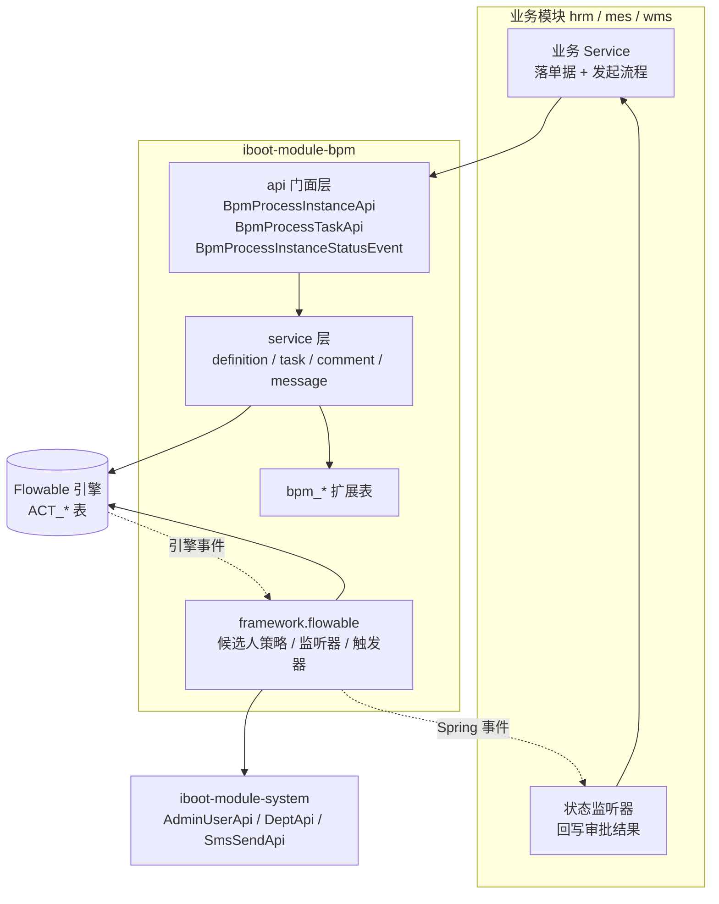
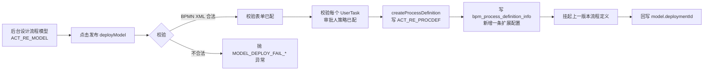
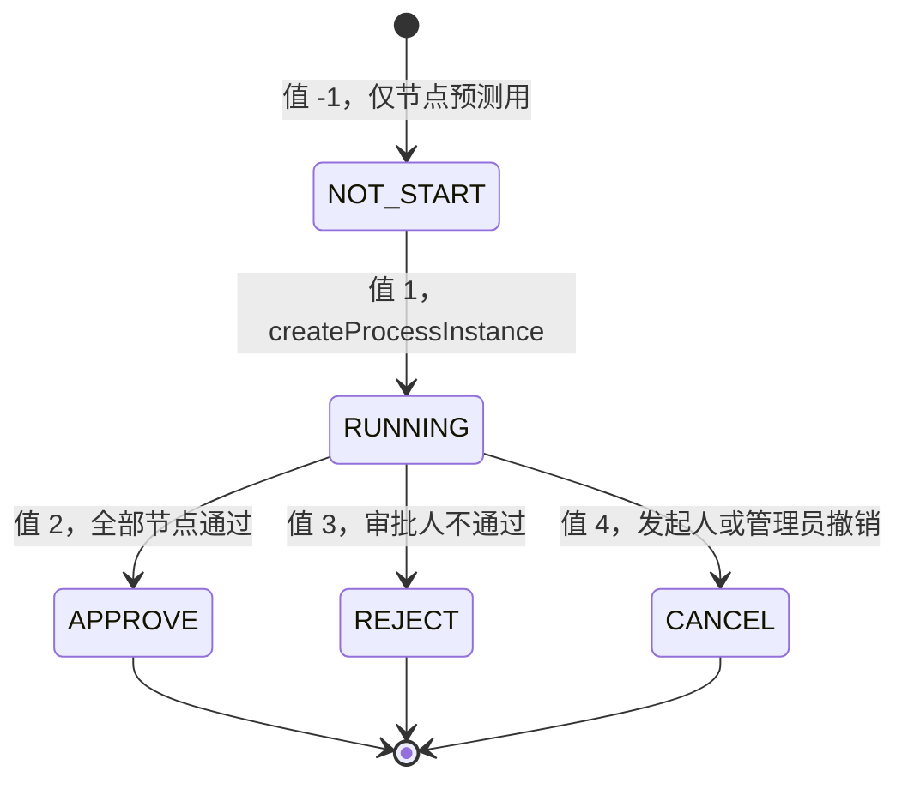
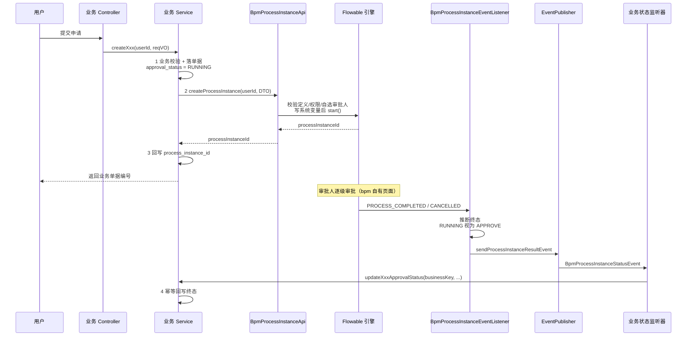

# BPM 模块详细设计与接入规范

本文用于两类工作：一是改动 `iboot-module-bpm` 本身（流程建模、审批人策略、触发器、状态流转）；二是让任意业务模块接入审批流。已落地的接入参考实现有两个：模块内置的 OA 请假（`bpm_oa_leave`，示例性质）和 HRM 员工请假（`hrm_attendance_leave`，生产形态）。**新接入一律照 HRM 那份写**，OA 那份缺幂等保护，只当流程配置的演示看。

与 `dev-docs/业务流程/` 系列的分工：本文讲**技术实现**，即怎么建模、怎么接、有哪些坑；`业务流程/07-BPM审批接入流程`（规划中）讲**业务口径**，即哪些业务动作需要审批、审批期间事实数据能不能改。两份都要看，本文是它的实现依据。

## 1. 技术栈与版本事实

| 项 | 值 | 位置 |
| --- | --- | --- |
| 引擎 | Flowable，`<flowable.version>8.0.0</flowable.version>` | `iboot-dependencies/pom.xml` |
| 引入方式 | `flowable-spring-boot-starter-process` + `flowable-spring-boot-starter-actuator` | `iboot-module-bpm/pom.xml` |
| 建表 | `flowable.database-schema-update: true`，引擎自建 `ACT_*` 表 | `iboot-server/src/main/resources/application.yaml` |
| 历史级别 | `history-level: audit` | 同上 |
| 自动部署 | `check-process-definitions: false`，**不扫 `/resources/processes`**，流程只能从后台设计器部署 | 同上 |

`iboot-module-bpm/pom.xml` 的 `<description>` 里还写着"工作流基于 Flowable 6 实现"，那是从上游继承下来的旧文案，实际锁的是 8.0.0。查资料时按 Flowable 8 的 API 找，不要按 6 的老文档抄。

bpm 只依赖 `iboot-module-system`，不依赖任何业务模块。**依赖方向永远是业务模块 → bpm**，bpm 里不许出现 `import com.iboot.pf.module.{mdm,mes,wms,aps,hrm}`。原因和跨模块取数规范一致：反向依赖会把工作流焊死在业务模块上。

## 2. 总体架构



四层职责边界：

`api` 是唯一对外出口，只有 3 个东西（见第 6 节），业务模块不许直接 `@Resource` 注入 `BpmProcessInstanceService` 这类内部 Service。

`service` 分四块：`definition`（模型、表单、分类、表达式、监听器、用户组）、`task`（流程实例、任务、抄送、触发器）、`comment`（审批意见）、`message`（短信通知）。

`framework.flowable` 是引擎扩展层：候选人策略、引擎事件监听器、`JavaDelegate`。`BpmFlowableConfiguration` 通过 `EngineConfigurationConfigurer` 把这些挂进引擎。

`dal` 只放 Flowable 装不下的扩展数据，流程运行态一律在 `ACT_*` 里。

## 3. 数据模型

### 3.1 两套表的分工

Flowable 在 dev 库里自建了 39 张 `ACT_*` 表，业务上要认的是三组：`ACT_RE_*`（3 张，模型、部署、流程定义）、`ACT_RU_*`（13 张，运行态的执行、任务、变量、定时任务）、`ACT_HI_*`（10 张，历史的流程实例、任务、活动、变量、评论、附件）。剩下的 `ACT_ID_*`（身份）、`ACT_GE_*`（通用资源）、`ACT_EV_*`、`ACT_PR_*` 是引擎内部用的，本项目的身份数据走 `iboot-module-system`，不用 Flowable 的身份表。

这些表**不建 DO、不写 Mapper**，一律通过 `RepositoryService` / `RuntimeService` / `TaskService` / `HistoryService` 访问。

自建 8 张 `bpm_*` 表：

| 表 | DO | 用途 | 为什么不能塞进 ACT_* |
| --- | --- | --- | --- |
| `bpm_process_definition_info` | `BpmProcessDefinitionInfoDO` | 流程定义的全部扩展配置 | `ProcessDefinition` 不支持扩展字段 |
| `bpm_category` | `BpmCategoryDO` | 流程分类（`code`/`name`/`sort`） | `ProcessDefinition#getCategory()` 无法写入 |
| `bpm_form` | `BpmFormDO` | 动态表单定义（`conf` + `fields`） | 业务概念，引擎无对应实体 |
| `bpm_user_group` | `BpmUserGroupDO` | 用户组（`userIds` 集合） | 引擎的 `IdentityLink` 组模型太弱 |
| `bpm_process_expression` | `BpmProcessExpressionDO` | 可复用的流程表达式模板 | 设计器用的配置数据 |
| `bpm_process_listener` | `BpmProcessListenerDO` | 监听器模板，供 BPMN 设计器选择 | 同上 |
| `bpm_process_instance_copy` | `BpmProcessInstanceCopyDO` | 抄送记录 | 抄送不是引擎概念 |
| `bpm_oa_leave` | `BpmOALeaveDO` | OA 请假示例业务表 | 示例业务数据 |

审批意见没有自建表，走 `TaskService#addComment` 写 `ACT_HI_COMMENT`，类型用 `BpmCommentTypeEnum`（评论/通过/不通过/取消/退回/委派/转派/加签/减签）。

### 3.2 bpm_process_definition_info 的关键字段

这张表按 `process_definition_id` 与 Flowable 流程定义一对一，**每次部署新增一条，老记录保留**。dev 库里已经有 256 行，就是历次部署的沉淀。

| 字段组 | 字段 | 说明 |
| --- | --- | --- |
| 关联 | `process_definition_id` / `model_id` | 分别关联 `ACT_RE_PROCDEF` 和 `ACT_RE_MODEL` |
| 建模方式 | `model_type` | `BpmModelTypeEnum`：`BPMN(10)` / `SIMPLE(20)` |
| 表单 | `form_type` / `form_id` / `form_conf` / `form_fields` | `NORMAL(10)` 时用，`form_conf`/`form_fields` 是从 `bpm_form` 冗余过来的快照 |
| 表单 | `form_custom_create_path` / `form_custom_view_path` | `CUSTOM(20)` 时用，Vue 路由/组件路径 |
| 权限 | `start_user_ids` / `start_dept_ids` / `manager_user_ids` | `LongListTypeHandler`，为了能用 `find_in_set` 过滤 |
| 行为 | `allow_cancel_running_process` / `allow_withdraw_task` / `auto_approval_type` | 撤销、撤回、自动去重 |
| 展示 | `title_setting` / `summary_setting` / `process_id_rule` / `print_template_setting` | `JacksonTypeHandler` 存 JSON |
| 集成 | `process_before/after_trigger_setting`、`task_before/after_trigger_setting` | 四个 HTTP 通知挂载点，见 10.2 |

`form_conf` / `form_fields` 是**冗余快照**，这是刻意的：流程发起后表单定义再改，已发起的实例仍按当时的快照渲染，否则历史单据会串版本。

### 3.3 数据库操作口径

`bpm_*` 表和字典、菜单一律用 dbx MCP 操作（连接 `芋道-dev`，库 `ruoyi-vue-pro-20260817`），不写 SQL 脚本。`ACT_*` 表由引擎 `database-schema-update: true` 自建，**任何情况下不许手工 DDL 改动 `ACT_*`**，引擎启动时会校验版本，改了就起不来。

bpm 相关字典共 9 个，已在库里：`bpm_model_type`、`bpm_model_form_type`、`bpm_process_instance_status`、`bpm_task_status`、`bpm_task_candidate_strategy`、`bpm_comment_type`、`bpm_process_listener_type`、`bpm_process_listener_value_type`、`bpm_oa_leave_type`。业务模块展示审批状态直接复用 `bpm_process_instance_status`，不要自己再建一份。

## 4. 流程建模的两个正交维度

一个流程长什么样，由两个互不相干的维度决定，配错组合是接入阶段最常见的返工原因。

### 4.1 model_type：谁来画流程图

| 值 | 名称 | 存储 | 适用 |
| --- | --- | --- | --- |
| `BPMN(10)` | BPMN 设计器 | BPMN XML 存 `ACT_RE_MODEL` 的资源里 | 需要网关、边界事件、子流程等完整 BPMN 语义 |
| `SIMPLE(20)` | 仿钉钉设计器 | SIMPLE JSON 存 `bpm_process_definition_info.simple_model`，部署时由 `SimpleModelUtils` 转成 BPMN | 顺序审批 + 条件分支的常规审批流，配置门槛低 |

SIMPLE 的节点类型见 `BpmSimpleModelNodeTypeEnum`：发起人、审批人、抄送人、办理人、延迟器、触发器、子流程、条件/并行/包容/路由分支。部署时每种节点各自转成对应的 BPMN 元素（审批人→`userTask`、抄送人→`serviceTask`、延迟器→`receiveTask`、触发器→`serviceTask`、子流程→`callActivity`）。

**业务模块接入优先选 SIMPLE**：审批人策略、超时、退回、自选审批人这些能力 SIMPLE 已经全覆盖，改审批链不用动 XML。

### 4.2 form_type：表单数据存在哪

| 值 | 名称 | 数据落在 | 谁负责 CRUD |
| --- | --- | --- | --- |
| `NORMAL(10)` | 流程表单 | Flowable 流程变量（`ACT_*_VARINST`） | bpm 模块，业务侧零代码 |
| `CUSTOM(20)` | 业务表单 | 业务模块自己的表 | 业务模块 |

判断标准只有一条：**这份数据审批完之后还要不要被业务继续用**。要，就必须 `CUSTOM`。请假记录后续要参与考勤统计，所以 HRM 用 `CUSTOM`；一次性的用章申请这类流程变量就够，可以用 `NORMAL`。

**业务模块接入一律是 `CUSTOM`。** 用 `NORMAL` 会把业务数据埋进流程变量表，查询、统计、导出全都做不了，这是不可逆的建模错误。

### 4.3 部署链路



三条校验的落点在 `BpmModelServiceImpl#deployModel`：`validateBpmnXml`、`validateFormConfig`、`BpmTaskCandidateInvoker#validateBpmnConfig`。第三条最关键——审批人策略没配的节点，流程跑到那里会找不到负责人直接卡死，所以在部署时就拦掉。

**只有最新部署的版本是 active，历史版本一律 suspended。** `getActiveProcessDefinition(key)` 用的就是这个前提，它按 key 查 `.active().singleResult()`，如果同一个 key 有两个 active 版本会直接抛异常。这也是业务侧只需要记 `processDefinitionKey`、不需要记 `processDefinitionId` 的原因。

## 5. 状态机与流程变量

### 5.1 状态不落表，存在流程变量里

审批状态没有独立数据库字段，而是 Flowable 流程变量。常量在 `BpmnVariableConstants`：

| 变量名 | 常量 | 作用域 | 含义 |
| --- | --- | --- | --- |
| `PROCESS_STATUS` | `PROCESS_INSTANCE_VARIABLE_STATUS` | 流程实例 | 实例状态，`BpmProcessInstanceStatusEnum` |
| `PROCESS_REASON` | `PROCESS_INSTANCE_VARIABLE_REASON` | 流程实例 | 不通过/取消的理由 |
| `PROCESS_START_USER_ID` | `PROCESS_INSTANCE_VARIABLE_START_USER_ID` | 流程实例 | 发起人，条件表达式可用 |
| `PROCESS_START_USER_SELECT_ASSIGNEES` | 同名常量 | 流程实例 | 发起人自选审批人 Map |
| `PROCESS_APPROVE_USER_SELECT_ASSIGNEES` | 同名常量 | 流程实例 | 审批人自选下一节点审批人 Map |
| `TASK_STATUS` / `TASK_REASON` | `TASK_VARIABLE_*` | 任务局部 | 单个任务的状态与理由，`BpmTaskStatusEnum` |

**业务侧的流程变量不许用上面这些名字。** `FlowableUtils#filterProcessInstanceFormVariable` 会在发起时过滤系统变量，撞名会被静默丢掉。

### 5.2 实例状态机



`APPROVE` 是**推断出来的**，不是显式写入：`processProcessInstanceCompleted` 发现流程结束时状态还是 `RUNNING`，就认定审批通过。`REJECT` 和 `CANCEL` 都是先写变量、再 `moveTaskToEnd` 强制结束流程。

业务侧判终态用 `BpmProcessInstanceStatusEnum.isProcessEndStatus(status)`，别自己写 `status == 2 || status == 3 || status == 4`。

### 5.3 任务状态机

`BpmTaskStatusEnum` 比实例状态多出几个中间态，业务侧一般用不到，但看流转记录时需要认识：

| 值 | 名称 | 出现场景 |
| --- | --- | --- |
| `SKIP(-2)` | 跳过 | 自动去重、审批人与发起人同一人时跳过 |
| `WAIT(0)` | 待审批 | 向前加签时原任务等待，或向后加签产生的任务等待 |
| `RETURN(5)` | 已退回 | 任务被退回到前序节点 |
| `APPROVING(7)` | 审批通过中 | 向后加签的任务已通过，等加签任务全部完成才变 `APPROVE` |

### 5.4 子流程的状态传导

子流程审批不通过时，会把父流程也标成 `REJECT` 并结束。父流程的结束动作注册在 `TransactionSynchronization#afterCompletion` 里，必须等子流程事务提交后才执行，否则引擎状态会错乱。子流程本身不允许单独取消（`PROCESS_INSTANCE_CANCEL_CHILD_FAIL_NOT_ALLOW`），只能随父流程一起取消。

## 6. 对外门面：只有三个出口

`com.iboot.pf.module.bpm.api` 包是唯一对外接口，全部内容如下，不许绕过它直接注入 bpm 内部 Service。

### 6.1 BpmProcessInstanceApi

```java
// 发起流程实例
String createProcessInstance(Long userId, BpmProcessInstanceCreateReqDTO reqDTO);
// 发起人撤销运行中的流程
void cancelProcessInstanceByStartUser(Long userId, String processInstanceId, String reason);
```

`BpmProcessInstanceCreateReqDTO` 四个字段：

| 字段 | 必填 | 说明 |
| --- | --- | --- |
| `processDefinitionKey` | 是 | 流程定义 key，服务端自动取 active 版本 |
| `businessKey` | 是 | 业务主键的字符串形式，回写时靠它定位业务单据 |
| `variables` | 否 | 流程变量，只放审批条件和展示需要的字段 |
| `startUserSelectAssignees` | 否 | 发起人自选审批人，`{ taskKey: [userId] }` |

`createProcessInstance` 内部用 `FlowableUtils.executeAuthenticatedUserId(userId, ...)` 包了一层，把发起人写进 Flowable 的 `Authentication` 上下文。所以**必须传真实的 `userId`**，传 null 会导致发起人相关的审批人策略全部失效。

### 6.2 BpmProcessTaskApi

```java
void triggerTask(String processInstanceId, String taskDefineKey);
```

只服务一个场景：SIMPLE 设计器的 `HTTP_CALLBACK` 触发器节点把流程卡在 `receiveTask` 上，业务处理完后调这个方法让流程继续。

### 6.3 BpmProcessInstanceStatusEvent + Listener

```java
public abstract class BpmProcessInstanceStatusEventListener
        implements ApplicationListener<BpmProcessInstanceStatusEvent> {
    protected abstract String getProcessDefinitionKey();
    protected abstract void onEvent(BpmProcessInstanceStatusEvent event);
}
```

`onApplicationEvent` 是 `final` 的，里面按 `processDefinitionKey` 过滤后才调 `onEvent`，所以子类不用自己判断是不是自己的流程。事件带 `id`（流程实例编号）、`processDefinitionKey`、`status`、`reason`、`businessKey` 五个字段。

**这是同步事件，跑在 Flowable 的事务里。** `onEvent` 抛异常会连带整个流程实例的状态变更一起回滚，所以回写逻辑必须能吞掉自己的异常或者保证不抛。

## 7. 端到端时序



四个编号步骤就是业务侧要写的全部代码，其余都是 bpm 内部的事。

## 8. 业务模块接入标准动作

以 HRM 请假为完整参照：`HrmAttendanceLeaveServiceImpl` + `HrmAttendanceLeaveStatusListener` + `hrm_attendance_leave` 表 + `AttendanceLeaveProcessDetail.vue`。

### 8.1 加依赖

```xml
<dependency>
    <groupId>com.iboot</groupId>
    <artifactId>iboot-module-bpm</artifactId>
    <version>${revision}</version>
</dependency>
```

### 8.2 业务表加审批字段

固定四列，直接复用 bpm 的枚举，不要自建审批状态枚举：

| 字段 | 类型 | 说明 |
| --- | --- | --- |
| `approval_status` | tinyint NOT NULL | `BpmProcessInstanceStatusEnum` |
| `process_instance_id` | varchar(64) | 流程实例编号，**建唯一索引** |
| `approval_time` | datetime | 审批完成时间 |
| `approval_reason` | varchar(500) | 不通过/取消原因 |

`process_instance_id` 的唯一索引是第二道幂等防线（HRM 建的是 `uk_hrm_attendance_leave_process_instance_id`）。

### 8.3 Service 发起流程

```java
public static final String LEAVE_PROCESS_KEY = "hrm_attendance_leave";

@Transactional(rollbackFor = Exception.class)
public Long createLeave(Long userId, HrmAttendanceLeaveCreateReqVO reqVO) {
    // 1. 业务校验（本例：员工存在、时间不与审批中/已通过的申请重叠）
    // 2. 落业务单据，审批状态置 RUNNING
    HrmAttendanceLeaveDO leave = BeanUtils.toBean(reqVO, HrmAttendanceLeaveDO.class)
            .setEmployeeId(employee.getId())
            .setApprovalStatus(BpmProcessInstanceStatusEnum.RUNNING.getStatus());
    attendanceLeaveMapper.insert(leave);
    // 3. 发起流程
    Map<String, Object> variables = new HashMap<>();
    variables.put("employeeDeptId", employee.getDeptId()); // 审批人策略要用
    variables.put("day", reqVO.getDay());                  // 条件分支要用
    BpmProcessInstanceCreateReqDTO dto = new BpmProcessInstanceCreateReqDTO();
    dto.setProcessDefinitionKey(LEAVE_PROCESS_KEY);
    dto.setBusinessKey(String.valueOf(leave.getId()));
    dto.setVariables(variables);
    String processInstanceId = processInstanceApi.createProcessInstance(userId, dto);
    // 4. 回写流程实例编号
    attendanceLeaveMapper.updateById(new HrmAttendanceLeaveDO()
            .setId(leave.getId()).setProcessInstanceId(processInstanceId));
    return leave.getId();
}
```

三个要点：

`PROCESS_KEY` 必须是 Service 上的 `public static final`，监听器直接引用同一个常量，避免两处字符串对不上。

`variables` 只放**审批链真正要用的字段**（审批人策略的取值来源、条件分支的判断依据、标题模板的占位符）。整个业务对象塞进去会让流程变量表膨胀，而且业务字段一改流程变量就和业务表不一致。

发起流程和落单据在同一个事务里。流程发起失败，业务单据一起回滚，不会留下没有流程的孤单据。

### 8.4 撤销

```java
@Transactional(rollbackFor = Exception.class)
public void cancelLeave(Long userId, HrmAttendanceLeaveCancelReqVO reqVO) {
    // 1. 校验单据属于当前用户，且处于 RUNNING
    // 2. 先撤流程，再回写业务状态
    processInstanceApi.cancelProcessInstanceByStartUser(
            userId, leave.getProcessInstanceId(), reqVO.getReason());
    updateLeaveApprovalStatus(leave.getId(), leave.getProcessInstanceId(),
            BpmProcessInstanceStatusEnum.CANCEL.getStatus(), reqVO.getReason());
}
```

顺序是先撤流程后写业务：流程撤销会走一遍事件链路，业务侧的回写是幂等的，重复写不会出问题；反过来先写业务、流程撤销失败，就会出现业务已取消而流程还在跑的裂状态。

流程定义侧要允许撤销（`allow_cancel_running_process`），否则会抛 `PROCESS_INSTANCE_CANCEL_FAIL_NOT_ALLOW`。

### 8.5 监听器回写

```java
@Component
public class HrmAttendanceLeaveStatusListener extends BpmProcessInstanceStatusEventListener {

    @Resource
    private HrmAttendanceLeaveService attendanceLeaveService;

    @Override
    protected String getProcessDefinitionKey() {
        return HrmAttendanceLeaveServiceImpl.LEAVE_PROCESS_KEY;
    }

    @Override
    protected void onEvent(BpmProcessInstanceStatusEvent event) {
        attendanceLeaveService.updateLeaveApprovalStatus(
                Long.parseLong(event.getBusinessKey()), event.getId(),
                event.getStatus(), event.getReason());
    }
}
```

### 8.6 幂等回写（不可省）

这是接入里唯一容易写错又最难查的地方，照抄 HRM 的三层保护：

```java
public void updateLeaveApprovalStatus(Long id, String processInstanceId,
                                      Integer status, String reason) {
    // 第一层：只处理终态，RUNNING 之类的中间态直接忽略
    if (!BpmProcessInstanceStatusEnum.isProcessEndStatus(status)) {
        return;
    }
    HrmAttendanceLeaveDO leave = validateAttendanceLeaveExists(id);
    // 第二层：流程实例编号不匹配、或已是终态，直接忽略
    if ((leave.getProcessInstanceId() != null
            && ObjUtil.notEqual(leave.getProcessInstanceId(), processInstanceId))
            || ObjUtil.notEqual(leave.getApprovalStatus(),
                    BpmProcessInstanceStatusEnum.RUNNING.getStatus())) {
        return;
    }
    // 第三层：带条件 UPDATE，靠 SQL 保证终态只写一次
    attendanceLeaveMapper.updateApprovalResultByIdAndProcessInstanceIdAndApprovalStatus(
            id, processInstanceId, BpmProcessInstanceStatusEnum.RUNNING.getStatus(),
            new HrmAttendanceLeaveDO().setProcessInstanceId(processInstanceId)
                    .setApprovalStatus(status).setApprovalTime(LocalDateTime.now())
                    .setApprovalReason(reason));
}
```

为什么要三层：`cancelLeave` 里主动调一次、流程取消事件又回调一次，同一个终态会被写两遍；子流程场景下事件还可能重放。第三层的 `WHERE approval_status = RUNNING` 是最终兜底，把并发写压到一次。

### 8.7 权限放宽

审批人打开审批详情时，前端会调业务模块的 `get` 接口拉业务表单，所以这个接口的权限必须带上 bpm 的权限：

```java
@PreAuthorize("@ss.hasAnyPermissions('hrm:attendance:leave:query', "
        + "'bpm:process-instance:query', 'bpm:task:query')")
```

漏了这一步，审批人点开详情会 403，而发起人自己看没问题——这个 bug 很容易在自测时漏掉。

### 8.8 单元测试

`BpmProcessInstanceApi` 用 `@MockitoBean` 打桩，测试只覆盖业务侧逻辑，不启动 Flowable 引擎。参照 `HrmAttendanceLeaveServiceImplTest`：

```java
@MockitoBean
private BpmProcessInstanceApi processInstanceApi;

when(processInstanceApi.createProcessInstance(eq(userId), any())).thenReturn("leave-process");
```

必须覆盖的用例：发起成功后 `approval_status`/`process_instance_id` 正确；终态回写幂等（连调两次结果不变）；流程实例编号不匹配时不回写。

## 9. 审批人策略

审批人怎么算出来，由 `BpmTaskCandidateStrategyEnum` 的 16 种策略决定，实现类在 `framework/flowable/core/candidate/strategy/` 下按 `dept`/`user`/`form`/`other` 分包。业务模块**不需要写策略实现**，只在流程设计器里选，但要知道哪些策略依赖流程变量。

| 策略 | 值 | 依赖 |
| --- | --- | --- |
| `ROLE` / `POST` / `USER` / `USER_GROUP` | 10/22/30/40 | 设计时静态配置 |
| `DEPT_MEMBER` / `DEPT_LEADER` / `MULTI_DEPT_LEADER_MULTI` | 20/21/23 | 设计时选部门 |
| `START_USER` / `START_USER_DEPT_LEADER` / `START_USER_DEPT_LEADER_MULTI` | 36/37/38 | `PROCESS_START_USER_ID` 变量 |
| `START_USER_SELECT` | 35 | 发起时传 `startUserSelectAssignees` |
| `APPROVE_USER_SELECT` | 34 | 上一审批人在审批时指定 |
| `FORM_USER` / `FORM_DEPT_LEADER` | 50/51 | **业务传入的流程变量**，字段名在设计器里配 |
| `EXPRESSION` | 60 | 流程表达式，可引用任意流程变量 |
| `ASSIGN_EMPTY` | 1 | 审批人算空时的兜底 |

接入时要留意两条：

选 `FORM_USER` / `FORM_DEPT_LEADER` / `EXPRESSION` 时，`variables` 里必须放对应字段，字段名要和设计器里配的完全一致。HRM 就是为此传了 `employeeDeptId`、`employeeId`。

选 `START_USER_SELECT` 时，发起接口必须带 `startUserSelectAssignees`，否则发起直接失败（`PROCESS_INSTANCE_START_USER_SELECT_ASSIGNEES_NOT_CONFIG`）。服务端会先跑一遍节点预测，只校验**预测会走到的**自选节点，所以条件分支没走到的节点不用传。

审批人算空时的兜底行为由节点上的 `BpmUserTaskAssignEmptyHandlerTypeEnum` 决定（自动通过/自动拒绝/指定人员/转交流程管理员）；审批人恰好是发起人时的行为由 `BpmUserTaskAssignStartUserHandlerTypeEnum` 决定（自己审/跳过/转部门负责人）。多人审批的方式见 `BpmUserTaskApproveMethodEnum`：随机一人、按比例会签、或签、依次审批。

## 10. 无侵入集成：触发器与 HTTP 通知

不想让业务模块编译期依赖 bpm（比如跨系统、或者为未来微服务拆分留余地）时，用这条路线。

### 10.1 SIMPLE 触发器节点

`BpmTriggerTypeEnum` 四种，由 `BpmTriggerTaskDelegate` 按类型分发到 `BpmTrigger` 实现：

| 类型 | 值 | 语义 |
| --- | --- | --- |
| `HTTP_REQUEST` | 1 | BPM 调业务接口，发完即走，流程不等待 |
| `HTTP_CALLBACK` | 2 | BPM 调业务接口后**流程卡在 receiveTask**，等业务调 `triggerTask` 才继续 |
| `FORM_UPDATE` | 10 | 按条件更新流程表单变量 |
| `FORM_DELETE` | 11 | 删除流程表单变量 |

`HTTP_CALLBACK` 的请求体里会自动带上 `taskDefineKey`，业务侧回调 `triggerTask(processInstanceId, taskDefineKey)` 时要把它原样传回。

### 10.2 四个模型级 HTTP 通知挂载点

配在 `bpm_process_definition_info` 上，覆盖流程和任务的前后置：`process_before_trigger_setting`（流程发起后）、`process_after_trigger_setting`（审批通过后）、`task_before_trigger_setting`、`task_after_trigger_setting`。

请求由 `BpmHttpRequestUtils` 发出，`header`/`body` 参数支持固定值和流程变量取值两种来源，多租户场景会自动带上 `tenant-id` 请求头。

**返回值能反写流程变量**：接口返回必须符合 `CommonResult` 规范，配置里的 `response` 是 `List<KeyValue<流程变量名, 响应字段名>>`，命中就把值写回流程变量。这让业务系统可以在审批中途往流程里补数据（比如补一个信用评分供后续条件分支判断）。

### 10.3 怎么选

| 场景 | 方案 |
| --- | --- |
| 同一个 JVM 内的业务模块，需要强一致回写 | `api` 门面 + 状态事件监听器（第 8 节） |
| 跨系统、或不愿引入编译依赖 | 触发器 / HTTP 通知 |
| 审批中途需要业务系统做一步处理再继续 | `HTTP_CALLBACK` + `triggerTask` |

iboot 内部的业务模块**默认走门面**：同进程内 HTTP 自调用既绕了事务又多一跳网络，没有收益。

## 11. 前端接入

### 11.1 业务表单的两个挂载点

`form_type = CUSTOM` 时在流程模型上配两个 Vue 路径：

| 字段 | 用途 | 加载方式 |
| --- | --- | --- |
| `form_custom_create_path` | 发起页面 | `router.push({ path })` 整页跳转 |
| `form_custom_view_path` | 审批详情里的只读表单 | `registerComponent()` 动态内嵌 |

`registerComponent`（`apps/web-ele/src/utils/routerHelper.ts`）用 `import.meta.glob('../views/**/*.{vue,tsx}')` 做**模糊包含匹配**，所以配置值必须能唯一命中一个组件文件。dev 库里 `oa_leave` 早期版本配的是 `/bpm/oa/leave/create.vue`，新版本改成了不带后缀的 `/bpm/oa/leave/create`，两种都能匹配上，但**统一写不带后缀的形式**。

详情页把组件挂在 `<BusinessFormComponent :id="processInstance?.businessKey" />` 上，所以只读组件必须接收 `id: string` prop，内部自己按 id 查详情。参照 `views/hrm/attendance/leave/AttendanceLeaveProcessDetail.vue`：只用 `ElDescriptions` 平铺字段，不放任何操作按钮（审批按钮由 bpm 详情页统一提供）。

### 11.2 发起页面的节点预测

发起页要实时展示审批链、并在有自选节点时让用户选人，靠 `getApprovalDetail` 接口做节点预测。表单值变化时要重新预测（条件分支会因为表单值不同走向不同节点），参照 `views/bpm/oa/leave/create.vue` 的 `watch` + `getApprovalDetail` 组合。

这里有个坑：预测请求用 GET，流程变量得序列化成 `processVariablesStr` 传（后端再转回 JSON），不能直接传对象。

### 11.3 业务列表页

审批状态列用 `DictTag` + `DICT_TYPE.BPM_PROCESS_INSTANCE_STATUS`，不要自己写 formatter。行操作里加"审批进度"按钮跳 bpm 详情：

```ts
router.push({ name: 'BpmProcessInstanceDetail', query: { id: processInstanceId } });
```

按钮用 `ifShow: !!row.processInstanceId` 控制可见性。前端常量在 `@vben/constants` 的 `biz-bpm-enum.ts`：`BpmModelType`、`BpmModelFormType`、`BpmProcessInstanceStatus`、`BpmCandidateStrategyEnum`，与后端枚举值一一对应，不要另造。

页面本身仍受 [后台UI开发规范.md](后台UI开发规范.md) 约束：列表用 `useVbenVxeGrid`，发起表单如果是弹窗形态用 `useVbenModal` + `useVbenForm`。

## 12. 菜单与权限

bpm 的权限标识分两组：管理端（`bpm:model:*`、`bpm:form:*`、`bpm:category:*`、`bpm:process-listener:*`、`bpm:user-group:*`、`bpm:process-definition:query`）和使用端（`bpm:process-instance:query|create|cancel|manager-query|cancel-by-admin`、`bpm:task:query|update|manager-query`、`bpm:process-instance-cc:query`）。

业务模块自己的审批菜单权限按业务模块前缀建（如 `hrm:attendance:leave:*`），只在业务详情 `get` 接口上额外放行 bpm 的两个查询权限（见 8.7）。菜单通过 dbx 写 `system_menu`，不写 SQL 脚本。

## 13. 交付自查清单

接入一个新业务流程后逐条对：

1. `pom.xml` 加了 `iboot-module-bpm` 依赖
2. 业务表有 `approval_status` / `process_instance_id` / `approval_time` / `approval_reason`，且 `process_instance_id` 有唯一索引
3. 审批状态复用 `BpmProcessInstanceStatusEnum`，没有自建审批状态枚举
4. `PROCESS_KEY` 是 Service 上的 `public static final`，监听器引用同一常量
5. 流程模型 `form_type = CUSTOM`，`form_custom_create_path` / `form_custom_view_path` 都配了且能命中组件
6. 发起流程与落单据在同一事务，`businessKey` 传业务主键，`processInstanceId` 已回写
7. `variables` 只含审批链要用的字段，且没有撞 `PROCESS_*` 系统变量名
8. 监听器继承 `BpmProcessInstanceStatusEventListener`，回写方法有三层幂等保护
9. 撤销走 `cancelProcessInstanceByStartUser`，顺序是先撤流程后写业务；流程定义允许撤销
10. 业务 `get` 接口权限放行了 `bpm:process-instance:query` 和 `bpm:task:query`
11. 只读表单组件接 `id: string` prop，只展示不操作
12. 业务列表有审批状态列（`DICT_TYPE.BPM_PROCESS_INSTANCE_STATUS`）和跳转审批详情的入口
13. 单测用 `@MockitoBean` 打桩 `BpmProcessInstanceApi`，覆盖发起、幂等回写、编号不匹配三种情况
14. `mvn -pl iboot-module-<module> -am test` 通过

## 14. 红线

以下每条都对应过真实事故或不可逆的建模错误：

- **业务模块不许绕过 `api` 包**注入 bpm 内部 Service。门面之外的一切都是内部实现，随时会改。
- **bpm 不许反向依赖业务模块**。需要业务数据就让业务侧通过流程变量传进来，或走 HTTP 通知。
- **业务数据不许用 `form_type = NORMAL`** 存进流程变量。这是不可逆的：数据进了 `ACT_*_VARINST` 就没法正常查询统计，只能重做。
- **回写终态必须幂等**。事件会重复触发（主动取消 + 事件回调、子流程重放），没有幂等就会出现审批时间被覆盖、状态被反复改写。
- **不许手工改 `ACT_*` 表结构**。引擎启动会校验版本，改了直接起不来。
- **不许在 `onEvent` 里抛异常**。它跑在 Flowable 事务内，抛异常会回滚整个流程状态变更，表现为"审批点了没反应"。
- **同一个 `processDefinitionKey` 只能有一个 active 版本**。部署流程时老版本会自动挂起，不要手工把历史版本激活。
- **`businessKey` 只能承载一个主键**。审批对象是复合主键或一次审批多条记录时，现有模型接不住，必须在业务侧建审批批次表；这个决定要在建模阶段定，事后改会牵动监听器和全部历史数据。
