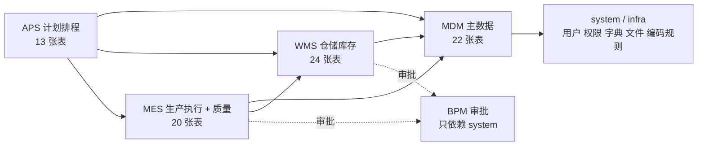
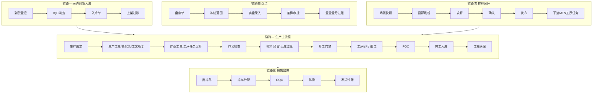

# 01 总览与流程地图

- 版本：v1.0.0
- 日期：2026-09-03
- 定位：`dev-docs/业务流程/` 系列的入口。本文只讲边界、权责、状态机总表与端到端地图，各领域的详细流程见 02～08。
- 上游依据：`业务建模/衡枢智造平台架构基石-v3.0.0.md`（26 项基石）、`业务建模/衡枢智造平台概要设计-v1.0.0.md`（领域与表）
- 下游约束：`dev-docs/通用CRUD开发流程.md`、`dev-docs/后台UI开发规范.md`、`dev-docs/APS求解器开发规范.md`、`dev-docs/BPM模块详细设计与接入规范.md`

## 文档清单

| 文件 | 内容 |
| --- | --- |
| 01-总览与流程地图 | 边界、数据权责、状态机总表、幂等规范、现状缺口总表 |
| 02-MDM主数据流程 | 组织三元组、物料与单位、BOM 与工艺版本生命周期、资源日历、项目、编码规则 |
| 03-WMS仓储库存流程 | 到货、入库上架、出库发货、转移、盘点、预留冻结、批次、过账铁律 |
| 04-MES生产执行流程 | 需求、工单下达锁版本、工序任务展开、齐套、领料三段、开工门禁、报工、完工入库 |
| 05-MES质量子域流程 | 质检规则触发、五检验点、检验单与缺陷、不合格处置六联动 |
| 06-APS计划排程流程 | 场景快照、投影刷新、求解、版本状态机、发布下达、缺料与负荷、插单重排 |
| 07-BPM审批接入流程 | 五个审批接入点、发起与回调范式、审批期间不改事实 |
| 08-跨模块协作与端到端时序 | 五条端到端主链路时序、跨模块调用矩阵、追溯查询链路 |

## 标记约定

文档描述的是目标流程，同时标注代码现状，避免实施者误以为全部已就绪。

| 标记 | 含义 |
| --- | --- |
| 【已实现】 | 代码已落地且有测试覆盖，按现状执行 |
| 【部分实现】 | 数据结构与 CRUD 在，流程动作缺失或未串联 |
| 【待建设】 | 仅有表和枚举，业务动作尚未编写 |
| 【预留】 | 字段与维度在，本轮不启用功能 |
| 【不建设】 | 明确不做，见基石文档第 9 节 |

## 试点范围前提

本系列按“一条离散装配试点产线可生产使用”组织，已确认的口径如下。改变任一条，相关流程文档需同步修订。

| 维度 | 口径 |
| --- | --- |
| 生产形态 | 离散装配多工序：工序级领料、工序级报工、工序逐道推进 |
| 操作端 | 后台 Web 为唯一操作端；移动端只定接口契约，不建 `controller/app` 代码 |
| 库存写入 | WMS 领域层为唯一写入口，CRUD 界面退出写入路径 |
| 计划来源 | APS 排程在闭环内，工序计划时间与资源由 APS 发布下达 |
| 质量范围 | IQC、IPQC、FQC、OQC、FAI 五检验点全开，规则驱动 |
| 审批 | 让步接收、报废、盘点差异、超发领料、工序跳序五处走 BPM |
| 外部集成 | Integration 与 interface-mgr 本轮零代码，设备任务与波次页面隐藏 |
| 报表 | 只做批次正反向追溯查询，不做看板与 KPI |
| 库结构交付 | 上线前从开发库导出结构快照与初始数据 |

## 领域边界与依赖方向

依赖单向，禁止反向 Maven 依赖，跨模块只走 `api` 与 `api.dto`。



当前 pom 依赖已符合此图，`iboot-module-wms`、`iboot-module-mes` 尚未引入 `iboot-module-bpm`，见 07。全仓唯一已接入 BPM 的是 `iboot-module-hrm`（员工请假），接入的技术范式见 `dev-docs/BPM模块详细设计与接入规范.md`。

## 数据权责表

每类事实只有一个写方，其他模块只读。这是基石 #21，也是排查“谁把数据改了”的唯一依据。

| 事实 | 载体 | 唯一写方 | 读方 |
| --- | --- | --- | --- |
| 主数据 | `mdm_*` | MDM | WMS MES APS |
| 库存余额与流水 | `wms_inv_balance` `wms_inv_txn` | WMS 过账动作 | MES APS 追溯 |
| 预留与冻结 | `wms_inv_reservation` `wms_inv_lock` | WMS 占用动作 | MES |
| 出入库与转移盘点单据 | `wms_in_order` `wms_out_order` `wms_transfer_order` `wms_count_order` | WMS 单据动作 | MES 追溯 |
| 批次主档 | `wms_batch` | WMS 批次注册 | MES 追溯 |
| 生产需求与工单 | `mes_prod_demand` `mes_prod_order` `mes_work_order` | MES | APS 投影 |
| 工序任务状态与进度 | `mes_op_task` | MES 动作 | APS 投影 |
| 工序任务计划时间与资源 | `mes_op_task.planned_*` `res_id` | APS 发布下达经 `OpTaskApi` | MES 展示 |
| 在制流水 | `mes_wip_txn` | MES 状态推进 | 追溯 |
| 检验任务与结果 | `mes_qc_*` | MES 质量子域 | WMS 质量状态过账触发方 |
| 排程版本与任务 | `aps_*` | APS | 无 |
| 审批实例状态 | `bpm_*` | BPM | 业务方经事件监听读取 |

两处容易踩的例外：APS 是唯一被允许写 MES 字段的外部模块，但只能经 `OpTaskApi.applySchedule`，且只改计划时间与资源；WMS 盘点差异不得直接改余额，必须生成盘盈入库或盘亏出库单过账。

## 端到端流程地图

五条主链路，详细时序见 08。



## 状态机总表

以下取值来自代码内的枚举类，是跨模块对账的唯一口径。禁止在业务代码里写状态字面量。

### MDM

| 实体 | 状态载体 | 取值 |
| --- | --- | --- |
| BOM `mdm_bom` | `CommonStatusEnum` | `ENABLE=0` 已发布 / `DISABLE=1` 草稿 |
| 工艺路线 `mdm_route` | `CommonStatusEnum` | 同上 |
| 资源能力、ESOP 等 | `CommonStatusEnum` | 同上 |

BOM 与工艺路线借用通用状态枚举表达草稿与发布两态，`ENABLE` 即已发布不可改。详见 02。

### WMS

| 实体 | 枚举类 | 取值 |
| --- | --- | --- |
| 单据头 | `WmsOrderStatusEnum` | `DRAFT` `SUBMITTED` `QC_PENDING` `APPROVED` `FROZEN` `READY` `TASK_CREATED` `IN_PROGRESS` `COUNTING` `DIFF_CONFIRMED` `DONE` `CANCELLED` `EXCEPTION` |
| 单据行 | `WmsOrderLineStatusEnum` | `DRAFT` `IN_PROGRESS` `DONE` `CANCELLED` |
| 到货单 | `WmsArrivalStatusEnum` | `DRAFT` `ARRIVED` `QC_PENDING` `DONE` `CANCELLED` |
| 到货行 | `WmsArrivalLineStatusEnum` | `PENDING` `QC_PENDING` `READY` `DONE` `CANCELLED` |
| 盘点行 | `WmsCountLineStatusEnum` | `PENDING` `COUNTED` `DIFF` `ADJUSTED` |
| 预留 | `WmsReservationStatusEnum` | `ACTIVE` `PARTIAL` `RELEASED` `CONSUMED` `CANCELLED` |
| 冻结 | `WmsLockStatusEnum` | `ACTIVE` `PARTIAL` `RELEASED` `CANCELLED` |
| 质量状态 | `WmsQualityStatusEnum` | `QUALIFIED` `QC_PENDING` `REJECTED` `FROZEN` |
| 库存流水类型 | `WmsTxnTypeEnum` | `RECEIPT` `ISSUE` `TRANSFER` `RESERVE` `RELEASE` `FREEZE` `UNFREEZE` `QUALITY_CHANGE` `ADJUST` |
| 容器 | `WmsContainerStatusEnum` | `EMPTY` `LOADED` `IN_TRANSIT` `STORED` `CLOSED` |
| 设备任务 | `WmsDeviceTaskStatusEnum` | `CREATED` `RUNNING` `DONE` `CANCELLED` `EXCEPTION` |
| 波次 | `WmsWaveStatusEnum` | `DRAFT` `RELEASED` `PICKING` `DONE` `CANCELLED` |

### MES

| 实体 | 枚举类 | 取值 |
| --- | --- | --- |
| 生产需求 | `MesDemandStatusEnum` | `DRAFT` `CONFIRMED` `PLANNED` `RELEASED` `DONE` `CANCELLED` |
| 生产工单 | `MesProdOrderStatusEnum` | `DRAFT` `RELEASED` `READY` `RUNNING` `HOLD` `DONE` `CLOSED` `CANCELLED` |
| 作业工单 | `MesWorkOrderStatusEnum` | `PENDING` `READY` `RUNNING` `HOLD` `DONE` `CANCELLED` |
| 工序任务 | `MesOpTaskStatusEnum` | `PENDING` `READY` `RUNNING` `PAUSED` `QC_WAITING` `HOLD` `DONE` `SKIPPED` `CANCELLED` |
| 齐套结论 | `MesKitStatusEnum` | `UNCHECKED` `FULL_KIT` `PARTIAL_KIT` `SHORTAGE` |
| 领退补料申请 | `MesMaterialReqStatusEnum` | `DRAFT` `SUBMITTED` `WMS_PROCESSING` `PARTIAL` `DONE` `CANCELLED` |
| 报工 | `MesProdReportStatusEnum` | `DRAFT` `SUBMITTED` `QC_PENDING` `CONFIRMED` `CANCELLED` |
| 在制流水类型 | `MesWipTxnTypeEnum` | `START` `PAUSE` `RESUME` `REPORT` `MOVE` `SKIP` `COMPLETE` `REWORK` `SCRAP` |
| 检验任务 | `MesQcTaskStatusEnum` | `CREATED` `ASSIGNED` `INSPECTING` `RESULT_POSTING` `DONE` `CANCELLED` |
| 检验结论 | `MesQcConclusionEnum` | `QUALIFIED` `REJECTED` `CONCESSION` |
| 检验方案 | `MesQcPlanStatusEnum` | `DRAFT` `PUBLISHED` `DISABLED` |
| 处置单 | `MesDispositionStatusEnum` | `DRAFT` `SUBMITTED` `APPROVED` `EXECUTING` `DONE` `REJECTED` `CANCELLED` |
| 返工任务 | `MesReworkStatusEnum` | `DRAFT` `RELEASED` `RUNNING` `QC_PENDING` `DONE` `CANCELLED` |
| 跳序记录 | `MesSkipRecordStatusEnum` | `PENDING` `EFFECTIVE` `REVOKED` |

### APS 与 BPM

| 实体 | 枚举类 | 取值 |
| --- | --- | --- |
| 排程场景 | `ApsScenarioStatusEnum` | `DRAFT` `SNAPSHOTTING` `READY` `SOLVING` `SOLVED` `CLOSED` |
| 排程版本 | `ApsVersionStatusEnum` | `SOLVING` `SOLVED` `PENDING_CONFIRM` `CONFIRMED` `PUBLISHED` `REPLACED` `FAILED` |
| 排程任务 | `ApsTaskStatusEnum` | `PLANNED` `LOCKED` `RELEASED` `STARTED` `DONE` `CANCELLED` |
| 缺料 | `ApsShortageStatusEnum` | `OPEN` `PARTIAL` `RESOLVED`（见 06） |
| 审批实例 | `BpmProcessInstanceStatusEnum` | `NOT_START=-1` `RUNNING=1` `APPROVE=2` `REJECT=3` `CANCEL=4` |

## 幂等键规范

所有跨模块命令与状态推进型动作携带幂等键，接收方命中时返回上一次结果而不是抛异常。

格式固定为四段冒号分隔：

```text
sourceModule:sourceBizNo:action:sourceBizLineNo
```

示例：

```text
MES:MR20260903001:ISSUE_CONFIRM:1     领料申请第 1 行确认出库
MES:PO20260903008:KIT_CHECK:0         工单整单齐套检查
APS:V20260903002:APPLY_SCHEDULE:0     排程版本下达
UI:CO20260903003:COUNT_DIFF_POST:2    盘点单第 2 行差异过账
```

两条落地路径：

1. 单据自带 `idempotency_key` 列且有唯一索引的，直接用列判重。已有此列的表包括 `wms_inv_txn` `wms_in_order` `wms_out_order` `wms_count_order` `wms_inv_reservation` `wms_inv_lock` `wms_device_task` `mes_prod_demand` `mes_material_req` `mes_prod_report` `mes_qc_task` `mes_disposition` `mes_wip_txn`。
2. 没有落库载体的纯状态推进动作，走命令记录表。APS 已有 `aps_command_record` 与 `ApsCommandService`，WMS 与 MES 照此补齐。

过账派生键统一加后缀，避免命令键与流水键相撞。现有实现的写法是 `原键 + ":POST"`，多行单据再拼行号，例如 `MES:MR2026001:ISSUE_CONFIRM:1:POST`。

## 现状缺口总表

这张表是流程文档与代码之间的差异清单，按影响排序。每条在对应文档里有详细描述。

| # | 缺口 | 后果 | 详见 |
| --- | --- | --- | --- |
| 1 | WMS 单据 Controller 接的是纯 CRUD Service，不过账、不校验可用量、不写流水 | 界面上的每笔出入库都不影响余额，账实必然不符 | 03 |
| 2 | 同一张 WMS 表存在两套 DO 与两条写入路径，共 18 张表 | 写入口不唯一，过账铁律有绕行口子 | 03 |
| 3 | 预留与冻结页面可直接增删记录，不改余额占用列 | 可用量虚高，超发无人拦 | 03 |
| 4 | `MesApiServiceImpl` 是空类，7 个 MES 门面抛 `UnsupportedOperationException` | 领料、齐套、质量、处置的跨模块命令全部不可用 | 04 05 |
| 5 | MES 无工单下达、开工、报工推进等动作端点，135 个端点全是 CRUD | 工单状态靠表单直填，可任意跳转 | 04 |
| 6 | 报工不推进工序任务与工单进度，`mes_wip_txn` 生产代码从未写入 | 进度不可信，追溯链断裂 | 04 |
| 7 | `MesBusinessRules.nextOpTaskStatus` 只覆盖 3 个状态且零调用方 | 状态机形同不存在 | 04 |
| 8 | 质检规则 `mes_qc_rule` 只有 CRUD，无触发解析逻辑 | 五检验点无法自动生成任务 | 05 |
| 9 | 处置单不联动库存与工序任务 | 判了报废但库存还在 | 05 |
| 10 | MES 未调用 WMS 的出库、入库、预留门面 | 领料与完工入库不闭环 | 04 |
| 11 | 出库过账不消费预留 | 预留与扣减双重占用，可用量偏低 | 03 04 |
| 12 | APS 两个已定义错误码零引用，任务时间与资源重叠未校验 | 排程结果可能自相矛盾 | 06 |
| 13 | WMS 与 MES 未接 BPM，高风险动作无审批 | 让步、报废、盘点差异无留痕审批 | 07 |
| 14 | 跨模块端到端测试缺失，模块内测试均 mock 对方门面 | 闭环无自动化保障 | 08 |

## 阅读建议

做主数据配置看 02；做仓储作业看 03；做生产执行看 04 与 05；做计划看 06；做审批接入看 07；做联调与验收看 08。
