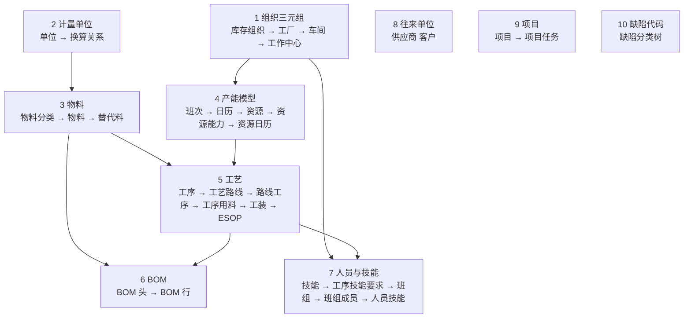
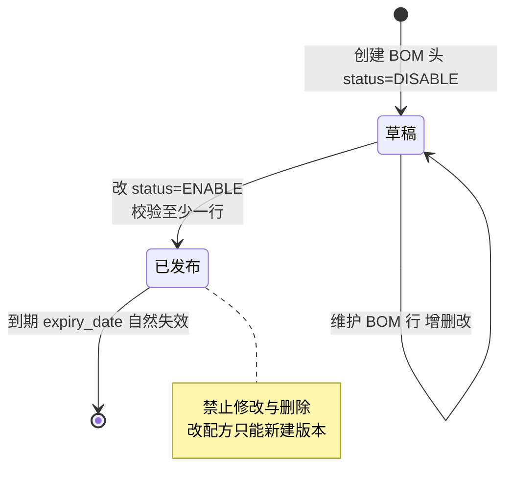
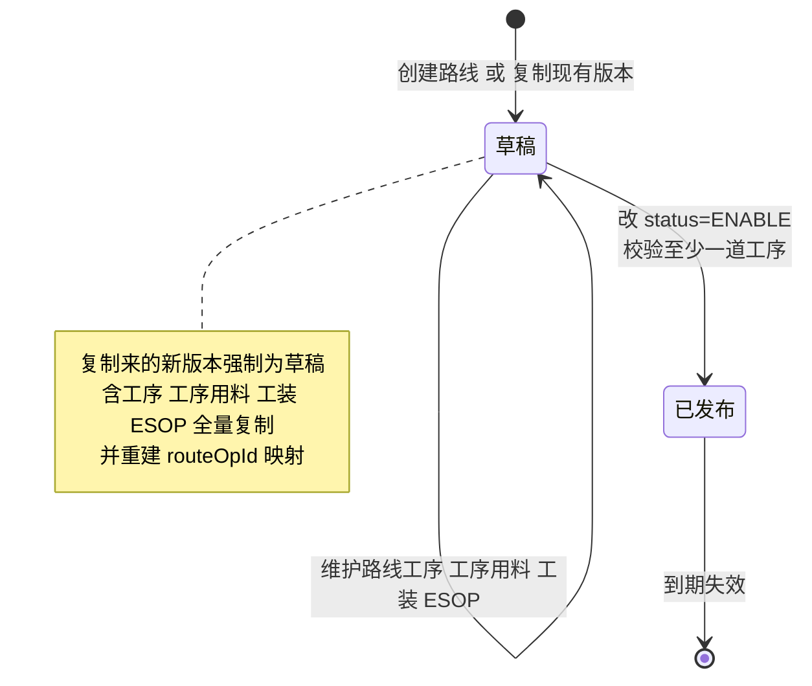
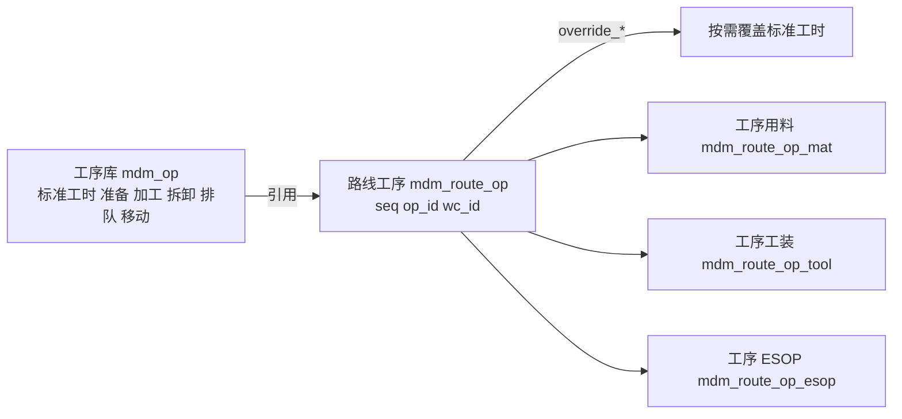
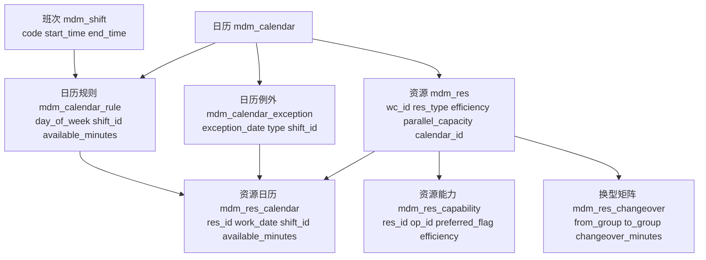

# 02 MDM 主数据流程

- 版本：v1.0.0
- 定位：主数据是全平台唯一的业务语言。本文定义各子域的维护流程、生效条件、被引用后的约束。
- 代码位置：`iboot-module-mdm`，22 张 `mdm_*` 表，371 个 Java 文件
- 现状：【已实现】全部子域 CRUD、BOM 与工艺路线的草稿发布控制、18 个跨模块 `Api` 门面

## 子域与依赖顺序

主数据之间有硬依赖，配置顺序错了后面建不出来。这个顺序也是新工厂上线的实施顺序。

编号 1 到 6 是试点上线的必配项，7 到 10 按需要配置：技能与工装影响开工门禁，项目维度本轮【预留】，缺陷代码在质检不合格录入时才用到。

## 组织三元组

基石 #9 要求三个概念独立建模，即使单工厂各只有一个值。

| 层级 | 表 | 关键字段 | 语义 |
| --- | --- | --- | --- |
| 库存组织 | `mdm_inv_org` | `code` `name` `status` | 库存归属与核算边界，库存余额的最外层维度 |
| 工厂 | `mdm_plant` | `inv_org_id` `code` `name` `address` | 物理地点，仓库与车间挂在工厂下 |
| 车间 | `mdm_workshop` | `plant_id` `code` `name` | 执行组织，作业工单归属它 |
| 工作中心 | `mdm_wc` | `workshop_id` `code` `name` | 车间内的产能分组，资源挂在工作中心下 |

流程要点：

1. 逐层创建，下层必须选已存在的上层。编码留空时按 `MDM_INV_ORG_CODE` 等编码规则自动分配。
2. 停用一层不级联停用下层，但引用校验会拦住新单据。删除有下级的记录被拒绝。
3. 单工厂场景也要各建一条，禁止用系统租户替代库存组织。

## 计量单位与换算

基石 #7 要求换算第一天生效，库存以基准单位存储。

`mdm_uom_conv` 按物料维护，不是全局换算表：同样 1 箱，A 物料装 10 个、B 物料装 24 个。换算系数改动只影响之后的单据，已过账流水保留当时口径。

## 物料

`mdm_mat` 字段较多，按用途分四组理解：

| 组 | 字段 | 谁在用 |
| --- | --- | --- |
| 标识 | `cat_id` `code` `name` `spec` `drawing_no` `mat_type` | 全平台 |
| 库存控制 | `base_uom_id` `batch_flag` `sn_flag` `shelf_life_days` `default_wh_id` `default_loc_id` `abc_class` `pack_qty` | WMS |
| 计划 | `plan_strategy` `lead_time_days` `safety_stock` `min_order_qty` `order_multiple` | APS |
| 物理属性 | `net_weight` `gross_weight` `length` `width` `height` `volume` `changeover_group` | WMS 尺寸校验、APS 换型 |

流程要点：

1. `batch_flag` 决定入库时是否必须提供批号。关掉批次管理的物料，WMS 仍会挂一个默认批次（`WmsConstants.DEFAULT_LOT_NO`），保证库存模型统一。
2. `sn_flag` 本轮【预留】。序列号建模为批次数量为 1 的退化形态，不单独建模型，见基石 #5。
3. `shelf_life_days` 大于 0 时，WMS 拣选策略可按 FEFO 取最早到期批次。
4. `changeover_group` 是 APS 换型时间矩阵的分组键，与 `mdm_res_changeover` 的 `from_group` `to_group` 对应。
5. 替代料 `mdm_mat_alt` 按 `priority` 排序，齐套检查缺料时按优先级查找可替代物料。

## BOM 生命周期

基石 #8：BOM 必须版本化，工单下达即冻结版本快照。

`mdm_bom` 用 `CommonStatusEnum` 表达两态：`DISABLE=1` 是草稿可编辑，`ENABLE=0` 是已发布锁定。

关键规则，均已在 [BomServiceImpl.java](D:/iboot-pro/iboot/iboot-module-mdm/src/main/java/com/iboot/pf/module/mdm/service/bom/BomServiceImpl.java) 落地：

1. 发布前校验至少有一行 BOM 行，否则抛 `BOM_ENABLE_WITHOUT_LINE`。
2. 已发布的 BOM 头与行都不可改不可删，抛 `BOM_ENABLED_LOCKED`。这是基石 #8 的执行点，改已发布 BOM 等于篡改在制工单的执行依据。
3. 同一物料同一版本号唯一。
4. 生效版本解析：`getEffectiveBom(matId, date)` 取 `status=ENABLE`、`effective_date <= date`、`expiry_date` 为空或 `>= date` 的记录，命中多条取 `effective_date` 最新的一条。

改配方的正确流程：

BOM 行 `mdm_bom_line` 的关键字段：

| 字段 | 作用 |
| --- | --- |
| `qty` `scrap_rate` | 需求量计算：`parentQty * qty / (1 - scrapRate)`，见 `MesBusinessRules.requiredQty` |
| `issue_method` | 发料方式，字典 `mdm_issue_method`，取值含常规领料、`PHANTOM` 虚拟件、`BACKFLUSH` 倒冲件 |
| `route_op_seq` | 该物料在哪道工序消耗，工序级齐套与领料的依据 |
| `position_no` | 装配位置号 |
| `effective_date` `expiry_date` | 行级生效期，支持同一 BOM 内的物料切换 |

`issue_method` 三种取值在齐套与领料时行为不同，这是最容易算错的地方，详见 04 的齐套章节。

## 工艺路线生命周期

`mdm_route` 与 BOM 同构，两态 + 版本。额外有复制版本能力。

发布校验：至少一道工序，否则抛 `ROUTE_ENABLE_WITHOUT_OP`。已发布不可改，删除时按“工序用料 → 路线工序 → 路线”在同一事务内逻辑删除，保证无物理外键时的引用一致性。

### 路线工序与工序库的关系

`mdm_op` 存标准工时：`setup_minutes` 准备、`std_minutes_per_unit` 单件加工、`teardown_minutes` 拆卸、`queue_minutes` 排队、`move_minutes` 移动，`duration_type` 决定工时计算方式。路线工序可用 `override_*` 四个字段按具体产品覆盖，为空则取工序库的值。APS 求解的工时来源就是这套覆盖逻辑。

`mdm_route_op` 上影响 MES 执行的三个标志：

| 字段 | 影响 |
| --- | --- |
| `parallel_group` | 同组工序可并行，工序任务展开时决定前后串接关系 |
| `key_flag` | 关键工序，报工与检验要求更严 |
| `fai_flag` | 需首件检验，开工门禁的 FAI 项由它触发 |

### 工序用料

`mdm_route_op_mat` 是工序级齐套与领料的前提，没有它只能做整单齐套。

| 字段 | 作用 |
| --- | --- |
| `route_op_id` `mat_id` `qty` `scrap_rate` | 该工序消耗什么、消耗多少 |
| `issue_method` | 发料方式，与 BOM 行同一字典 |
| `must_issue_before_start` | 开工门禁的发料校验项，为真时未发料不许开工 |

工序用料与 BOM 行是两套数据，配置时要对齐：BOM 行的 `route_op_seq` 指向工序序号，工序用料按 `route_op_id` 挂具体工序。两边不一致会导致齐套算出的需求量和实际领料对不上。

## 产能模型

这是 APS 排程的产能来源，也是 MES 开工门禁校验资源可用的依据。

资源日历生成流程：

1. 建班次，定义每天的作业时段。
2. 建日历，用日历规则定义每周几走哪个班次、可用多少分钟。
3. 用日历例外覆盖法定节假日、计划检修、加班。
4. 资源挂日历，按日期区间批量生成资源日历（`saveResCalendarBatch`），生成的记录 `generated_flag` 为真。
5. 手工调整个别资源某天的排班，直接改资源日历，`generated_flag` 置假，重新生成时不覆盖手工记录。

资源能力 `mdm_res_capability` 决定哪台设备能做哪道工序，`preferred_flag` 是 APS 的首选资源，`efficiency` 是该资源做该工序的效率系数（影响工时）。没有能力记录的资源不会被排到该工序上。

## 人员与技能

| 表 | 内容 |
| --- | --- |
| `mdm_skill` | 技能主档，含 `level_desc` 等级说明 |
| `mdm_op_skill_req` | 工序技能要求：`op_id` `skill_id` `min_level` |
| `mdm_member_skill` | 人员技能：`user_id` `skill_id` `level` `effective_date` `expiry_date` |
| `mdm_team` | 班组：`workshop_id` `shift_id` `leader_user_id` |
| `mdm_team_member` | 班组成员 |

人员来自 `system_users`，MDM 只维护技能与班组关系。跨模块取人员姓名必须走 `AdminUserApi.getUserMap`，禁止在 `mdm_*` 的 SQL 里 JOIN `system_users`。

人员技能有生效期，开工门禁校验操作者技能时按当天有效的记录判断。技能到期是常见的开工被拒原因，配置时要注意 `expiry_date`。

## 项目维度

【预留】基石 #10：需求、工单、库存、领退料单据全部带 `project_id` 与 `project_task_id`，允许为 0 表示无项目。

`mdm_project` 与 `mdm_project_task` 表已建、CRUD 已实现、`ProjectApi` 门面已提供批量查询。本轮不启用项目制专项物料隔离，但所有单据的字段位置已就位，启用时零改造。

库存侧对应的是 `wms_inv_balance.stock_scope`（`COMMON` 公共库存 / `PROJECT_DEDICATED` 项目专用）加 `project_id` 维度。

## 缺陷代码

`mdm_defect_code` 是树形结构（`parent_id`），带 `level` 严重程度（对应 `MesDefectLevelEnum` 的 `CRITICAL` `MAJOR` `MINOR`）。两张关联表限定适用范围：`mdm_defect_code_mat_cat` 按物料分类、`mdm_defect_code_op` 按工序。质检录入缺陷时按当前物料与工序过滤可选缺陷码。

## 编码规则

所有主数据编码留空时自动分配，规则码定义在 `MdmCodeRuleConstants`，取值必须与 `infra_code_rule.rule_code` 完全一致，共 18 个：库存组织、工厂、车间、工作中心、资源、班次、物料分类、物料、客户、供应商、项目、项目任务、工序、日历、缺陷代码、班组、技能、工装。

上线前这 18 条规则必须在 `infra_code_rule` 里配好，否则创建主数据时抛“编码规则不存在”。这是交付脚本的必含内容，见 08。

## 主数据被引用后的约束

主数据一旦被业务引用，改动就有传播风险。分三档处理：

| 档 | 字段类型 | 处理 |
| --- | --- | --- |
| 可自由改 | 名称、备注、地址这类描述字段 | 直接改。业务单据里的冗余快照保留下单时的值，不回溯更新 |
| 停用即止 | `status` | 停用后新单据不能选，在制单据不受影响 |
| 版本化 | BOM、工艺路线的内容 | 不能改，只能新建版本。在制工单锁的是快照 |

静态描述字段的快照式冗余是概要设计的既定原则：`wms_inv_balance` 冗余 `mat_code` `mat_name`，`mes_prod_order` 冗余 `mat_code` `mat_name` `mat_spec` `bom_version` `route_version`。改了主数据名称不回刷历史单据，这是刻意的，历史单据应当反映当时的事实。

## 试点上线主数据清单

一条离散装配试点产线的最小配置量，可作为实施检查表：

| 项 | 数量级 | 必需 |
| --- | --- | --- |
| 库存组织 / 工厂 / 车间 / 工作中心 | 1 / 1 / 1 / 2-3 | 是 |
| 计量单位 | 3-5 | 是 |
| 物料（成品、半成品、原料） | 20-50 | 是 |
| 物料换算 | 按需 | 否 |
| 班次 / 日历 / 日历规则 | 2 / 1 / 7 | 是 |
| 资源 | 5-10 | 是 |
| 资源能力 | 资源 x 工序组合 | 是（APS 必需） |
| 资源日历 | 按排程窗口批量生成 | 是（APS 必需） |
| 工序库 | 5-10 | 是 |
| 工艺路线 + 路线工序 | 成品数 x 1 版本 | 是 |
| 工序用料 | 每道消耗料的工序 | 是（工序级齐套必需） |
| BOM + BOM 行 | 成品数 x 1 版本 | 是 |
| 技能 / 工序技能要求 / 人员技能 | 按门禁需要 | 否 |
| 工装 / 工序工装 | 按门禁需要 | 否 |
| 供应商 / 客户 | 按采购销售需要 | 是 |
| 缺陷代码 | 10-20 | 是（质检必需） |
| 换型矩阵 | 按 `changeover_group` 组合 | 否 |

## 本文档涉及的现状缺口

MDM 是四个业务模块里完成度最高的，无阻断性缺口。两处可改进：

1. BOM 与工艺路线借用 `CommonStatusEnum` 表达草稿与发布，语义上 `ENABLE` 读作“启用”而实际含义是“已发布且锁定”，新人容易误读。可考虑后续引入专用的 `MdmVersionStatusEnum`，但改动会波及前端字典与已有数据，非必要不动。
2. 生效版本解析 `getEffectiveBom` 是全量捞回内存过滤（注释说明是为规避 `expiry_date` 为空时的 SQL 误伤）。物料版本数量增长后需要改为 SQL 过滤加 `ORDER BY effective_date DESC LIMIT 1`。
