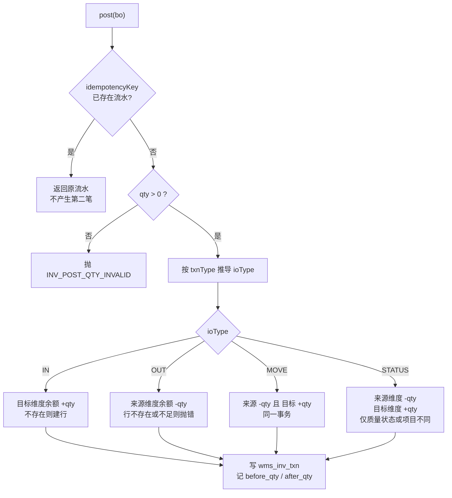
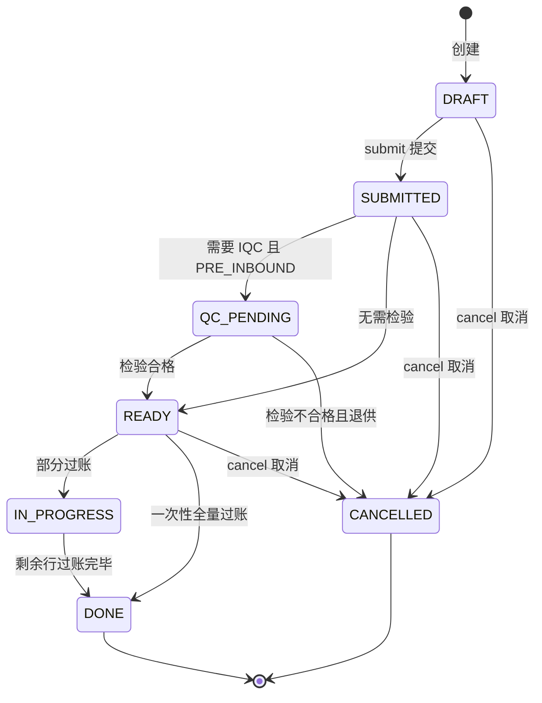
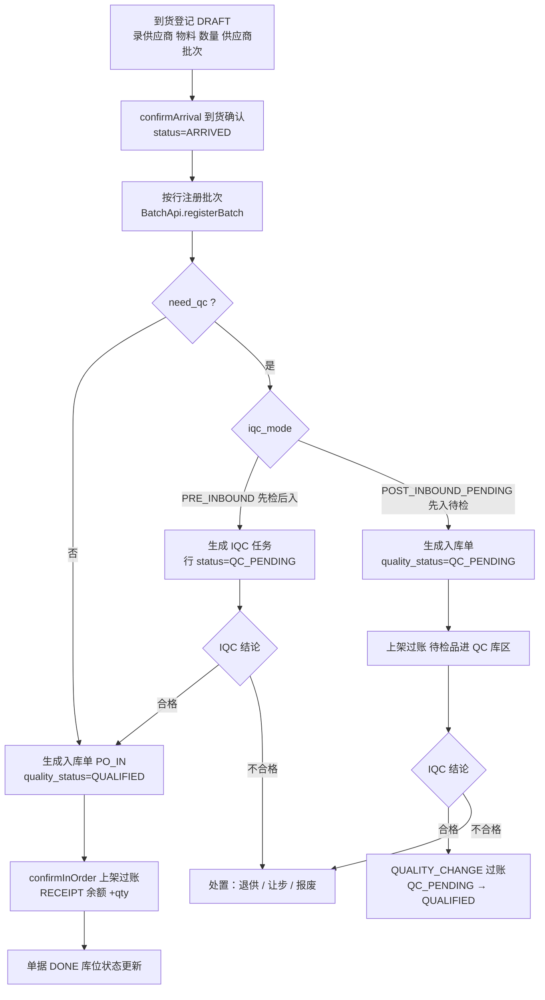
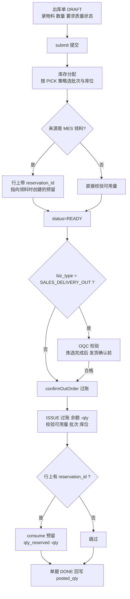
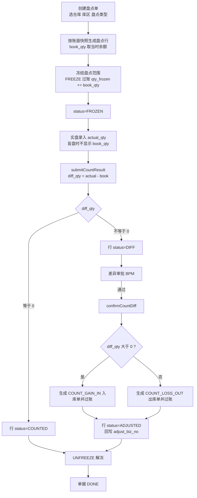
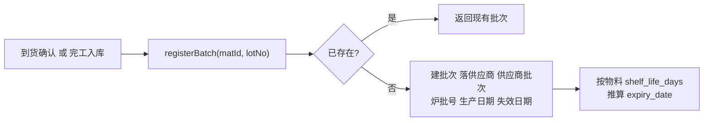

# 03 WMS 仓储库存流程

- 版本：v1.0.0
- 定位：库存是整个平台唯一的"钱账"。本文定义库存事实的写入口、维度模型、可用量口径、六类单据流程与页面权责。
- 代码位置：`iboot-module-wms`，24 张 `wms_*` 表，10 个跨模块 `Api` 门面，21 个测试类
- 现状：【部分实现】库存领域层（过账、预留、冻结、批次、四类单据）已完成且有测试；**18 个 Controller 中 17 个接的是 codegen CRUD Service，界面上的操作不过账**；10 个 `Api` 门面全部接领域 Service，MES / APS 的调用是真过账。收口方案见下一节

## 一句话铁律

> **库存余额只能由 `WmsInventoryService.post` 改，一次 `post` 必写一条 `wms_inv_txn`。**

任何绕过 `post` 修改 `wms_inv_balance` 的代码都是 bug，不管它在 Controller、Service 还是 Mapper。这条规则的存在理由：`wms_inv_txn` 是账实核对与批次追溯的唯一事实源，余额只是流水的物化汇总。余额被直接改一次，追溯链就断一次，且事后无法发现是谁改的。

验收方式：`sum(wms_inv_txn)` 按维度推导出的余额必须与 `wms_inv_balance` 逐维度相等。这是 08 里的账实一致用例。

## 两套 DO 与两套 Service：现状、成因与收口

WMS 有 18 张表同时存在两套 DO、两套 Mapper、两套 Service。这不是设计，是一次命名冲突处理的连带产物。本节把现状、成因、留哪一套、怎么最小代价删掉另一套讲完，是 WMS 收口的第一优先级。

### 规模

| 层 | 领域侧（`Wms` 前缀） | codegen 侧（无前缀） | 合计 |
| --- | --- | --- | --- |
| DO | 19 | ~~23~~ → 5 | ~~42~~ → 24 |
| Mapper | 19 | 23 | 42 |
| Mapper XML | 0 | 24 | 24 |
| Service 接口 | 13 | 17 | 30 |
| ServiceImpl | 11 | 17 | 28 |
| Controller | 0 | 18 | 18 |
| 测试类 | 6 | 15 | 21 |

**18 张表的两套 DO，字段逐个比对完全一致**，无一例外——从 `wms_wh` 的 10 个字段到 `wms_inv_txn` 的 33 个字段，两侧声明的字段集合一字不差。所以这是纯粹的内容重复，删掉任意一套都不会丢字段，这是后面所有删除动作的安全前提。

**DO 层已收口（见"最小代价执行路径"第一步）**：18 个重复的 codegen DO 已删除，一张表现在只有一个 DO 类。codegen 侧剩下的 5 个 DO 是单套表自己的（`ArrivalDO`、`ArrivalLineDO`、`DeviceTaskDO`、`WaveDO`、`WaveLineDO`），不存在重复。Mapper、Service、Controller 三层的重复仍在，收口方案见下。

### 谁在跑

这是最关键的一张表。同一份库存数据，界面和跨模块走的是两条不同的路：

| 入口 | 指向 | 后果 |
| --- | --- | --- |
| 18 个 Controller 中的 17 个 | codegen Service | 界面上的出入库、预留、冻结**不过账** |
| `StrategyController`（唯一例外） | `WmsStrategyService` | 已收口，只有一套 |
| 10 个 `Api` 门面（`InventoryApi`、`InOrderApi`…） | 100% 领域 Service | MES / APS 调用**真过账** |

结论：**领域侧是真实的业务实现，codegen 侧是界面的展示与裸写入通道**。MES 领料能正确扣减余额，人在界面上做同一件事却只改单据不动余额——账实不符的根因就在这里，不在过账逻辑本身。

### 成因：一次撞名引发的全模块改名

codegen 原始产物还留在 `.tmp-codegen/`（已 gitignore）里，可以直接对证：

- `.tmp-codegen/extract-wms2/t275/` → wms 生成了 `StrategyDO` / `StrategyMapper` / `StrategyService` / `StrategyServiceImpl`
- `.tmp-codegen/extract-wms-aps/t287/` → aps 生成了**同名的** `StrategyDO` / `StrategyMapper` / `StrategyService` / `StrategyServiceImpl`

`wms_strategy` 与 `aps_strategy` 只差表前缀，codegen 按表名去前缀生成类名，两个模块撞成同名。`@Service` 与 `@Mapper` 的默认 bean 名是类名首字母小写，两个 `strategyServiceImpl` 在同一个容器里会抛 `ConflictingBeanDefinitionException`，且 `iboot-server` 没有开 `allow-bean-definition-overriding`，启动直接失败。

修的时候两侧都加了模块前缀：aps → `ApsStrategyXxx`，wms → `WmsStrategyXxx`。**但同一轮把 WMS 领域层的 19 个类也一并加上了 `Wms` 前缀**，而 codegen 侧其余 17 张表保持无前缀。于是前缀从"避开撞名的手段"变成了"区分两套的标记"——正因为两侧类名不同，重复的两套才能在同一个容器里和平共处，启动期一声不响。

**前缀掩盖了重复。** 如果当初两套都叫 `InvBalanceDO` / `InvBalanceServiceImpl`，第一次启动就会因 bean 名冲突失败，问题当场暴露。

### 命名规则：前缀什么时候是必需的

按类是不是 Spring bean 分两种情况：

| 类型 | 是 bean | 同 simple name 后果 | 解法 |
| --- | --- | --- | --- |
| `Service` / `ServiceImpl` / `Mapper` / `Controller` | 是 | 启动抛 `ConflictingBeanDefinitionException` | 加模块前缀，**或**用显式 bean 名 |
| `DO` / `VO` / `BO` / `DTO` / `Convert` | 否 | Java 层无冲突；springdoc 按 simple name 建 OpenAPI schema，同名会互相覆盖 | 加模块前缀 |

所以"不撞名就不用前缀，撞了才加"这个判断在技术上是成立的。而且解法比改名更轻——**WMS 现在就有一个活例子**：

```java
@RestController("wmsStrategyController")   // 类名仍是 StrategyController
public class StrategyController { ... }

@RestController("apsStrategyController")   // 类名也仍是 StrategyController
public class StrategyController { ... }
```

两个模块的 Controller 类名、VO 类名全部相同，只用显式 bean 名就避开了冲突，一个类都没改名。

**但 WMS 这轮不要动前缀，理由是三条：**

1. 顺序错了会更乱。前缀是现在唯一区分两套的标记，先去前缀会让两侧同名、无法启动，也让 IDE 的引用替换失去锚点。**必须先删掉多余的一套，才有资格谈改名。**
2. 删完之后就没有技术必要性了。全仓扫描确认：18 张表的领域类去掉 `Wms` 前缀后，与其他模块**无一撞名**（唯一命中都是 codegen 侧自己）；aps 侧已改成 `ApsStrategyXxx`，连 strategy 也不再撞。
3. 但届时也没有收益。全仓命名本来就不统一——mdm 39 个 DO、mes 21 个 DO 零前缀，aps 14 个、hrm 50 个 DO 全前缀。`Wms` 前缀不是异类，跨模块阅读时反而有正面价值。改名要动上百个文件的 import，纯机械、零风险、零收益。

一句话：**前缀留着，重复删掉。** 新增表沿用 `Wms` 前缀，与模块内现有代码保持一致。

### 收口方案：按表的性质分四类

"删 codegen 留领域"是错的粗口径——配置主数据的写入实现只存在于 codegen 侧，领域侧那几个 Service 是纯读门面（`WmsWarehouseService` 全是 `getXxx` / `validateXxx`，没有一个写方法）。按性质分四类处理：

| 类 | 表 | codegen 侧 | 领域侧 | 处理 |
| --- | --- | --- | --- | --- |
| A 配置主数据 | `wms_wh`、`wms_zone`、`wms_loc`、`wms_container_type`、`wms_container` | **唯一写入实现**（编码生成、编码唯一校验、级联占用校验、跨模块门面校验） | 只读门面（`getXxxMap` 供快照补全） | 两套 Service 都留，职责不重叠；**只删重复的 DO** |
| B 库存事实 | `wms_inv_balance`、`wms_inv_txn` | 已收成只读，并含跨模块补全（`fillProjectName`） | 过账写入 | 已达标；**只删重复的 DO** |
| B' 占用记录 | `wms_inv_reservation`、`wms_inv_lock` | 全套 CRUD，**直接写记录但不改 `qty_reserved` / `qty_frozen`** | `reserve` / `release` / `consume` / `lock` / `unlock` | **删写方法**，列表降只读加动作端点（缺口 3） |
| C 单据 | 入库、出库、转移、盘点各主子表 | 裸 CRUD，无状态机、无幂等、无过账 | 完整状态机 + 过账 | **删写方法**，Controller 写端点转调领域 Service（缺口 1、5） |
| D 批次 | `wms_batch` | `createBatch` / `importBatchList` | `registerBatch`（入库动作触发） | **删 codegen 写方法**，人工不许建批次 |

不涉及的单套表：`wms_arrival` / `_line`、`wms_device_task`、`wms_wave` / `_line`、`wms_strategy`。

### 最小代价执行路径

对外契约不能动：**18 条 URL 前缀、RespVO 字段名、前端 18 个 API 文件与 18 个视图目录**。以下步骤全部在这条红线内。

**第一步：把 18 个 codegen DO 的引用全部指向领域 DO，再删掉这 18 个文件。零行为变化，可独立提交。【已完成】**

Mapper XML 与 codegen DO **零耦合**——24 个 XML 的 48 处 `resultType` 全部指向 RespVO，没有一处指向 `dataobject`，SQL 里表名硬编码，JOIN 全是 `wms_*` 同模块表，`namespace` 指向 codegen Mapper 全类名。所以 DO 删掉，XML 一行都不用改（实测 XML 零改动）。

```java
// dal/mysql/invbalance/InvBalanceMapper.java
- public interface InvBalanceMapper extends BaseMapperX<InvBalanceDO> {
+ public interface InvBalanceMapper extends BaseMapperX<WmsInvBalanceDO> {
```

MyBatis Plus 的 `TableInfo` 按 entity class 缓存，两个 Mapper 共用同一个 DO 完全合法；两个 Mapper 接口的 statement id 按全类名区分，也不冲突。

**这不是"改 18 行"的活。** 实际执行规模：

| 项 | 数量 |
| --- | --- |
| 改动文件 | 80 个（含 13 个 codegen 测试类） |
| 净减少行数 | 2742 删 / 785 增 |
| 删除 DO 文件 | 18 个，`dal/dataobject/` 下 18 个目录随之清空 |
| Mapper XML | 0 改动 |
| 波次相关 | 仅 `WaveServiceImpl` 的 2 行类名引用（它校验出库明细，删 `OutOrderLineDO` 后必须跟着改），逻辑与 `WaveDO`/`WaveMapper`/`WaveService`/测试/前端全部零改动 |

改法是一张表一张表来：先把 `import` 全路径从 `dataobject.{codegen包}.{XxxDO}` 换成 `dataobject.{领域包}.{WmsXxxDO}`，再把裸类名 `\bXxxDO\b` 换成 `WmsXxxDO`（词边界保护，不会误伤 `XxxLineDO` 或 `ContainerTypeDO`），最后删 DO 文件。字段名两侧一字不差（18 组逐个 diff 全空，含 `wms_inv_txn` 的 33 字段），所以 `XxxDO::getField` 方法引用可以直接换类名，不用逐个核对 getter。每张表或每批表改完编译一次，不要 18 张一起动。

### 注解差异：两侧不是完全等价

字段一致不等于注解一致。两侧的差异有六处，其中主键策略这一条最实质：

| 注解 | codegen DO | 领域 DO | 收口到领域 DO 后的变化 |
| --- | --- | --- | --- |
| `@TableId` | 无 `type`，随全局 `id-type: NONE` 由 `IdTypeEnvironmentPostProcessor` 按数据源适配（MySQL 变 `AUTO`、H2 变 `INPUT`） | `type = IdType.ASSIGN_ID` | **主键生成从环境自适应变成固定雪花 ID**。领域侧本来就这么插，收口后两条写入路径一致，是想要的结果 |
| `@KeySequence("wms_xxx_seq")` | 有 | 无 | 无影响。`ASSIGN_ID` 不走数据库序列，这个注解对领域 DO 本就无意义 |
| `@Builder` | 有 | 无 | 无影响，全模块 `builder()` 调用点为 0 |
| `@NoArgsConstructor` | 有 | 无 | 无影响，`@Data` 已含无参构造 |
| `@AllArgsConstructor` | 有 | 无 | 无影响，无调用点 |
| `@ToString(callSuper = true)` | 有 | 无 | `@Data` 自带 `@ToString`，只影响日志里是否带父类字段 |

主键策略这条已实测确认无害：H2 单元测试的建表脚本里 24 张表都是 `id BIGINT PRIMARY KEY`，既无 `AUTO_INCREMENT` 也无序列，而 codegen 测试里有 `mapper.insert(new XxxDO()...)` 这种不带 id 的写法——收口成 `ASSIGN_ID` 后由雪花算法生成，反而比依赖序列更稳。生产库的历史数据是自增小数字、新数据是 19 位雪花 ID，两者混存在 `bigint` 列里没有问题，且领域侧插入本来就产生雪花 ID，前端已在处理。

顺带修一处方向错误的依赖：领域侧 `WmsSnapshotService` 反向 `import` 了 codegen 的 `BatchDO` / `ContainerDO` / `LocDO` 与 `BatchMapper` / `ContainerMapper` / `LocMapper`。DO 收口后自然指向领域侧，但注入的 Mapper 仍是 codegen 的，要改注入 `WmsBatchMapper` / `WmsContainerMapper` / `WmsLocMapper`——这三个领域 Mapper 已存在，改注入即可。

**第二步：删 codegen 写方法，Controller 写端点转调领域 Service。**

按上表 B'、C、D 三类逐个改。领域侧的 BO 入口已经就位，签名可直接对接：

```java
// 领域侧现成的入口
Long createInOrder(WmsCreateInOrderBO bo);
void confirmInOrder(WmsConfirmOrderBO bo);
void cancelInOrder(WmsCancelOrderBO bo);
```

Controller 保留 `/page`、`/get`、`/export-excel` 接 codegen Service（XML JOIN 与跨模块补全都在这里），`/create`、`/update`、`/delete` 改为 VO 转 BO 后调领域 Service，并新增 `/submit`、`/confirm`、`/cancel` 动作端点。A 类配置表的 CRUD 全套不动。

**第三步（可选）：合并 Mapper。**

两套 Mapper 的方法并不重复——codegen 侧是 XML 的 `selectJoinPage` / `selectJoinById`，领域侧是 `selectByDim` / `selectBalancePage` 这类业务查询。要彻底收口，把 XML 方法声明挪进领域 Mapper，24 个 XML 改 `namespace` 指向领域 Mapper 全类名即可，Mapper 从 42 个降到 24 个。这一步只减文件数，不改行为，可以缓做。

**不要做：去掉 `Wms` 前缀。** 理由见上一节。

### 验收

1. `wms_inv_balance` 有且只有一个 DO 类；18 张表同理。
2. 全模块搜不到第二处 `@TableName("wms_inv_balance")`。
3. 界面上完成一次入库确认后，`wms_inv_txn` 多一条流水，`wms_inv_balance` 对应维度余额增加相同数量。
4. `sum(wms_inv_txn)` 按维度推导的余额与 `wms_inv_balance` 逐维度相等。
5. 前端 18 个 API 文件与 18 个视图目录零改动，列表页的可读字段（仓库名、物料名、批次号、项目名）不缺。
6. 删 codegen 测试之前先补领域测试。领域侧现有 6 个测试类（`WmsInOrder` `WmsOutOrder` `WmsCountOrder` `WmsInventory` `WmsInventoryReservation` `WmsStrategy`），codegen 侧 15 个，缺 transfer、batch、warehouse、lock、container 五处覆盖，先补齐再删对应的 codegen 测试，否则净掉覆盖率。
7. `@KeySequence` 移除后，H2 环境的主键自增仍正常——由阶段 6 的跨模块集成测试确认。

## 库存维度模型

`wms_inv_balance` 的唯一键是 9 个维度的组合，缺一个维度就会把不同性质的库存混成一行。

| 维度 | 字段 | 为什么必须在键里 |
| --- | --- | --- |
| 库存组织 | `inv_org_id` | 核算边界，跨组织移库是买卖不是搬运 |
| 工厂 | `plant_id` | 物理地点 |
| 仓库 | `wh_id` | 责任主体 |
| 库位 | `loc_id` | 拣货找得到 |
| 物料 | `mat_id` | 不解释 |
| 批次 | `batch_id` | 追溯与效期的粒度；无批次物料挂默认批次 |
| 容器 | `container_id` | 【预留】0 表示散件 |
| 项目 | `project_id` / `project_task_id` | 【预留】0 表示无项目 |
| 质量状态 | `quality_status` | 合格与待检不能混，否则待检品会被拣走 |
| 库存范围 | `stock_scope` | 【预留】`COMMON` / `PROJECT_DEDICATED` |

可选维度一律落 `0` 而不是 `NULL`（`WmsConstants.NONE_ID`）。MySQL 唯一索引中 `NULL` 不等于 `NULL`，落空会让同一批库存被拆成多行，余额从此对不上。

三个数量列：`qty_onhand` 现存、`qty_reserved` 预留、`qty_frozen` 冻结。

### 可用量公式

```text
可用量 = qty_onhand - qty_reserved - qty_frozen
```

定义在 `WmsInventoryService.availableQtyOf`，是接口的静态方法，所有调用方共用同一份实现，不允许在别处重算。可用量为负时原样返回，由调用方判断是否异常——这是刻意的，负可用量说明预留或冻结失控，藏起来只会让问题更晚暴露。

质量状态不在公式里，通过查询条件控制：领料与发货只查 `quality_status = QUALIFIED` 的余额，待检品天然被排除。

## 过账动作

`WmsInventoryService.post(WmsInvPostBO)` 是唯一写入口，一次调用完成四件事：幂等判重、方向推导、余额更新、流水落库。



`ioType` 由 `WmsTxnTypeEnum` 自带，传入的 `ioType` 只在需要覆盖时使用。九种事务类型与方向的对应：

| `txn_type` | `io_type` | 用途 |
| --- | --- | --- |
| `RECEIPT` | IN | 入库过账 |
| `ISSUE` | OUT | 出库过账 |
| `TRANSFER` | MOVE | 库位或仓库间转移 |
| `RESERVE` / `RELEASE` | STATUS | 预留占用与释放，只改 `qty_reserved` |
| `FREEZE` / `UNFREEZE` | STATUS | 冻结与解冻，只改 `qty_frozen` |
| `QUALITY_CHANGE` | STATUS | 质量状态转换，`quality_status_from` → `quality_status_to` |
| `ADJUST` | IN 或 OUT | 盘点差异调整，方向由差异正负决定 |

`RESERVE` / `FREEZE` 这四种类型走 `applyStatusChange`，只动 `qty_reserved` / `qty_frozen`，不动 `qty_onhand`。这是预留与冻结不改变现存量的技术落点。

### 幂等键

四段格式见 01。过账派生键在业务命令键后加 `:POST`，多行单据再拼行号：

```text
MES:MR20260903001:ISSUE_CONFIRM:1:POST
```

判重靠 `wms_inv_txn.idempotency_key` 的唯一索引，命中直接返回原流水。**返回而不是抛异常**——调用方（MES 领料确认）重试时期待的是"这笔已经做过了"，抛异常会让它误判为失败并回滚自己的状态推进。

## 单据状态机

四类单据共用 `WmsOrderStatusEnum`，但各自只走其中一条路径。状态取值一律引枚举，禁止字面量。



不可协商的三条：

1. `update` 与 `delete` 只在 `DRAFT` 放行。已提交的单据不许改行、改数量、改库位，要改先取消再重开。
2. `cancel` 只在 `DRAFT`、`SUBMITTED`、`READY` 放行。已过账的单据不能取消，冲销要另开反向单据。
3. `DONE` 是终态，不可逆。

盘点单走独立路径：`DRAFT → FROZEN → COUNTING → DIFF_CONFIRMED → DONE`。到货单走 `WmsArrivalStatusEnum`：`DRAFT → ARRIVED → QC_PENDING → DONE`。

## 流程一：到货登记与入库

现状：`ArrivalServiceImpl` 是纯 codegen CRUD，**没有到货确认动作**，`wms_arrival_line` 上的 `need_qc`、`iqc_mode`、`qc_task_id`、`qualified_qty` 四个字段无人写入。这是 IQC 链路的断点。



两种 IQC 模式的区别与选用：

| 模式 | 库存何时增加 | 适用场景 | 代价 |
| --- | --- | --- | --- |
| `PRE_INBOUND` 先检后入 | 检验合格后 | 关键料、高价值料 | 检验期间货物在收货区，不在账上 |
| `POST_INBOUND_PENDING` 先入待检 | 到货即入，质量状态为 `QC_PENDING` | 常规料、周转快的料 | 需要 QC 库区隔离，且必须有 `QUALITY_CHANGE` 过账把状态转正 |

`iqc_mode` 配在 `wms_arrival_line`，来源是 `mes_qc_rule.qc_mode`，同一张到货单不同物料可以走不同模式。

### 入库业务类型

`wms_in_order.biz_type` 决定入库的语义与来源单据，共 8 种：

| 取值 | 来源 | 触发方 |
| --- | --- | --- |
| `PO_IN` | 采购到货 | 到货确认 |
| `PROD_FINISH_IN` | 生产完工 | MES 末道工序完工 |
| `REWORK_FINISH_IN` | 返工完工 | MES 返工任务完工 |
| `SALES_RETURN_IN` | 销售退货 | 手工 |
| `PROD_RETURN_IN` | 生产退料 | MES 退料申请确认 |
| `TRANSFER_IN` | 调拨入库 | 转移单 |
| `COUNT_GAIN_IN` | 盘盈 | 盘点差异确认 |
| `OTHER_IN` | 其他 | 手工 |

## 流程二：出库与发货



### 预留与扣减的双重占用

这是当前最隐蔽的一处账目错误。MES 领料提交时创建预留（`qty_reserved += 100`），出库确认时扣减现存（`qty_onhand -= 100`），但预留没有被消费，`qty_reserved` 仍是 100。结果：

```text
过账前：onhand=500 reserved=100 → available=400
过账后：onhand=400 reserved=100 → available=300   ← 错，应当是 400
```

同一批 100 个料被占了两次，可用量凭空少 100。修复方式是给 `wms_out_order_line` 增加 `reservation_id` 列，`confirmOutOrder` 过账后按该列调用 `WmsInventoryReservationService.consume` 核销预留。

**consume 而不是 release**：`CONSUMED` 表示预留已履约转为实际出库，`RELEASED` 表示预留作废库存归还，两者的业务含义与追溯口径不同。`wms_out_order_line` 当前没有 `reservation_id` 列，需要新增。

### 出库业务类型

| 取值 | 来源 |
| --- | --- |
| `PROD_ISSUE_OUT` | 生产领料 |
| `SALES_DELIVERY_OUT` | 销售发货 |
| `PO_RETURN_OUT` | 采购退货 |
| `SCRAP_OUT` | 报废出库 |
| `TRANSFER_OUT` | 调拨出库 |
| `COUNT_LOSS_OUT` | 盘亏 |
| `OTHER_OUT` | 其他 |

## 流程三：库存转移

转移单是 MOVE 方向的过账，来源维度减、目标维度加，两条余额变更在同一事务内。三种转移类型：

| 类型 | 变化维度 | 说明 |
| --- | --- | --- |
| 库位转移 | `loc_id` | 同仓库内移库，最常见 |
| 仓库转移 | `wh_id` + `loc_id` | 跨仓库搬运，同库存组织 |
| 组织调拨 | `inv_org_id` | 跨核算边界，业务上是内部交易，需拆成 `TRANSFER_OUT` + `TRANSFER_IN` 两张单 |

前两种走 `confirmTransferOrder` 一次 MOVE 过账；组织调拨拆两张单，中间可挂在途仓（`wms_wh.wh_type = IN_TRANSIT`）。

## 流程四：盘点

盘点是唯一"账实不符时以实物为准"的场景，但**修正必须走过账，不许直接改余额**。



四种盘点类型：`FULL` 全盘、`SAMPLE` 抽盘、`ABC_CYCLE` 按 ABC 分类循环盘、`DYNAMIC` 动态盘（按流水频次）。盲盘 `blind_count_flag` 为真时前端不显示账面数量，防止盘点员照抄。

盘点期间冻结范围内的库存，避免边盘边动。冻结是 `FREEZE` 过账而不是打个标记——冻结量要反映在可用量里，否则盘点期间照样能领走。

## 预留与冻结

两者都是占用，区别在意图与去向：

| 对比项 | 预留 `wms_inv_reservation` | 冻结 `wms_inv_lock` |
| --- | --- | --- |
| 意图 | 这批货留给某张单据 | 这批货暂时不许动 |
| 余额列 | `qty_reserved` | `qty_frozen` |
| 正常出口 | `CONSUMED` 履约出库 | `RELEASED` 解冻 |
| 典型来源 | MES 领料、销售订单 | 盘点、质量冻结、待处置 |
| 状态取值 | `ACTIVE` `PARTIAL` `RELEASED` `CONSUMED` `CANCELLED` | `ACTIVE` `PARTIAL` `RELEASED` `CANCELLED` |

`PARTIAL` 表示部分释放或部分核销，`released_qty` 记已处理量。

### 页面权责

预留与冻结页面**不允许增删记录**。现状是 `InvReservationController` 与 `InvLockController` 有完整 CRUD 端点，界面上直接插一条预留记录不会改 `qty_reserved`，可用量因此虚高，超发无人拦。正确形态是只读列表加两个动作端点：

| 端点 | 转调 |
| --- | --- |
| `POST /inv-reservation/release` | `WmsInventoryReservationService.release` |
| `POST /inv-lock/unlock` | `WmsInventoryLockService.unlock` |

预留的创建方永远是业务动作（MES 领料提交、销售订单确认），不是人在界面上点。

## 批次管理

`wms_batch` 是批次主档，一物料一批号一条记录。



要点：

1. `batch_flag = false` 的物料也挂批次，批号取 `WmsConstants.DEFAULT_LOT_NO`，值是 `DEFAULT`。库存模型因此统一，不需要在每个查询里判断"这个物料管不管批次"。
2. `sn_no` 字段存在但本轮【预留】。序列号是数量为 1 的批次，不单独建模型。
3. 页面降为只读加批属性维护（改炉批号、生产日期、失效日期、状态）。批次的创建只能由入库动作触发，人工建批次会造出没有库存的孤儿批次。
4. `expiry_date` 支撑 FEFO 拣选：`shelf_life_days` 大于 0 的物料，拣选策略按最早到期优先。

## 仓储策略

`wms_strategy` 用 `config_json` 存条件与排序规则，三种类型：

| 类型 | 用途 | 典型规则 |
| --- | --- | --- |
| `PUTAWAY` | 上架选库位 | 按库区类型匹配物料类型；容器尺寸不超库位上限；同批次靠拢 |
| `PICK` | 拣选选批次与库位 | FIFO / FEFO / 就近 / 整箱优先 |
| `REPLENISH` | 线边仓补货 | 【预留】低于安全库存触发 |

策略按 `priority` 降序匹配，第一条命中即用。`wh_id = 0` 表示全局策略，是兜底。`status` 用 `WmsStrategyStatusEnum`（`DRAFT` / `ENABLED` / `DISABLED`），只有 `ENABLED` 参与匹配。

库位尺寸校验由 `wms_loc.dimension_check_mode` 控制：`NONE` 不校验、`HEIGHT_ONLY` 只校验高度、`FULL_DIM` 长宽高全校验。

## 容器与设备任务

【预留】容器 `wms_container` 与容器类型 `wms_container_type` 的 CRUD 全套保留，字段与维度就位，但本轮不启用"整容器收发存"。

【不建设】设备任务 `wms_device_task` 与波次 `wms_wave` 本轮**菜单隐藏、代码保留**：

- 设备任务是 WCS / AGV / RGV 的对接载体，Integration 模块本轮零代码。手工在界面上造设备任务会产生永远不会被回调的僵尸任务，还可能触发 `post_status` 相关的过账逻辑。
- **波次管理本轮完全不动**：不改代码、不改测试、不删表，只把菜单 `visible` 置假。

隐藏方式是改菜单的 `visible` 字段，不删菜单也不删权限，启用时改一个字段即可。

## 页面权责总表

| 页面 | 列表 | 新增 | 修改 | 删除 | 动作端点 |
| --- | --- | --- | --- | --- | --- |
| 仓库 / 库区 / 库位 | 是 | 是 | 是 | 是 | 无 |
| 容器类型 / 容器 | 是 | 是 | 是 | 是 | 无 |
| 仓储策略 | 是 | 是 | 是 | 是 | 无 |
| 到货登记 | 是 | 是 | 仅 DRAFT | 仅 DRAFT | `confirm` |
| 入库单 | 是 | 是 | 仅 DRAFT | 仅 DRAFT | `submit` `confirm` `cancel` |
| 出库单 | 是 | 是 | 仅 DRAFT | 仅 DRAFT | `submit` `confirm` `cancel` |
| 转移单 | 是 | 是 | 仅 DRAFT | 仅 DRAFT | `submit` `confirm` `cancel` |
| 盘点单 | 是 | 是 | 仅 DRAFT | 仅 DRAFT | `freeze` `submit-result` `confirm-diff` |
| 批次 | 是 | 否 | 仅批属性 | 否 | 无 |
| 库存余额 | 是 | 否 | 否 | 否 | 无 |
| 库存流水 | 是 | 否 | 否 | 否 | 无 |
| 库存预留 | 是 | 否 | 否 | 否 | `release` |
| 库存冻结 | 是 | 否 | 否 | 否 | `unlock` |
| 设备任务 | 菜单隐藏 | — | — | — | — |
| 波次管理 | 菜单隐藏，代码不动 | — | — | — | — |

## 作业导向页面

单据式页面（列表 → 详情 → 编辑行 → 提交）适合办公室补录，不适合库房现场。现场需要一屏完成的作业页：

| 作业页 | 一屏内容 | 替代的多页跳转 |
| --- | --- | --- |
| 收货上架作业 | 选到货单 → 逐行确认数量与批次 → 选库位 → 确认上架 | 到货登记 + 入库单 + 过账 |
| 拣选发货作业 | 选出库单 → 系统建议批次库位 → 扫码确认 → 确认发货 | 出库单 + 分配 + 过账 |
| 盘点作业 | 选盘点单 → 逐行录实盘 → 提交 → 看差异 | 盘点单 + 明细 + 差异确认 |

作业页与单据页共用同一套领域 Service，只是交互形态不同。单据页保留给异常处理与补录。

## 跨模块门面

WMS 对外暴露 10 个 `Api`，是 MES 与 APS 取库存与建单据的唯一通道：

| 门面 | 关键方法 | 调用方 |
| --- | --- | --- |
| `InventoryApi` | `getAvailableQtyMap` `getBalanceList` | MES 齐套、APS 投影 |
| `InOrderApi` | `createInOrder` `confirmInOrder` | MES 完工入库、退料 |
| `OutOrderApi` | `createOutOrder` `confirmOutOrder` | MES 领料、报废 |
| `InventoryReservationApi` | `reserveInventory` `releaseReservation` `consumeReservation` | MES 领料提交 |
| `InventoryLockApi` | `lock` `unlock` | MES 质量冻结处置 |
| `BatchApi` | `registerBatch` `getBatch` | MES 完工批次注册、追溯 |
| `TransferOrderApi` | `createTransferOrder` `confirmTransferOrder` | 内部调拨 |
| `CountOrderApi` | 盘点单查询 | 追溯 |
| `WarehouseApi` | `getWh` `getLoc` `getZone` | MES 展示仓库名 |
| `ContainerApi` | 容器查询 | 【预留】 |

## 本文档涉及的现状缺口

| # | 缺口 | 后果 |
| --- | --- | --- |
| 1 | 18 个 Controller 中 17 个接 codegen Service，界面操作不过账 | 界面上每笔出入库都不影响余额，账实必然不符 |
| 2 | 18 张表两套 DO、两套 Mapper、两套 Service，字段完全一致 | 写入口不唯一，过账铁律有绕行口子；`Wms` 前缀让重复的两套在启动期无声共存 |
| 3 | 预留与冻结页面可直接增删，不改余额占用列 | 可用量虚高，超发无人拦 |
| 4 | `ArrivalServiceImpl` 无到货确认动作，IQC 字段无人写 | IQC 链路断在起点 |
| 5 | 单据缺 `submit` / `confirm` / `cancel` 端点 | 状态靠表单直填，可任意跳转 |
| 6 | `wms_out_order_line` 无 `reservation_id`，过账不消费预留 | 预留与扣减双重占用，可用量偏低 |
| 7 | 无 `wms_command_record` 与 `WmsCommandService` | 状态推进型动作没有幂等载体 |

缺口 1 到 3 是"一个业务事实只有一条写入路径"这条原则的直接违反，必须先修，否则后面 MES 的闭环建在流沙上。
