# 04 MES 生产执行流程

- 版本：v1.0.0
- 定位：MES 是生产事实的唯一写方。本文定义三级工单模型、七个核心动作、状态推进链与库存三段联动。质量子域见 05。
- 代码位置：`iboot-module-mes`，20 张 `mes_*` 表，10 个跨模块 `Api` 门面，20 个测试类
- 现状：【部分实现】表结构、枚举、CRUD 全部就绪；**135 个 Controller 端点全是 CRUD，零个动作端点；`MesApiServiceImpl` 是空类；`mes_wip_txn` 生产代码从未写入**

## 一句话铁律

> **工单状态只能由动作推进，不能由表单直填。**

现状是 `ProdOrderSaveReqVO`、`WorkOrderSaveReqVO`、`OpTaskSaveReqVO` 三个表单 VO 都带 `status` 字段，界面上可以把工单从 `DRAFT` 一步改成 `CLOSED`，跳过下达、齐套、领料、报工全部环节。这不是缺功能，是缺约束——状态字段留在表单里，任何流程校验都可以被绕过。

三个 VO 的 `status` 字段必须删除，前端 `data.ts` 同步删除。

## 三级工单模型

离散装配的执行粒度是工序，因此工单分三级。三级不是冗余，各自回答不同的问题。

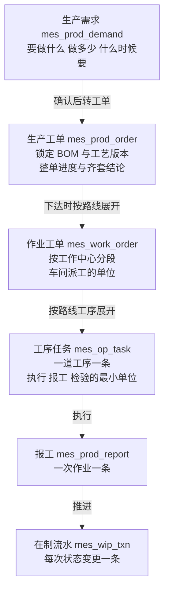

各级的职责边界：

| 层级 | 回答的问题 | 数量列 | 谁在看 |
| --- | --- | --- | --- |
| 生产需求 | 要做什么 | `qty` | 计划员 |
| 生产工单 | 用哪个版本做，整单做到哪了 | `qty` `completed_qty` `scrap_qty` | 计划员、APS |
| 作业工单 | 哪个工作中心负责哪一段 | `planned_qty` `completed_qty` | 车间主管 |
| 工序任务 | 这道工序谁在做、做到哪了 | `planned_qty` `completed_qty` `scrap_qty` | 班组长、操作工、APS |

`mes_op_task` 是全平台最热的一张表：APS 往里写计划时间与资源，MES 往里写状态与进度，报工往里累加数量，质检以它为对象。因此它有 `version` 乐观锁列。

## 三个状态机

状态机集中定义在 `enums` 包，迁移表覆盖全部合法组合，非法迁移抛 `*_STATUS_INVALID`。现状 `MesBusinessRules.nextOpTaskStatus` 只覆盖 3 个状态且零调用方，等于状态机不存在。

### 生产工单 8 态

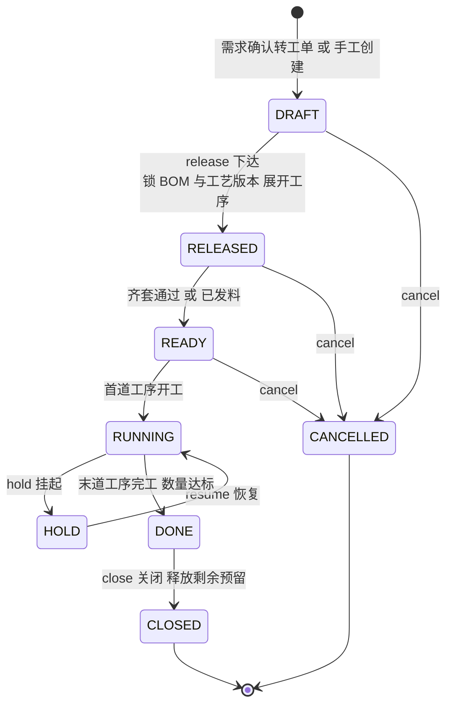

`DONE` 与 `CLOSED` 的区别：`DONE` 表示物理上做完了，`CLOSED` 表示账目上结清了（剩余预留已释放、多余领料已退、成本已归集）。中间留一步是为了让计划员有机会处理尾数。

### 作业工单 6 态

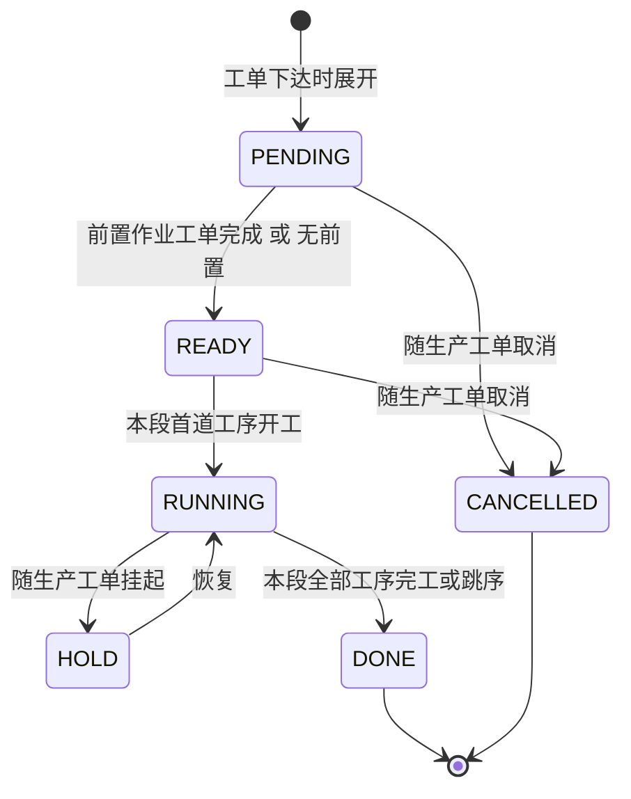

### 工序任务 9 态

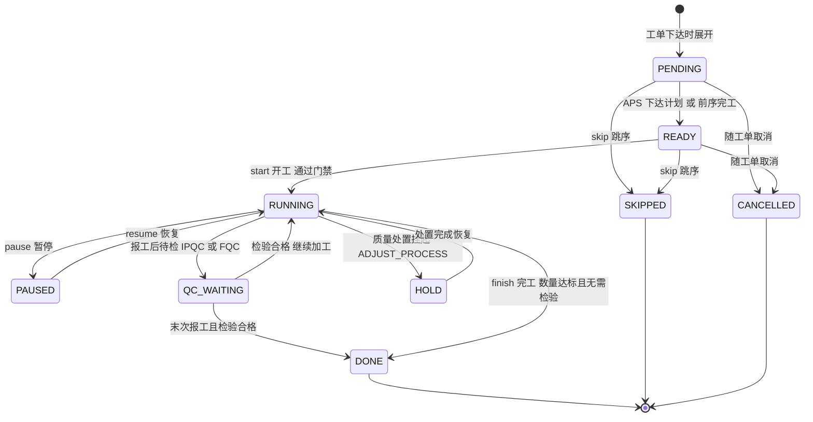

`PENDING` 与 `READY` 的区别是 APS 闭环的关键：`PENDING` 表示还没有计划时间与资源，`READY` 表示计划已下达可以干。`OpTaskApi.applySchedule` 当前只写 `res_id` 与计划时间，不推进状态，车间因此不知道计划已经来了。

## 流程一：生产需求

需求是计划的入口，四种来源：`MANUAL` 手工、`EXCEL` 导入、`ERP` 外部系统、`APS` 排程反推。本轮只用前两种。

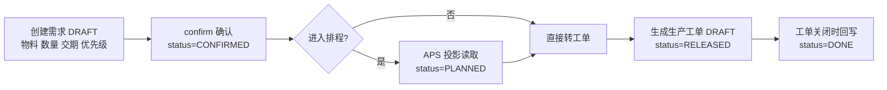

需求状态 `PLANNED` 表示已被排程纳入，`RELEASED` 表示已转工单。一个需求可以拆成多个工单（分批投产），`mes_prod_order.demand_id` 指回需求。

## 流程二：工单下达

这是整个 MES 最重要的一个动作，做四件事，缺一件后面全乱。

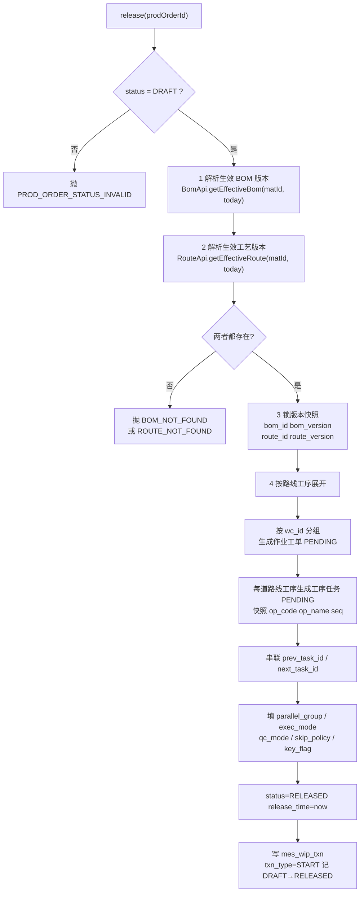

### 为什么必须锁版本

下达那一刻起，这张工单的执行依据就固定了。之后主数据改 BOM、改工艺，在制工单不受影响。这是基石 #8，也是 MDM 侧"已发布 BOM 不可改"的配套约束：MDM 保证已发布版本不被篡改，MES 保证在制工单用的是下达时的版本。

`mes_prod_order` 的四个快照列 `bom_id` `bom_version` `route_id` `route_version` 在 `RELEASED` 之后不可改。`ProdOrderRespDTO` 必须带 `bomVersion` 与 `routeVersion` 两个字段，否则 APS 与追溯查询拿不到版本口径。

### 工序串联规则

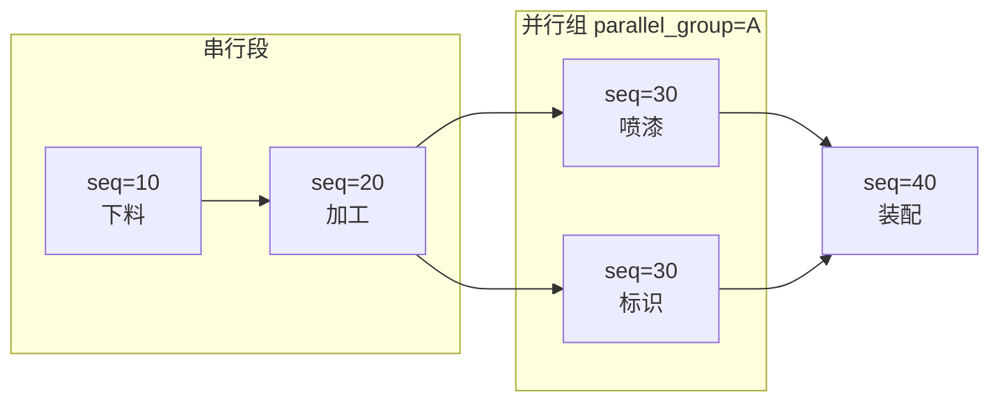

| 字段 | 来源 | 作用 |
| --- | --- | --- |
| `prev_task_id` / `next_task_id` | 按 `seq` 顺序串联 | 前序完工门禁的判断依据 |
| `parallel_group` | `mdm_route_op.parallel_group` | 同组工序互不为前后序，可同时开工 |
| `exec_mode` | 路线工序配置 | `SEQUENTIAL` 必须按序 / `PARALLEL` 可并行 / `OPTIONAL` 可跳过 |
| `qc_mode` | `mes_qc_rule` 解析结果 | 决定这道工序在哪个点触发检验 |
| `skip_policy` | 路线工序配置 | `NOT_ALLOWED` / `ALLOW_WITH_REASON` / `APPROVAL_REQUIRED` |

并行组内的工序 `prev_task_id` 指向同一个前序，`next_task_id` 指向同一个后序。后序工序的开工门禁要求**并行组全部完工**，不是任一完工。

## 流程三：齐套检查

齐套回答一个问题：现在的库存够不够开工。三档检查范围，粒度越细越准但配置要求越高。

| `check_scope` | 需求量来源 | 适用 |
| --- | --- | --- |
| `PROD_ORDER` | BOM 全展开 | 投产前的粗判 |
| `WORK_ORDER` | 该作业工单覆盖工序的用料 | 分段投产 |
| `OP_TASK` | 单道工序的 `mdm_route_op_mat` | 开工门禁 |

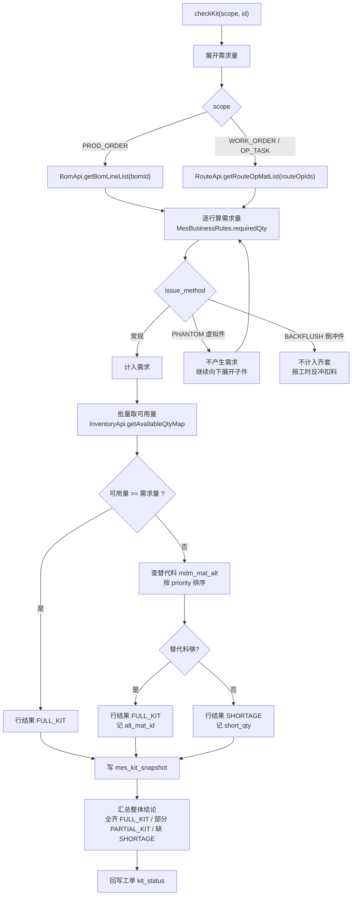

### 需求量公式

```text
需求量 = 父项数量 × 单位用量 ÷ (1 - 损耗率)
```

实现在 `MesBusinessRules.requiredQty`，精度取 `MesConstants.QTY_SCALE`（库表 `decimal(20,6)`），舍入 `HALF_UP`。损耗率大于等于 1 时抛参数异常——损耗 100% 意味着永远做不出来。

### 三种发料方式的行为差异

这是齐套最容易算错的地方：

| `issue_method` | 齐套是否计需求 | 是否领料 | 库存何时扣减 |
| --- | --- | --- | --- |
| 常规领料 | 计 | 领 | 领料出库过账时 |
| `PHANTOM` 虚拟件 | **不计**，但继续向下展开子件 | 不领 | 子件被领时 |
| `BACKFLUSH` 倒冲件 | **不计** | 不领 | 报工时按实际产量反冲 |

虚拟件是 BOM 的结构层次，物理上不存在（比如"某组螺栓套件"），它的子件才是真实物料。倒冲件是低价值辅料（胶水、标签），逐次领料成本高于价值，按产量事后扣。

把 `PHANTOM` 当常规料算会导致齐套永远缺料（虚拟件库存永远是 0）；把 `BACKFLUSH` 计入齐套会导致辅料没领就开不了工。

### 快照的语义

`mes_kit_snapshot` 是**检查时点的快照，不占库存**。这一点必须明确：齐套通过不代表料被留住了，别的工单照样能领走。真正的占用发生在领料提交时的预留动作。

快照的价值在于事后复盘"当时判齐套时账上有多少"，以及 APS 缺料分析的对账基准。`avail_qty`、`reserved_qty`、`issued_qty`、`short_qty` 四列都是检查时点的值。

## 流程四：领料三段

领料是 MES 与 WMS 联动最密集的地方，拆成申请、提交、确认三段，每段有明确的库存后果。

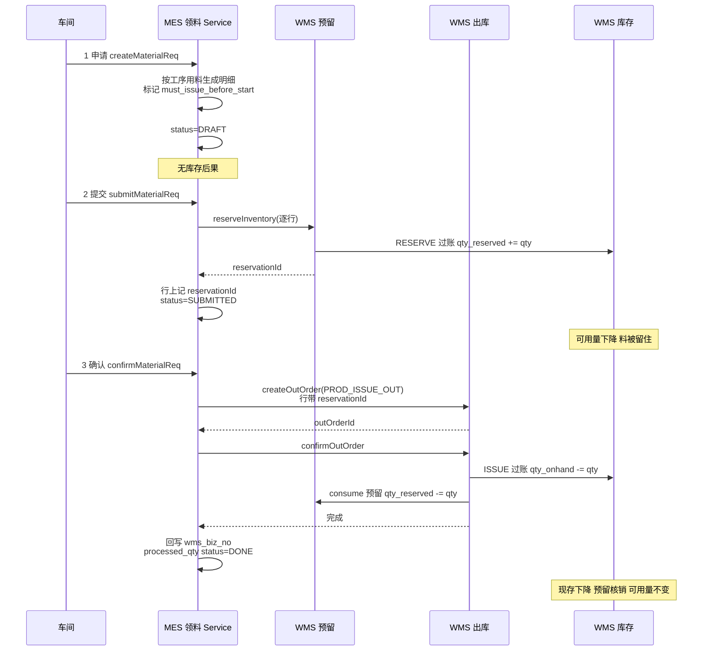

三段的库存状态对照（以领 100 个、初始现存 500 为例）：

| 阶段 | `qty_onhand` | `qty_reserved` | 可用量 |
| --- | --- | --- | --- |
| 申请后 | 500 | 0 | 500 |
| 提交后 | 500 | 100 | 400 |
| 确认后 | 400 | 0 | 400 |

确认后可用量不变（400 → 400）是正确的：料已经从仓库出到车间了，仓库可用量本来就该是 400。如果确认后可用量变成 300，说明预留没被消费，就是 03 里说的双重占用。

### 三种申请类型

| `req_type` | 方向 | 调用的 WMS 门面 | 出入库类型 |
| --- | --- | --- | --- |
| `ISSUE` 领料 | 仓库 → 车间 | `OutOrderApi` | `PROD_ISSUE_OUT` |
| `RETURN` 退料 | 车间 → 仓库 | `InOrderApi` | `PROD_RETURN_IN` |
| `SUPPLEMENT` 补料 | 仓库 → 车间 | `OutOrderApi` | `PROD_ISSUE_OUT` |

补料与领料的技术路径相同，区别在业务含义：补料是超出 BOM 计划量的额外领用，通常因为报废或损耗超标，是**超发领料审批**的触发点（见 07）。

## 流程五：工序动作与开工门禁

五个工序动作，都写 `mes_wip_txn`：

| 动作 | 状态迁移 | `txn_type` | 附带效果 |
| --- | --- | --- | --- |
| `start` 开工 | `READY` → `RUNNING` | `START` | 过门禁；写 `actual_start_time`；推进作业工单与生产工单到 `RUNNING` |
| `pause` 暂停 | `RUNNING` → `PAUSED` | `PAUSE` | 记暂停原因 |
| `resume` 恢复 | `PAUSED` → `RUNNING` | `RESUME` | — |
| `finish` 完工 | `RUNNING` → `DONE` | `COMPLETE` | 写 `actual_end_time`；触发后序工序 `PENDING` → `READY` |
| `skip` 跳序 | `PENDING`/`READY` → `SKIPPED` | `SKIP` | 按 `skip_policy` 决定是否走审批；写 `mes_op_skip_record` |

### 开工门禁校验链

门禁做成**可配置的校验链**，不是写死的 if 串。每一项可按工序或工作中心开关，校验项失败时返回明确原因，不是笼统的"不满足开工条件"。

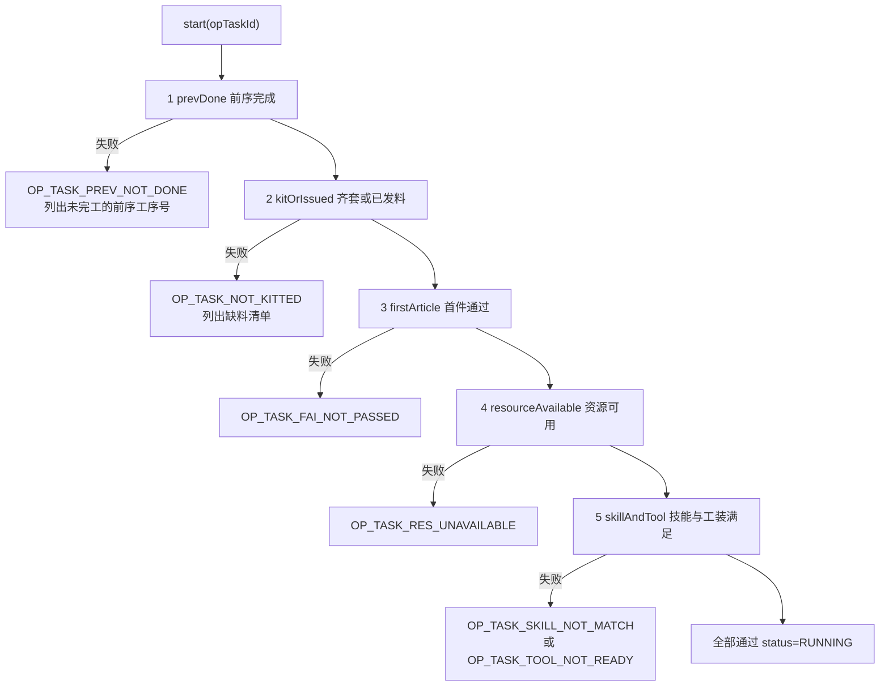

五项校验的数据来源与判定：

| 校验项 | 数据来源 | 判定 |
| --- | --- | --- |
| `prevDone` 前序完成 | `prev_task_id` 链 + `parallel_group` | 前序（并行组全部）状态为 `DONE` 或 `SKIPPED` |
| `kitOrIssued` 齐套或已发料 | `mes_kit_snapshot` + `mes_material_req_line` | 本工序 `must_issue_before_start` 为真的物料，已有 `DONE` 的领料行 |
| `firstArticle` 首件通过 | `mdm_route_op.fai_flag` + `mes_qc_task` | `fai_flag` 为真时，必须有结论为 `QUALIFIED` 的 FAI 任务 |
| `resourceAvailable` 资源可用 | `mes_op_task.res_id` + `mdm_res_calendar` | 资源当天有排班，且未被其他 `RUNNING` 工序任务占用 |
| `skillAndTool` 技能与工装 | `mdm_op_skill_req` + `mdm_member_skill` + `mdm_route_op_tool` | 操作者当天有效技能等级不低于要求；工装可用 |

`resourceAvailable` 的"未被占用"判定按资源的 `parallel_capacity`：一台设备允许同时做 N 道工序时，只有正在做的数量达到 N 才算不可用。

### 跳序

跳序是"这道工序不做了，直接进下一道"。三种策略：

| `skip_policy` | 行为 |
| --- | --- |
| `NOT_ALLOWED` | 直接拒绝，抛 `OP_TASK_SKIP_NOT_ALLOWED` |
| `ALLOW_WITH_REASON` | 必须填原因，立即生效，写 `mes_op_skip_record` 状态 `EFFECTIVE` |
| `APPROVAL_REQUIRED` | 发起 BPM 审批，`mes_op_skip_record` 状态 `PENDING`，审批通过后才 `EFFECTIVE`（见 07） |

跳序记录带 `reason_type`（`MesSkipReasonTypeEnum`）与 `approve_status`（`MesSkipApproveStatusEnum`）。撤销跳序把记录置 `REVOKED`，工序任务回到 `READY`。

## 流程六：报工推进链

报工是唯一往上推进数量的动作，一次报工推进三级。这条链断在任何一环，进度都不可信。

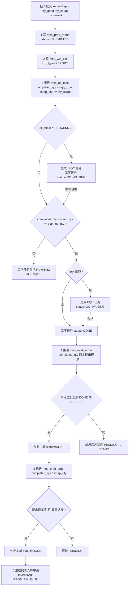

### 数量推进口径

| 层级 | `completed_qty` 取值 | 理由 |
| --- | --- | --- |
| 工序任务 | 本工序累计合格数 | 每道工序都要报，各自累加 |
| 作业工单 | 本段**末道工序**的 `completed_qty` | 一段内多道工序，产出以最后一道为准，否则会重复计数 |
| 生产工单 | **末道工序**的 `completed_qty` | 同理，整单产出以最后一道工序为准 |

这是最容易写错的地方：把各工序 `completed_qty` 相加得到工单产出，做 5 道工序的 100 件产品会算成 500 件。

### 完工数量校验

`MesBusinessRules.validateFinishQty` 要求 `合格数 + 报废数 = 计划数`。这是 `finish` 动作的校验，不是单次报工的校验——单次报工可以少报（分批报工），但点"完工"时必须凑齐。

`qty_rework` 返工数不进这个等式：返工件要么最终合格要么最终报废，返工中的数量记在 `mes_rework` 里，不计入本工序的完工数量。

## 流程七：完工入库与工单关闭

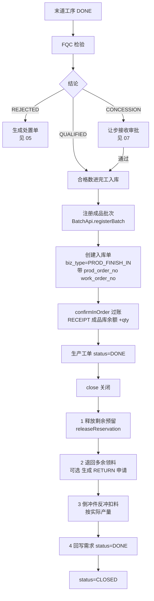

关闭是账目收尾动作，四件事必须做，否则预留会永久挂着占用可用量。倒冲件反冲放在关闭而不是每次报工：按整单实际产量一次扣，避免多次小额过账。

## 在制流水

`mes_wip_txn` 是 MES 侧的"库存流水"，每次状态变更或数量变更写一条。生产代码当前从未写入，追溯链因此断在 MES 侧。

事务类型与写入时机：

| `txn_type` | 写入时机 | `qty` 含义 |
| --- | --- | --- |
| `START` | 工序开工 / 工单下达 | 0 或计划数 |
| `PAUSE` / `RESUME` | 暂停恢复 | 0 |
| `REPORT` | 每次报工 | 本次合格数 |
| `MOVE` | 工序间流转 | 流转数量，记 `from_op_task_id` / `to_op_task_id` |
| `SKIP` | 跳序 | 0 |
| `COMPLETE` | 工序完工 | 累计合格数 |
| `FINISH_INBOUND` | 完工入库过账 | 本次入库量 |
| `REWORK` | 生成返工任务 | 返工数量 |
| `SCRAP` | 报废处置 | 报废数量 |

每条流水记 `from_status` / `to_status`，这是状态机执行轨迹的唯一凭据。带 `idempotency_key`，同一动作重复提交不产生第二条。

## 派工

`mes_dispatch_task` 是"把工序任务派给具体的人和设备"。与 `mes_op_task` 的关系：一道工序任务可以有多条派工记录（换班、换人）。

派工不改变工序任务状态，只是记录"谁负责"。开工时按当前派工记录取操作者，校验技能。

`mes_rgv_task` 是 RGV 工位流转任务，与 WMS 的设备任务同理，Integration 本轮零代码，**菜单隐藏、代码保留**。

## 门面收口

现状是 10 个 `Api` 里 7 个抛 `UnsupportedOperationException`，`MesApiServiceImpl` 是空类，`MesRespDTO` 与 `MesCommandDTOs` 是通用占位 DTO。

收口方案：

| 动作 | 现状 | 目标 |
| --- | --- | --- |
| `MesApiService` / `MesApiServiceImpl` | 空壳，只有 `unsupported()` 方法 | 删除 |
| `MesRespDTO` | 通用响应占位 | 删除，按域拆成 `ProdOrderRespDTO` `WorkOrderRespDTO` `MaterialReqRespDTO` `KitSnapshotRespDTO` `QcTaskRespDTO` `ReworkRespDTO` `ProdDemandRespDTO` |
| `MesCommandDTOs` | 内部类堆放 `StatusReq` `FinishReq` `CreateReq` | 删除，按域拆分到各自 `dto` 包 |
| 10 个 `*ApiImpl` | 抛异常或部分实现 | 委托真实领域 Service |

`ProdOrderRespDTO` 必须含 `bomVersion` 与 `routeVersion`，这是 APS 与追溯查询的硬需求。

## 页面权责总表

| 页面 | 列表 | 新增 | 修改 | 删除 | 动作端点 |
| --- | --- | --- | --- | --- | --- |
| 生产需求 | 是 | 是 | 仅 DRAFT | 仅 DRAFT | `confirm` `cancel` `to-order` |
| 生产工单 | 是 | 是 | 仅 DRAFT | 仅 DRAFT | `release` `hold` `resume` `close` `cancel` `check-kit` |
| 作业工单 | 是 | 否 | 否 | 否 | 无（随生产工单展开与推进） |
| 工序任务 | 是 | 否 | 否 | 否 | `start` `pause` `resume` `finish` `skip` |
| 齐套快照 | 是 | 否 | 否 | 否 | 无（只读结果） |
| 领退补料 | 是 | 是 | 仅 DRAFT | 仅 DRAFT | `submit` `confirm` `cancel` |
| 报工记录 | 是 | 是 | 仅 DRAFT | 仅 DRAFT | `submit` `cancel` |
| 在制流水 | 是 | 否 | 否 | 否 | 无 |
| 跳序记录 | 是 | 否 | 否 | 否 | `revoke` |
| 派工任务 | 是 | 是 | 是 | 是 | 无 |
| RGV 任务 | 菜单隐藏 | — | — | — | — |

作业工单与工序任务**不允许手工新增**：它们是工单下达的产物，手工建一条会造出不挂在任何路线上的孤儿任务，报工推进链找不到它的前后序。

## 作业导向页面

| 作业页 | 一屏内容 |
| --- | --- |
| 车间派工作业 | 按车间/工作中心看待开工工序任务 → 选资源与操作者 → 批量派工 |
| 报工作业 | 选工序任务 → 录合格/报废/返工数 → 提交 → 看推进结果与下一道工序 |
| 领料确认作业 | 选领料申请 → 逐行确认批次与数量 → 一键确认出库 |

报工作业页要直接显示门禁校验结果与推进后的三级进度，不让操作工在多个页面之间来回确认。

## 本文档涉及的现状缺口

| # | 缺口 | 后果 |
| --- | --- | --- |
| 1 | `MesApiServiceImpl` 空类，7 个门面抛 `UnsupportedOperationException` | 领料、齐套、质量、处置的跨模块命令全部不可用 |
| 2 | 135 个端点全是 CRUD，零个动作端点 | 工单状态靠表单直填，可任意跳转 |
| 3 | 三个 `SaveReqVO` 带 `status` 字段 | 状态约束可被绕过 |
| 4 | `MesBusinessRules.nextOpTaskStatus` 只覆盖 3 态且零调用方 | 状态机形同不存在 |
| 5 | 报工不推进工序任务与工单进度 | 进度不可信 |
| 6 | `mes_wip_txn` 生产代码从未写入 | 追溯链断裂，状态轨迹无凭据 |
| 7 | 未调用 WMS 的出库、入库、预留门面 | 领料与完工入库不闭环 |
| 8 | 无齐套解析逻辑，`mes_kit_snapshot` 无人写 | 开工门禁的齐套项无数据支撑 |
| 9 | 无开工门禁 | 缺料、跳序、无技能都能开工 |
| 10 | `applySchedule` 不推进 `PENDING` → `READY` | 车间不知道 APS 计划已下达 |
| 11 | 无 `mes_command_record` 与 `MesCommandService` | 状态推进型动作没有幂等载体 |

缺口 1 与 2 是所有其他缺口的根：没有动作端点，就没有地方挂状态机、门禁、推进链。
