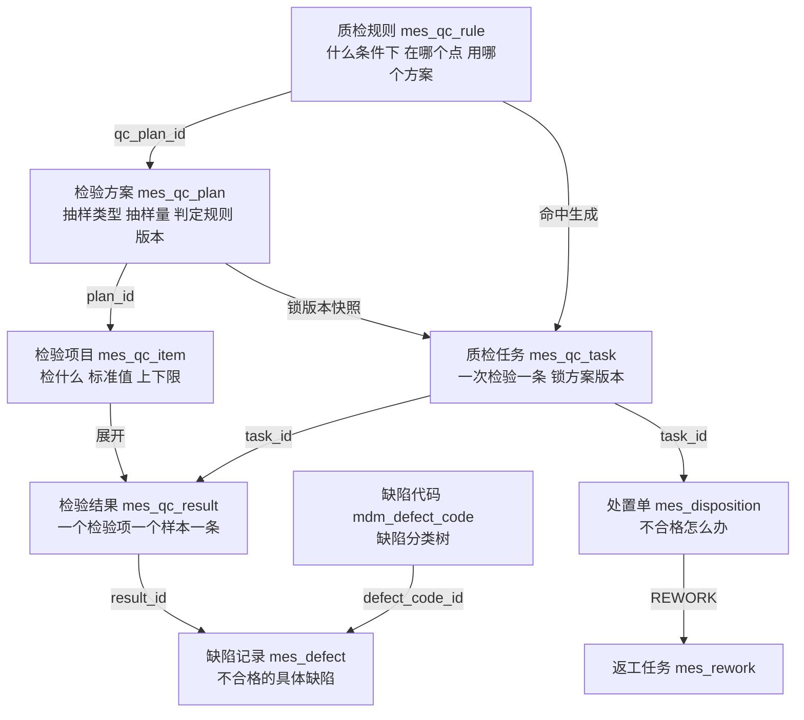
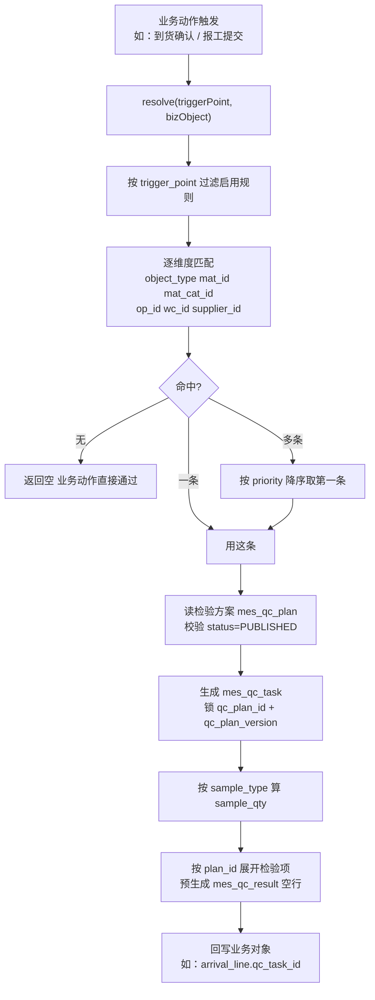
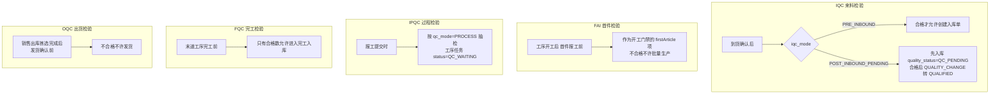
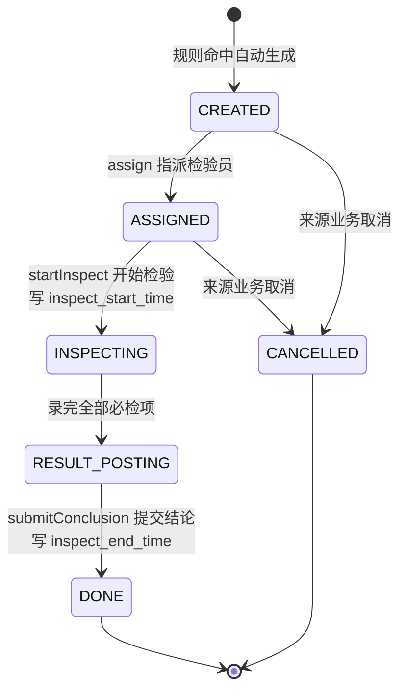
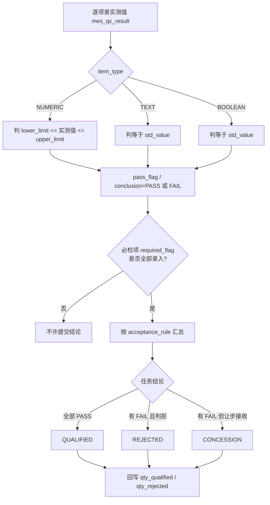
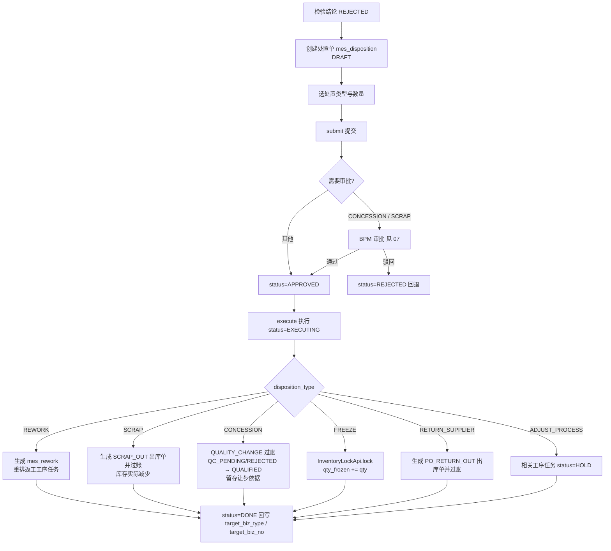
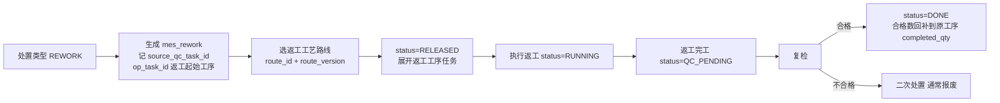

# 05 MES 质量子域流程

- 版本：v1.0.0
- 定位：质量不是一个模块，是挂在业务动作上的门禁。本文定义规则驱动的检验点触发、检验任务生命周期、不合格处置的六种库存后果。
- 代码位置：`iboot-module-mes` 的 `qcrule` `qcplan` `qcitem` `qctask` `qcresult` `defect` `disposition` `rework` 八个包，8 张表
- 现状：【待建设】表结构、枚举、CRUD 全部就绪；**`mes_qc_rule` 只有 CRUD 无触发解析逻辑，五检验点无法自动生成任务；处置单不联动库存与工序任务**

## 一句话铁律

> **检验点不硬编码在业务代码里，由 `mes_qc_rule` 规则表驱动。**

理由：检验策略是最常变的业务配置。今天关键件全检、明天抽检 10%、下周换供应商后免检——如果检验点写在业务代码的 if 里，每次调整都要改代码、测试、发版。规则驱动的目标是**改检验流程只改规则数据不改代码**。

## 数据模型



各表的职责：

| 表 | 回答的问题 | 变更频率 |
| --- | --- | --- |
| `mes_qc_rule` | 什么情况下要检 | 高，业务配置 |
| `mes_qc_plan` | 怎么抽样怎么判 | 中，版本化 |
| `mes_qc_item` | 具体检哪些项 | 中，随方案 |
| `mes_qc_task` | 这一次检验的过程与结论 | 每次检验 |
| `mes_qc_result` | 每个检验项的实测值 | 每个项每个样本 |
| `mes_defect` | 不合格的具体表现 | 仅不合格时 |
| `mes_disposition` | 不合格品的去向 | 仅不合格时 |

## 规则解析

核心是一个方法：`QcTriggerService.resolve(triggerPoint, 业务对象)`。



### 匹配维度

规则的六个维度都用 `0` 表示不限，越具体的规则 `priority` 应当越高：

| 维度 | 含义 | 典型用法 |
| --- | --- | --- |
| `object_type` | 检验对象类型 | `MATERIAL` `BATCH` `OP_TASK` `PROD_ORDER` `OUT_ORDER` |
| `mat_id` | 指定物料 | 单个关键件的专用规则 |
| `mat_cat_id` | 指定物料分类 | 一类物料统一规则 |
| `op_id` | 指定工序 | 某道工序必检 |
| `wc_id` | 指定工作中心 | 某条线加严 |
| `supplier_id` | 指定供应商 | 新供应商加严、免检供应商放宽 |

匹配是**与关系**：非 0 的维度必须全部匹配上。举例，`mat_cat_id=5 AND supplier_id=12` 的规则只对"5 类物料且来自 12 号供应商"生效。

`priority` 数值越大越优先，同优先级取 `id` 小的（先配置的）。规则解析必须可解释：命中哪条规则要记在 `mes_qc_task.rule_id` 上，事后能回答"为什么这批要检/不检"。

### 方案版本锁定

`mes_qc_task` 锁 `qc_plan_id` + `qc_plan_version`，理由与工单锁 BOM 版本相同：检验过程中方案改了，判定标准不能跟着变。检验项在任务生成时就展开成 `mes_qc_result` 空行，之后改方案不影响已生成的任务。

`mes_qc_plan.status` 三态：`DRAFT` 可编辑、`PUBLISHED` 锁定可用、`DISABLED` 停用。规则只能引用 `PUBLISHED` 的方案。

## 五个检验点

五个检验点挂在五个不同的业务动作上。挂载位置决定了"检验没过时什么事做不了"。



| 检验点 | 挂载动作 | 对象类型 | 拦住什么 | `qc_mode` |
| --- | --- | --- | --- | --- |
| IQC | 到货确认 `confirmArrival` | `MATERIAL` / `BATCH` | 入库或转合格状态 | `PRE_INBOUND` / `POST_INBOUND_PENDING` |
| FAI | 工序开工 `start` 后 | `OP_TASK` | 批量生产 | `FIRST_ARTICLE` |
| IPQC | 报工提交 `submitReport` | `OP_TASK` | 工序完工 | `PROCESS` |
| FQC | 末道工序完工 `finish` | `PROD_ORDER` / `BATCH` | 完工入库 | `BEFORE_COMPLETE` |
| OQC | 拣选完成后 | `OUT_ORDER` | 发货过账 | `BEFORE_START` 复用 |

FAI 的特殊之处：它既是检验任务，又是开工门禁的一项。流程是"开工 → 做首件 → 首件送检 → 合格后继续批量"。因此 `fai_flag` 为真的工序，开工门禁的 `firstArticle` 项在**第二次报工时**才校验，第一次报工是首件本身。

## 检验任务生命周期



`RESULT_POSTING` 是一个中间态，表示结果录完但结论未定。存在这一步的理由：多样本多项目的检验，录入过程可能跨班次，需要一个"录完待判"的稳定状态。

## 抽样与判定

`mes_qc_plan.sample_type` 四种抽样方式：

| 取值 | `sample_value` 含义 | `sample_qty` 计算 |
| --- | --- | --- |
| `FULL` | 忽略 | 等于送检数量 `qty` |
| `FIXED_QTY` | 固定件数 | 取 `min(sample_value, qty)` |
| `PERCENT` | 百分比 | `qty × sample_value ÷ 100` 向上取整 |
| `AQL` | 忽略，用 `aql` 字段 | 按 GB/T 2828.1 抽样表查，本轮简化为按 `acceptance_rule` 配置 |

判定链条：



`MesBusinessRules.validateQualityQty` 要求 `合格数 + 不合格数 = 抽检数`。

结论三态的业务含义：

| `conclusion` | 含义 | 下游 |
| --- | --- | --- |
| `QUALIFIED` | 合格 | 放行下游动作 |
| `REJECTED` | 不合格 | 强制要求处置单 |
| `CONCESSION` | 让步接收 | 走 BPM 审批，通过后按合格处理但留存依据 |

## 缺陷录入

结论为 `REJECTED` 时必须录缺陷，否则无法定位问题与统计改进方向。

`mes_defect` 关联 `mdm_defect_code`（缺陷分类树），`defect_level` 三档 `CRITICAL` / `MAJOR` / `MINOR`。可选缺陷码按当前物料分类与工序过滤：

```text
mdm_defect_code_mat_cat 按物料分类限定
mdm_defect_code_op      按工序限定
```

两张关联表都没有记录的缺陷码视为通用码，任何场景可选。

`defect_level` 影响处置的默认建议：`CRITICAL` 默认建议报废或退供，`MINOR` 默认建议让步接收。这是建议不是强制，处置类型由人决定。

## 处置六联动

这是质量子域最关键的一节。**每种处置类型都必须产生真实的业务事实**，否则会出现"判了报废但库存还在"这种账实分离状态。



六种类型的库存与工序后果对照：

| `disposition_type` | 库存后果 | 工序后果 | 调用的门面 |
| --- | --- | --- | --- |
| `REWORK` 返工 | 无 | 生成返工任务，重排工序 | 无（MES 内部） |
| `SCRAP` 报废 | `qty_onhand` 减少 | 报废数计入工序 `scrap_qty` | `OutOrderApi` |
| `CONCESSION` 让步接收 | 质量状态转 `QUALIFIED` | 无 | `InventoryApi.post` 的 `QUALITY_CHANGE` |
| `FREEZE` 冻结 | `qty_frozen` 增加 | 无 | `InventoryLockApi` |
| `RETURN_SUPPLIER` 退供 | `qty_onhand` 减少 | 无 | `OutOrderApi` |
| `ADJUST_PROCESS` 调整工艺 | 无 | 相关工序任务挂起 | 无（MES 内部） |

`target_biz_type` 与 `target_biz_no` 回写联动产生的单据号，这是"处置有没有真的执行"的凭据。处置单状态到 `DONE` 而这两个字段为空，说明联动没做，是 bug。

### 返工流程



返工可以用原工艺路线也可以用专门的返工路线（比如只做打磨和复检两道）。`mes_rework.route_id` / `route_version` 独立锁版本。

返工合格后数量回补到**原工序任务**的 `completed_qty`，不是新建工序任务累加，否则整单产出会重复计数。

## 检验结论的门禁作用

检验录入后自动推进下游，这是"质量是门禁"的落点：

| 检验点 | 合格 | 不合格且无处置 | 不合格且已处置 |
| --- | --- | --- | --- |
| IQC | 放行入库 / 转合格状态 | 入库单创建被拦 | 按处置类型执行 |
| FAI | 放行批量生产 | 开工门禁 `firstArticle` 项失败 | 返工后重新首检 |
| IPQC | 工序继续 `QC_WAITING` → `RUNNING` | 工序卡在 `QC_WAITING` | 按处置类型执行 |
| FQC | 合格数进完工入库 | 完工入库被拦 | 返工或报废 |
| OQC | 放行发货过账 | 发货确认被拦 | 换批或让步 |

"不合格且无处置时下游动作被门禁拦住"是硬约束：不允许出现"检出不合格，没人处置，货照样发走"。

## 页面权责总表

| 页面 | 列表 | 新增 | 修改 | 删除 | 动作端点 |
| --- | --- | --- | --- | --- | --- |
| 质检规则 | 是 | 是 | 是 | 是 | 无 |
| 检验方案 | 是 | 是 | 仅 DRAFT | 仅 DRAFT | `publish` `disable` |
| 检验项目 | 是 | 是 | 仅方案 DRAFT | 仅方案 DRAFT | 无 |
| 质检任务 | 是 | 否 | 否 | 否 | `assign` `start-inspect` `submit-conclusion` `cancel` |
| 检验结果 | 是 | 否 | 仅 INSPECTING | 否 | `batch-save`（批量录入） |
| 缺陷记录 | 是 | 是 | 是 | 是 | 无 |
| 处置单 | 是 | 是 | 仅 DRAFT | 仅 DRAFT | `submit` `execute` `cancel` |
| 返工任务 | 是 | 否 | 否 | 否 | `release` `finish` `cancel` |

质检任务**不允许手工新增**：任务只能由规则命中生成，手工建的任务没有 `rule_id` 与方案版本快照，判定标准无从考证。同理返工任务只能由处置单生成。

检验方案与检验项目的编辑必须联动：方案 `PUBLISHED` 后检验项不可改，与 BOM、工艺路线同一套版本化逻辑。

## 质检作业页面

检验员的工作是"录数"，单据式页面（列表 → 详情 → 逐项编辑 → 保存）效率太低。

| 作业页 | 一屏内容 |
| --- | --- |
| 检验录入作业 | 选任务 → 表格形态逐项逐样本录实测值 → 自动判 PASS/FAIL → 提交结论 |
| 处置作业 | 选不合格任务 → 选处置类型与数量 → 提交 → 看联动结果 |

检验录入页的表格是"检验项 × 样本"的二维表，一次进入录完全部数据。数值项自动按上下限判定并高亮超差。

## 试点配置清单

一条离散装配试点产线的质量配置最小量：

| 项 | 数量级 | 必需 |
| --- | --- | --- |
| 缺陷代码（`mdm_defect_code`） | 10-20 | 是 |
| 检验方案 | 5-8（IQC 常规、IQC 关键、FAI、IPQC、FQC、OQC 各一） | 是 |
| 检验项目 | 每方案 3-10 项 | 是 |
| 质检规则 | 5-15（五个检验点各 1-3 条） | 是 |

规则配置建议：每个检验点先配一条"不限维度"的兜底规则，再按物料分类或供应商加严。这样新物料不会因为漏配规则而免检。

## 本文档涉及的现状缺口

| # | 缺口 | 后果 |
| --- | --- | --- |
| 1 | `mes_qc_rule` 只有 CRUD，无 `QcTriggerService` 解析逻辑 | 五检验点无法自动生成任务，规则表是死数据 |
| 2 | 五个检验点未挂载到任何业务动作 | 检验不构成门禁，不合格照样流下去 |
| 3 | 处置单不联动库存与工序任务 | 判了报废但库存还在，判了冻结但可用量不变 |
| 4 | `mes_defect` 无缺陷码过滤逻辑 | 可选缺陷码不受物料与工序约束 |
| 5 | 抽样量 `sample_qty` 无计算逻辑 | 四种抽样方式形同不存在 |
| 6 | 检验结论不推进下游动作 | 合格了也不放行，不合格了也不拦 |
| 7 | 返工任务不重排工序，合格数不回补 | 返工是个孤立记录，不影响生产进度 |

缺口 1 是所有其他缺口的前提：没有规则解析，就没有检验任务，后面的判定、处置、门禁全部无从谈起。
