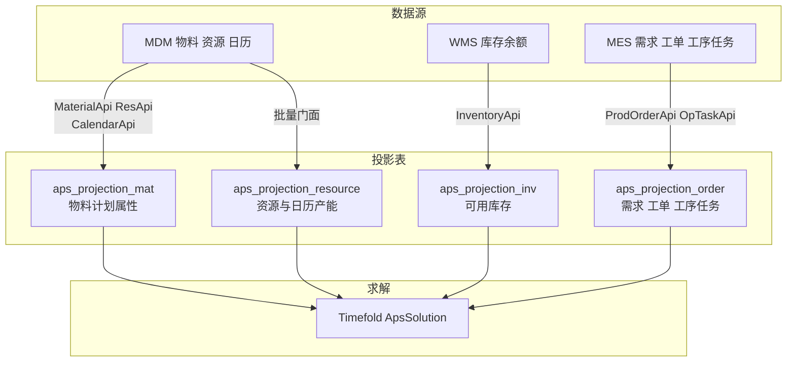
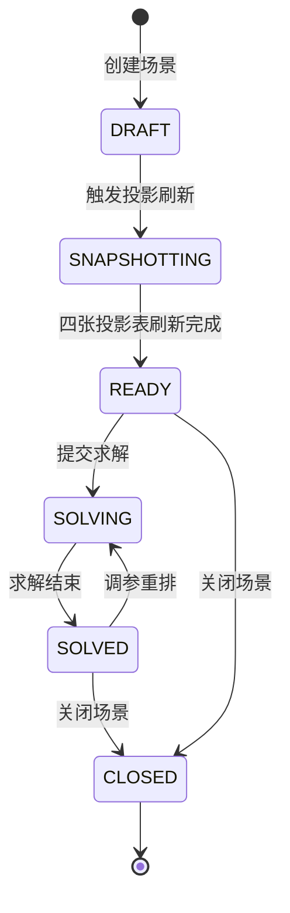
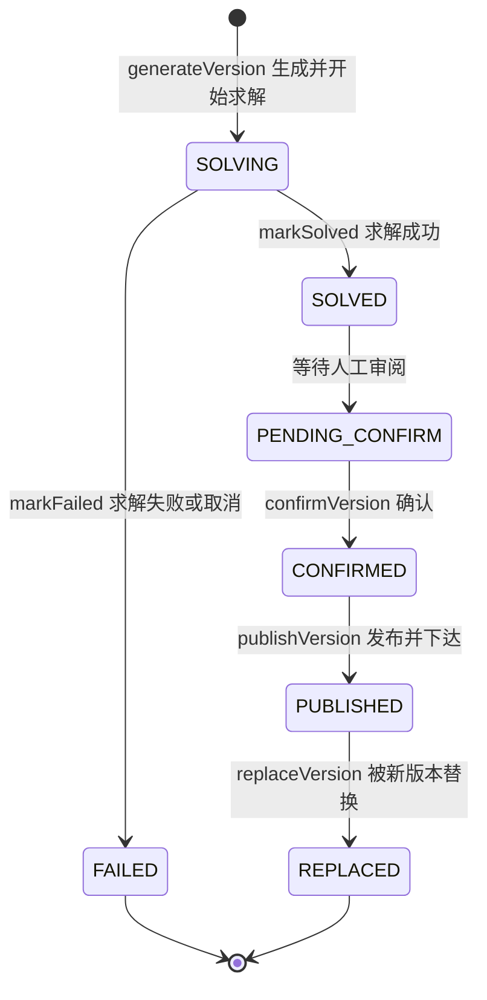
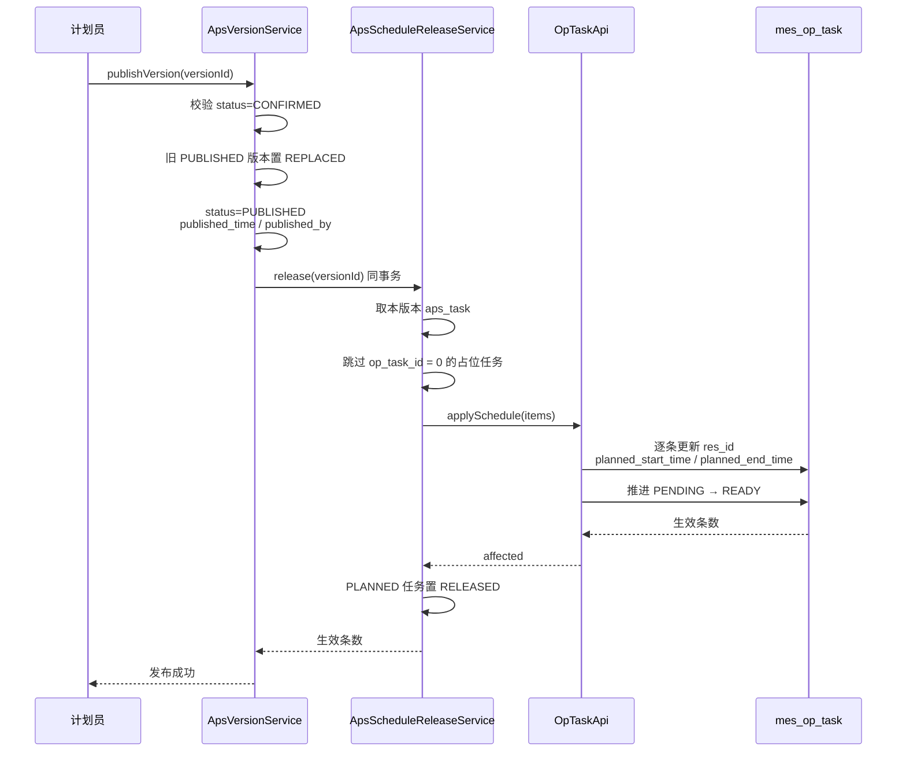
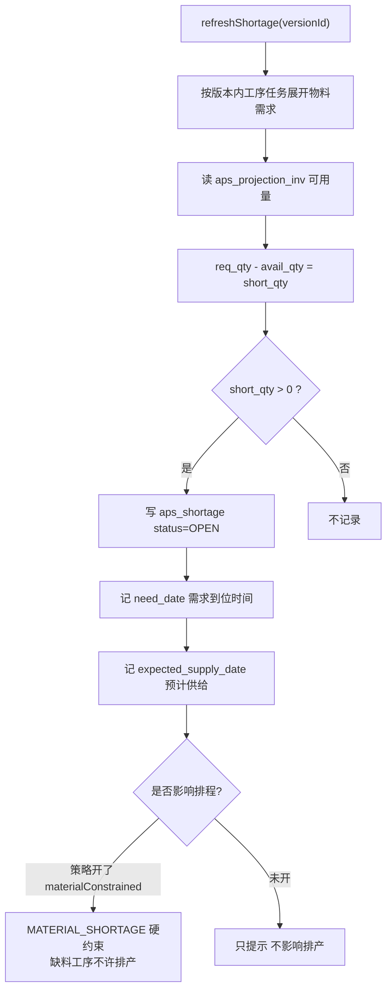
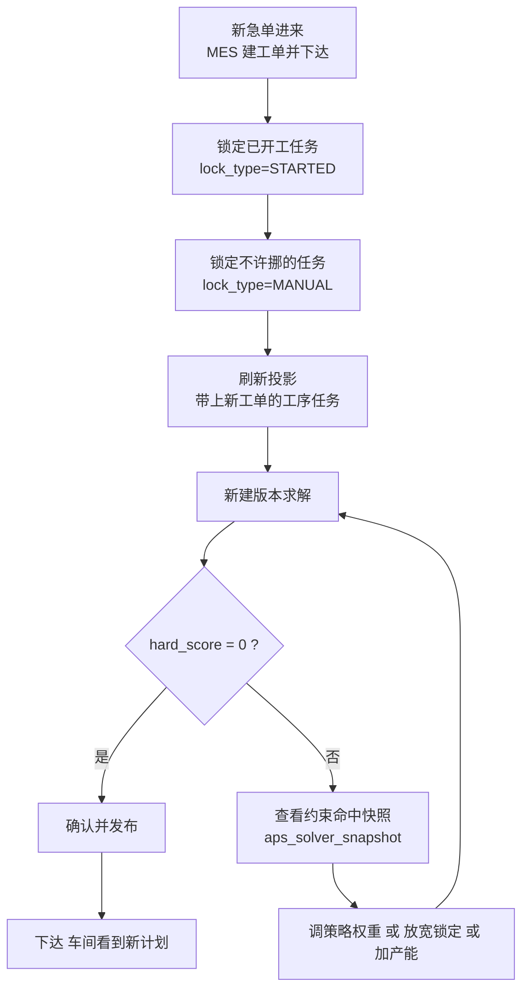

# 06 APS 计划排程流程

- 版本：v1.0.0
- 定位：APS 回答"什么时候在哪台设备做哪道工序"。本文定义场景到下达的六段闭环、投影输入约定、版本状态机、缺料与负荷。求解器内部实现见 `dev-docs/APS求解器开发规范.md`。
- 代码位置：`iboot-module-aps`，14 张 `aps_*` 表，Timefold 1.34.0，23 个测试类
- 现状：【已实现】场景、投影、求解、版本状态机、发布下达、缺料、负荷、任务锁定全链路；**下达不推进 MES 工序任务状态，投影数据的可信性依赖 MES 执行闭环建成**

## 六段闭环


每段的产出与不可跳过的理由：

| 段 | 产出 | 为什么不能跳 |
| --- | --- | --- |
| 场景 | 计划窗口、范围、策略 | 排程必须有边界，无边界的排程算不完 |
| 投影 | 四张只读投影表 | 求解不能直连主数据，否则求解期间数据变了结果不可复现 |
| 求解 | `aps_task` 与得分 | — |
| 确认 | 人工判断结果可用 | 求解结果可能硬约束不满足（`hard_score < 0`），直接发布会把矛盾计划下到车间 |
| 发布 | `PUBLISHED` 版本 | 一个场景同时只能有一个生效版本 |
| 下达 | MES 工序任务的计划时间与资源 | 不下达，排程结果只躺在 `aps_task` 里，车间按旧计划干活 |

## 投影输入约定

**求解只读四张投影表，不许回查主数据。** 这是不可协商的红线。



理由有三条：

1. **可复现**：求解可能跑几分钟，期间主数据在变。投影固定了输入，同一份投影重跑得到同一个结果。
2. **不焊死**：投影经门面刷新，求解侧只认投影表，将来拆微服务时改的是刷新逻辑不是求解逻辑。
3. **性能**：求解要在内存里反复遍历产能与库存，走门面 RPC 一次都受不了。

`snapshot_time` 记投影刷新时刻，是"这份计划基于什么时候的数据"的唯一凭据。

### 投影可信性

`aps_projection_order` 投的是 MES 的需求、工单、工序任务。MES 执行闭环建成前，投影里的工序任务状态永远是 `PENDING`、`completed_qty` 永远是 0、`actual_start_time` 永远为空。这意味着：

- 在制工序会被当成未开工重排，可能把正在加工的工序排到明天
- 已完成数量不参与剩余量计算，重排会把已做完的部分再排一遍

因此 MES 报工推进链建成后**必须重跑一次投影刷新**，确认在制工序的进度与实际开工时间进入投影。这是阶段验证的必做项，不是可选项。

## 场景与策略

`aps_scenario` 定义一次排程的边界：

| 字段 | 作用 |
| --- | --- |
| `plant_id` / `workshop_id` | 排哪个范围，`workshop_id = 0` 表示全工厂 |
| `plan_start_time` / `plan_end_time` | 计划窗口，窗口外的工单不排 |
| `strategy_id` | 用哪套约束权重 |
| `snapshot_time` | 投影刷新时刻 |



场景可复制（`copyScenario`）：复制窗口与策略配置，不复制版本与任务，用于"同样的边界换个策略试试"。

`aps_strategy.config_json` 存约束权重覆盖，键名必须来自 `ApsConstraintNames`。策略三态 `DRAFT` / `ENABLED` / `DISABLED`，只有 `ENABLED` 可被场景引用。

## 版本状态机

一个场景可以有多个版本，版本号 `version_no` 自增。同时只有一个 `PUBLISHED`。



四条硬规则：

1. `PUBLISHED` 之后的版本内容不可改（`validateMutable` 拦住）。已发布的计划是车间的执行依据，改它等于偷偷换掉计划。
2. 发布与下达**同事务**。下达失败要整个发布回滚，否则会留下一个 `PUBLISHED` 但车间没收到的版本，比不发布更危险。
3. 一个场景同时只有一个 `PUBLISHED`，新版本发布时旧版本置 `REPLACED`。
4. `hard_score < 0` 的版本可以确认（有时不得不接受矛盾计划），但界面必须显著提示硬约束未满足。

## 求解与任务

`aps_task` 是求解的产出，一道 MES 工序任务对应一条。关键字段：

| 字段 | 来源 | 说明 |
| --- | --- | --- |
| `op_task_id` | 投影 | 指回 MES 工序任务，`0` 表示占位（无对应工序，下达时跳过） |
| `res_id` | 求解结果 | 排在哪台资源上 |
| `planned_start_time` / `planned_end_time` | 求解结果 | 计划起止 |
| `status` | 状态机 | `PLANNED` `LOCKED` `RELEASED` `STARTED` `DONE` `CANCELLED` |

`aps_task_dep` 存任务依赖（工序前后序），`ApsTaskDepTypeEnum` 定义依赖类型。

### 手工调整校验

`aps_task` 允许人工调整计划时间与资源（插单、赶工），两条校验必须生效：

| 校验 | 错误码 | 判定 |
| --- | --- | --- |
| 时间正区间 | `TASK_TIME_INVALID` | `planned_start_time < planned_end_time` |
| 资源不重叠 | `TASK_RESOURCE_OVERLAP` | 同 `version_id` 同 `res_id` 的时间区间不相交 |

两者都在 `ApsTaskServiceImpl` 的 `validateTimeRange` 与 `validateNoOverlap` 里落地，调整任务时调用。**这两处已实现**，早期分析里"错误码零引用"的说法已经过期。

### 任务锁定

`aps_task_lock` 记锁定原因，四种类型：

| `lock_type` | 含义 | 谁产生 |
| --- | --- | --- |
| `STARTED` | 已开工，不许重排 | MES 开工动作反馈 |
| `MANUAL` | 人工钉住 | 计划员 |
| `MATERIAL` | 料已备齐，不许挪 | 齐套结论 |
| `RESOURCE` | 设备已占用 | 资源冲突处理 |

锁定的任务在求解时由 `PINNED_TASK_IMMUTABLE` 硬约束保持原样。这是"重排不打乱已开工的活"的技术落点。

## 发布与下达



### 下达的过滤规则

`applySchedule` 只更新**未开工**的工序任务（`MesOpTaskStatusEnum.isNotStarted`）。已开工、已完工、已跳序的任务保持原状态与原计划时间。

理由：车间已经按旧计划开工的活，改它的计划时间只会让实际与计划对不上，不改变任何物理事实。差额（下达 N 条、生效 M 条）记日志，是正常情况不是错误。

### 状态推进的缺口

`applySchedule` 当前只写 `res_id` 与两个计划时间，**不推进 `PENDING` → `READY`**。后果是车间看不出"这道工序的计划已经下来了"，派工页面无法用状态区分"等计划"和"可开工"。

补齐方式：在 `applySchedule` 的更新里带上 `status = READY`（仅对当前为 `PENDING` 的任务），并写一条 `mes_wip_txn`（`txn_type = START`，`from_status = PENDING`，`to_status = READY`）。

## 缺料分析

`aps_shortage` 是排程视角的缺料清单，与 MES 的齐套快照口径必须一致。



四个状态：`OPEN` 未解决、`PARTIAL` 部分解决、`RESOLVED` 已解决、`IGNORED` 忽略。

### 与齐套快照的对账

两边算的是同一件事，必须对得上：

| | `aps_shortage` | `mes_kit_snapshot` |
| --- | --- | --- |
| 视角 | 计划期内所有工单 | 单个工单或工序 |
| 需求量来源 | 投影里的 BOM 与工序用料 | `BomApi` / `RouteApi` 实时查 |
| 可用量来源 | `aps_projection_inv` | `InventoryApi.getAvailableQtyMap` |
| 时间口径 | 投影刷新时刻 | 检查时刻 |

对账口径：同物料同工单的 `short_qty` 在两边应当相等（允许因时间差产生的偏移）。不相等说明需求量展开逻辑不一致——最常见的原因是一边算了 `PHANTOM` 虚拟件、另一边没算，或者损耗率处理不同。

这是阶段验证的必做对账项。

## 资源负荷

`aps_load` 按资源与日期汇总计划负荷：

```text
load_rate = load_minutes ÷ capacity_minutes
overload_minutes = max(0, load_minutes - capacity_minutes)
```

`capacity_minutes` 来自 `aps_projection_resource`（资源日历的可用分钟数）。负荷率大于 1 表示超产能，通常意味着策略权重需要调整或产能需要扩充。

负荷是**求解后的分析结果**，不是求解输入。求解期间的产能约束由 `CALENDAR_CAPACITY` 硬约束保证。

## 插单重排

插单是最常见的计划变更场景，流程是"锁住不动的、重排能动的"。



`aps_solver_snapshot` 存约束命中明细，是"为什么排不出来"的诊断依据。硬约束命中项直接指出冲突：缺能力资源、前后序矛盾、产能不足、缺料。

## 页面权责总表

| 页面 | 列表 | 新增 | 修改 | 删除 | 动作端点 |
| --- | --- | --- | --- | --- | --- |
| 排程场景 | 是 | 是 | 仅 DRAFT | 仅 DRAFT | `snapshot` `copy` `close` |
| 排程策略 | 是 | 是 | 仅 DRAFT | 仅 DRAFT | `enable` `disable` |
| 排程版本 | 是 | 否 | 否 | 否 | `generate` `cancel-solve` `confirm` `publish` `replace` |
| 排程任务 | 是 | 否 | 仅未发布版本 | 否 | `lock` `unlock` |
| 任务依赖 | 是 | 否 | 否 | 否 | 无 |
| 任务锁定 | 是 | 否 | 否 | 否 | `unlock` |
| 缺料清单 | 是 | 否 | 否 | 否 | `refresh` `ignore` |
| 资源负荷 | 是 | 否 | 否 | 否 | `refresh` |
| 求解快照 | 是 | 否 | 否 | 否 | 无 |
| 四张投影表 | 是 | 否 | 否 | 否 | `refresh` |
| 甘特图 | 是 | — | 拖拽调整 | — | 调整走 `aps_task` 的更新校验 |
| 排程结果页 | 是 | — | — | — | 只读汇总 |

投影表页面只读加刷新按钮：投影是主数据的镜像，手工改它等于让排程基于假数据。

## 试点配置清单

| 项 | 数量级 | 必需 |
| --- | --- | --- |
| 排程策略 | 1-3（交期优先、产能均衡、换型最少） | 是 |
| 排程场景 | 1（试点车间） | 是 |
| 资源能力 `mdm_res_capability` | 资源 × 工序组合 | 是，没有能力记录的资源不会被排 |
| 资源日历 `mdm_res_calendar` | 覆盖计划窗口 | 是，没日历等于没产能 |
| 换型矩阵 `mdm_res_changeover` | 按 `changeover_group` | 否，不配则换型时间为 0 |

## 本文档涉及的现状缺口

| # | 缺口 | 后果 |
| --- | --- | --- |
| 1 | `applySchedule` 不推进 `PENDING` → `READY` | 车间不知道计划已下达，派工页无法区分状态 |
| 2 | 投影数据依赖 MES 执行闭环，当前工序进度全为初始值 | 重排会把在制工序当未开工，计划失真 |
| 3 | `aps_shortage` 与 `mes_kit_snapshot` 未做口径对账 | 两套缺料数字并存，谁对谁错无从判断 |
| 4 | APS 代码存在风格违规（一行多方法、通配 import、缺 `@Override`） | 与阿里巴巴 Java 开发手册不符，可读性差 |

缺口 2 不是 APS 的问题，是 MES 的问题，但影响的是 APS 的结果质量。MES 阶段完成后必须回来验证。
