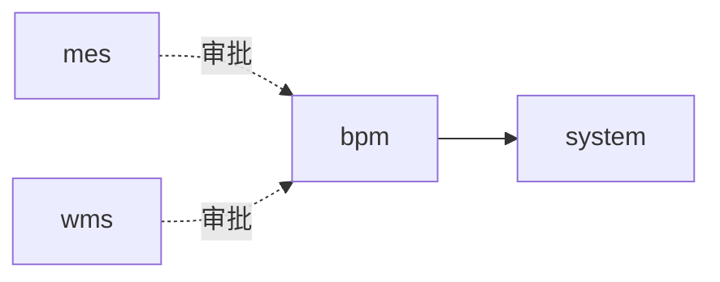
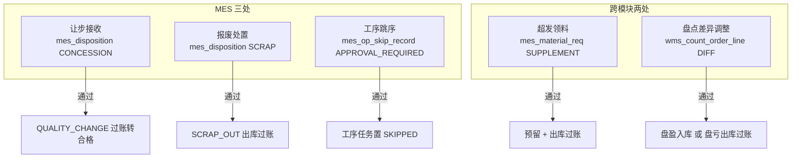
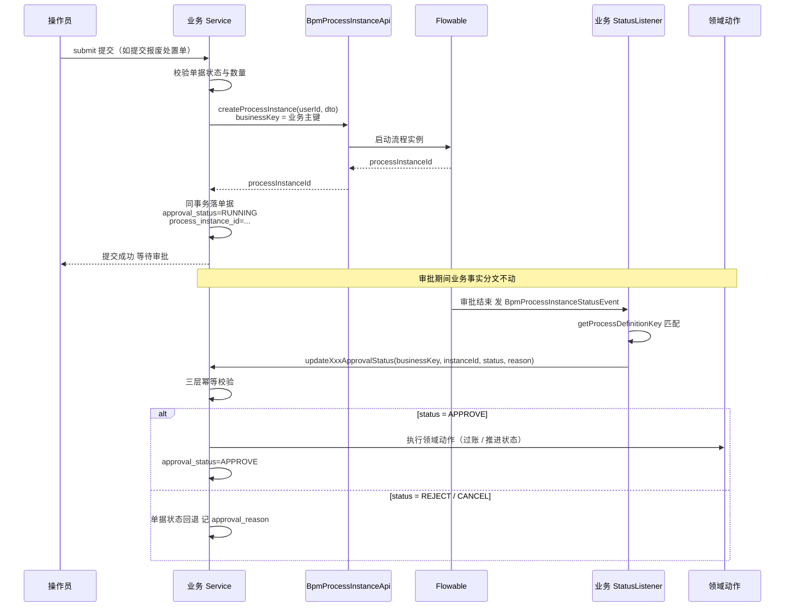
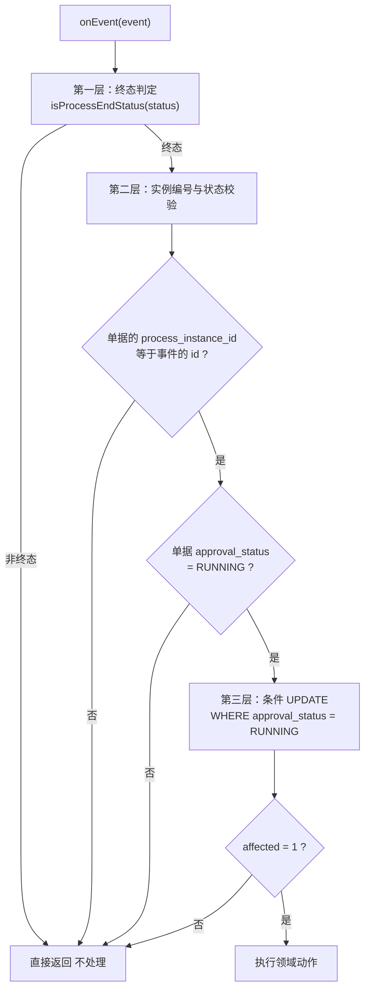
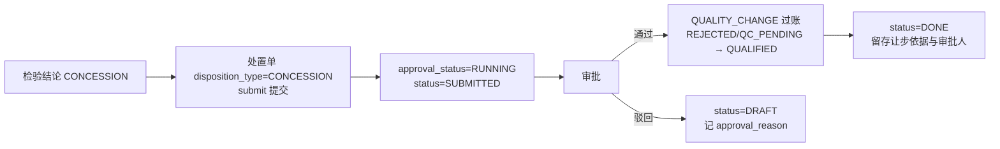
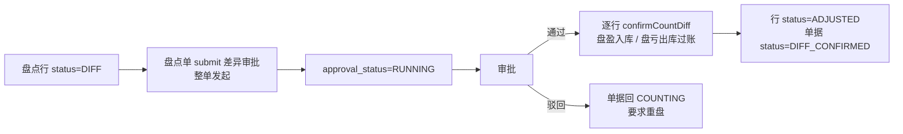
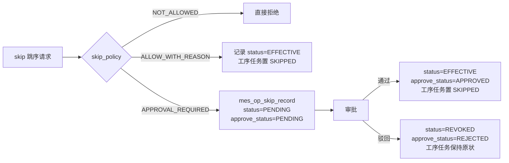

# 07 BPM 审批接入流程

- 版本：v1.0.0
- 定位：定义五个高风险动作的审批接入设计。技术范式、表结构、状态机、四步动作见 `dev-docs/BPM模块详细设计与接入规范.md`，本文只讲业务侧的接入点与不变量。
- 代码位置：`iboot-module-bpm`，Flowable 8，`ACT_*` 与 `bpm_*` 两套表
- 现状：【待建设】全仓唯一已接入的是 HRM 员工请假；**`iboot-module-mes` 与 `iboot-module-wms` 的 pom 尚未引入 `iboot-module-bpm`**

## 一句话铁律

> **审批期间不改业务事实。发起时只改单据状态，审批通过的回调里才执行领域动作。**

违反这条的典型写法：发起审批时就把库存扣了，审批驳回再冲销。后果是审批期间库存已经变了，别人看到的可用量是错的；驳回的冲销如果失败，账目永久错误。

正确的做法是发起时单据进入"审批中"，库存分文不动；审批通过的回调里才调领域动作。驳回则单据状态回退，什么都不用冲销。

## 依赖方向

`bpm` 只依赖 `system`，不依赖任何业务模块，因此业务模块引入 `bpm` 不产生循环依赖。反向绝对禁止：`bpm` 不许依赖 `mes` 或 `wms`。

业务模块只能走三个出口：

| 出口 | 用途 |
| --- | --- |
| `BpmProcessInstanceApi.createProcessInstance` | 发起审批 |
| `BpmProcessTaskApi` | 查任务（业务详情页展示审批进度） |
| `BpmProcessInstanceStatusEventListener` | 接终态回调 |

禁止注入 `bpm` 内部 Service。

## 五个接入点

选这五个的标准：动作产生不可逆的库存或工序事实，且有被滥用的动机。

| 接入点 | 载体表 | 审批的是什么 | 不审批的后果 |
| --- | --- | --- | --- |
| 让步接收 | `mes_disposition` | 把不合格品当合格用 | 质量责任无留痕，客户投诉时查不到谁批的 |
| 报废处置 | `mes_disposition` | 直接减库存 | 报废成为掩盖丢料的手段 |
| 盘点差异调整 | `wms_count_order_line` | 账实差异以实物为准 | 盘点成为调账工具 |
| 超发领料 | `mes_material_req` | 领超出 BOM 计划量的料 | 物料消耗失控，成本不可控 |
| 工序跳序 | `mes_op_skip_record` | 少做一道工序 | 关键工序被跳过，产品质量无保证 |

## 业务表的四个固定字段

每个接入点的业务表必须加这四列，命名与语义不许自定义：

| 列 | 类型 | 说明 |
| --- | --- | --- |
| `approval_status` | `int` | 复用 `BpmProcessInstanceStatusEnum` 的取值，**不自建枚举** |
| `process_instance_id` | `varchar(64)` | 流程实例编号，**加唯一索引** |
| `approval_time` | `datetime` | 终态回写时间 |
| `approval_reason` | `varchar(500)` | 驳回原因或审批意见 |

`process_instance_id` 的唯一索引是幂等的第一道防线：同一个流程实例不可能对应两条业务单据。

`approval_status` 取值：`NOT_START = -1`、`RUNNING = 1`、`APPROVE = 2`、`REJECT = 3`、`CANCEL = 4`。

## 发起与回调范式

### 发起时的两条要求

1. `businessKey` 传业务主键（字符串形式的 ID），回调时靠它找回业务单据。
2. **发起流程与落单据同事务**。流程起了但单据没落，会产生一个找不到业务对象的孤儿流程；单据落了但流程没起，单据永远卡在"审批中"。

### 回调的三层幂等

`onEvent` 跑在 Flowable 的事务里，重复投递、并发投递都可能发生。三层防护：

第三层的条件 UPDATE 是并发安全的关键：两个线程同时进到这里，只有一个能把 `RUNNING` 改成终态，另一个 `affected = 0` 直接退出。

### onEvent 不许抛异常

`onEvent` 在 Flowable 的事务内执行，抛异常会回滚整个流程状态变更——审批人点了通过，流程却回到审批中。所有异常必须在 `onEvent` 内部捕获并记日志。

领域动作失败时的处理：单据置一个"审批通过但执行失败"的状态（可用 `EXCEPTION`），由人工重试执行，不要让流程回滚。

## 五个接入点的详细设计

### 让步接收

流程定义 key 建议 `mes-concession`。审批人策略：质量主管 + 技术负责人两级。

让步接收的特殊要求：**必须留存依据**。`remark` 里记为什么可以让步（客户已确认、非关键特性超差、有补偿措施），审批意见记在 `approval_reason`。这是客户审核时的必查项。

### 报废处置

流程定义 key 建议 `mes-scrap`。审批人策略：按报废金额分档，小额班组长、大额生产经理。金额从物料标准成本乘数量算，本轮简化为按数量分档。

通过后执行 `SCRAP_OUT` 出库过账，幂等键 `MES:{dispositionNo}:SCRAP_POST:0`。

### 盘点差异调整

流程定义 key 建议 `wms-count-diff`。审批粒度是**盘点单级**而不是行级：一次盘点的差异一起审，不然几百行差异要审几百次。

幂等键按行派生：`WMS:{countNo}:COUNT_DIFF_POST:{lineNo}`。

### 超发领料

流程定义 key 建议 `mes-supplement`。触发条件：`req_type = SUPPLEMENT`，或 `ISSUE` 类型但累计领用量超出 BOM 计划量（超发比例阈值可配）。

审批通过后才执行预留与出库过账，也就是说 04 里的"领料三段"在超发场景下变成四段：申请 → 提交（发起审批）→ 审批通过 → 确认出库。

### 工序跳序

流程定义 key 建议 `mes-op-skip`。只有 `skip_policy = APPROVAL_REQUIRED` 的工序走审批，`ALLOW_WITH_REASON` 填原因即时生效。

跳序审批必须填 `effect_remark`（对后续工序、质检及排程的影响说明），这是跳序审批与其他审批的区别：审批人需要知道跳了这道工序会怎样。

## 权限放行

**业务详情 `get` 接口必须放行 `bpm:process-instance:query` 与 `bpm:task:query` 两个权限**，否则审批人在审批页面点开业务详情会 403。

这是最容易漏的一步：审批人通常不是业务操作员，没有业务模块的查询权限。放行方式见 BPM 接入规范。

## 表单类型

业务数据一律 `form_type = CUSTOM`，存在业务自己的表里。

**禁止用 `NORMAL` 把业务数据埋进流程变量**。理由：流程变量是 Flowable 的内部存储，业务查询无法 JOIN，报表取不到，且这个决定不可逆——一旦有历史数据存进流程变量，只能重做。

## 接入自查清单

每个接入点上线前逐条确认：

| # | 检查项 |
| --- | --- |
| 1 | 业务表有 `approval_status` / `process_instance_id`（唯一索引）/ `approval_time` / `approval_reason` |
| 2 | `approval_status` 复用 `BpmProcessInstanceStatusEnum`，未自建枚举 |
| 3 | `form_type = CUSTOM`，业务数据不在流程变量里 |
| 4 | `businessKey` 传业务主键 |
| 5 | 发起流程与落单据同事务 |
| 6 | 审批期间不产生任何库存或工序事实 |
| 7 | 回调三层幂等：终态判定 + 实例与状态校验 + 条件 UPDATE |
| 8 | `onEvent` 内不抛异常 |
| 9 | 业务详情 `get` 放行两个 bpm 权限 |
| 10 | 幂等键由 `businessKey` 派生 |
| 11 | 驳回路径的状态回退已测试 |
| 12 | 重复投递回调不产生第二笔过账（有测试用例） |

## 本文档涉及的现状缺口

| # | 缺口 | 后果 |
| --- | --- | --- |
| 1 | `iboot-module-mes` / `iboot-module-wms` 的 pom 未引入 bpm | 五个接入点无法开工 |
| 2 | 五个业务表缺四个审批字段 | 无审批状态载体 |
| 3 | 五个流程定义未创建 | 无流程可发起 |
| 4 | 业务详情接口未放行 bpm 权限 | 审批人打不开详情 |

模块内置的 OA 请假只是流程配置演示，缺幂等保护，**不要照抄**。生产参照是 HRM 员工请假（`HrmAttendanceLeaveServiceImpl` + `HrmAttendanceLeaveStatusListener`）。
