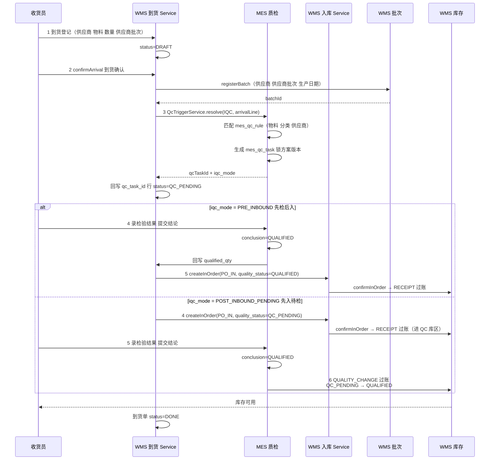
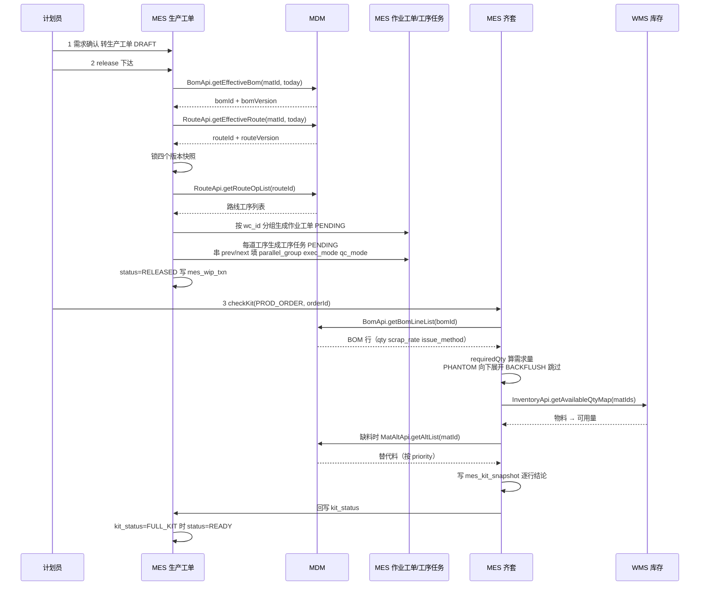
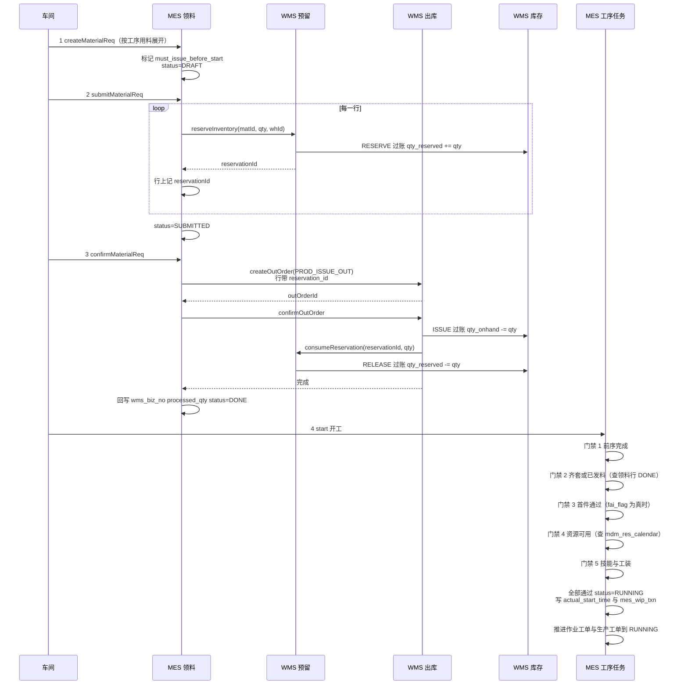
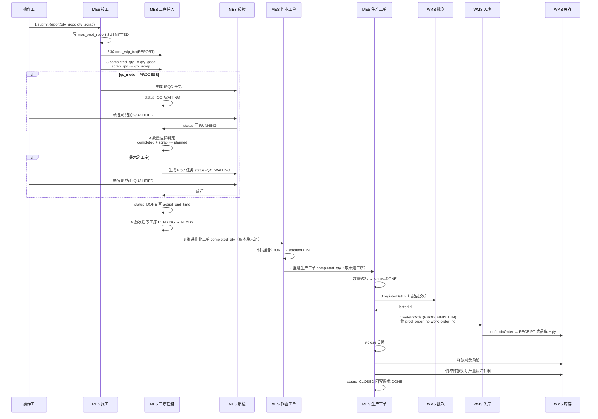
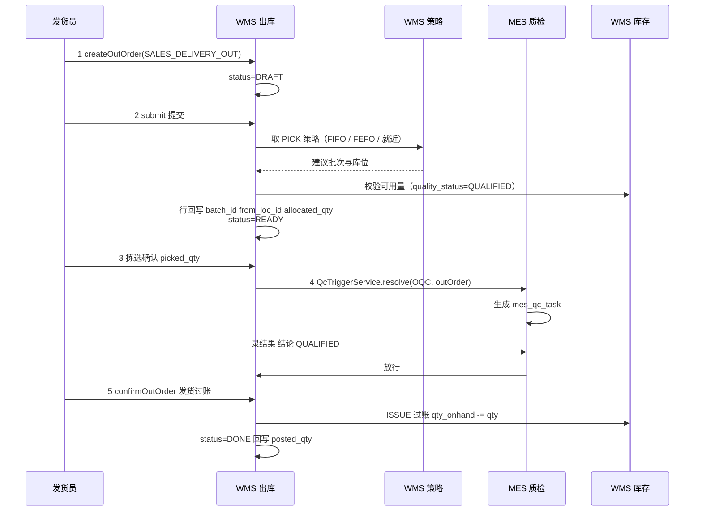
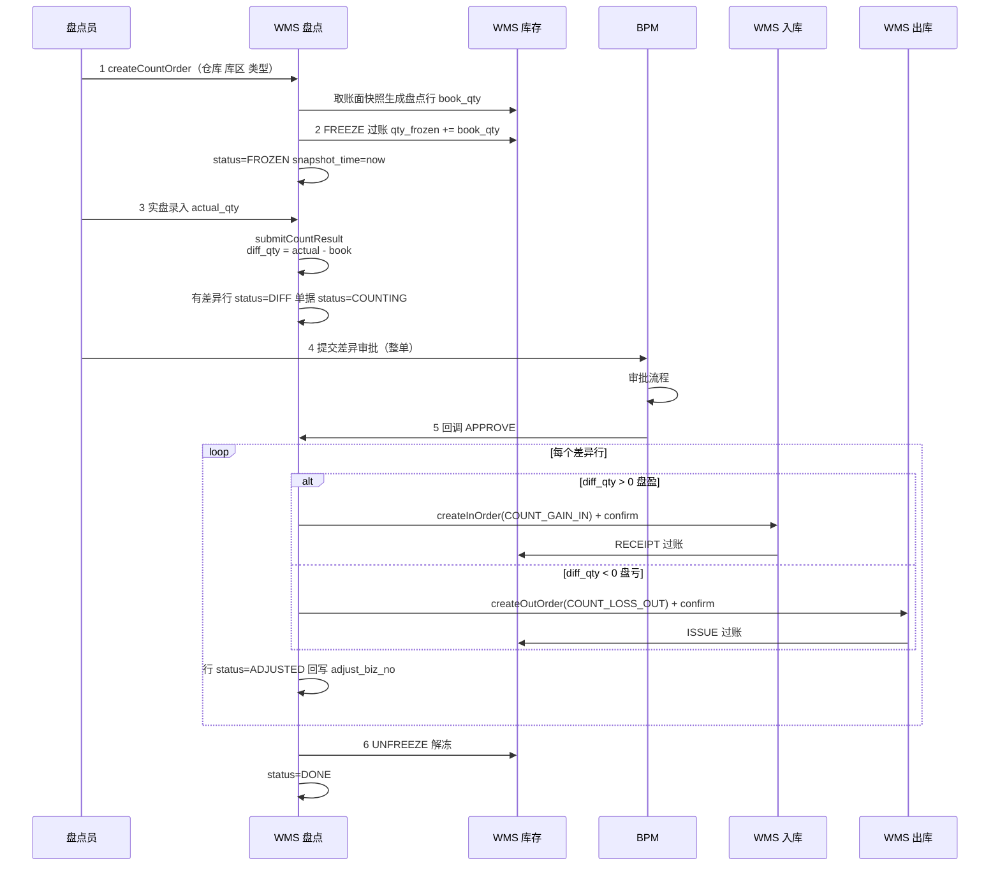
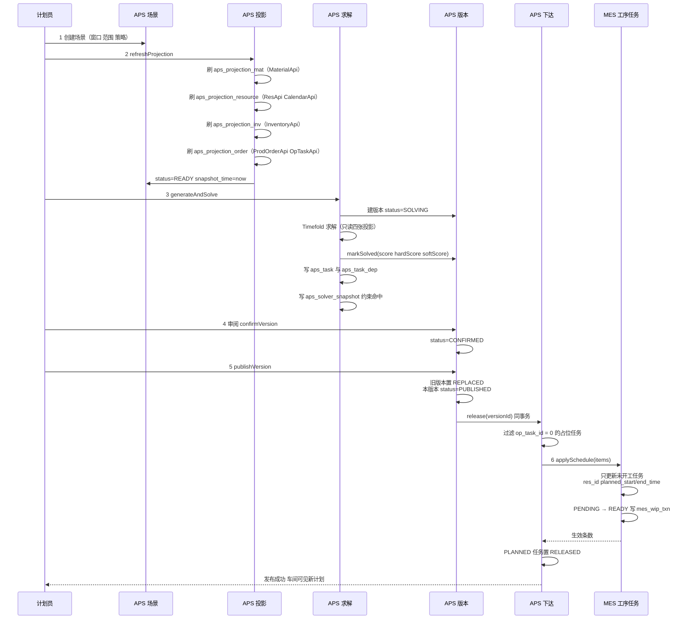
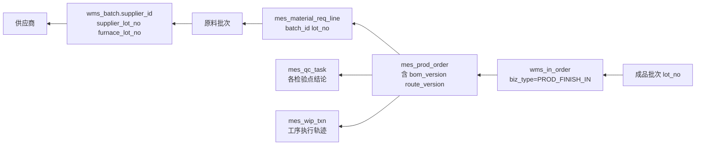
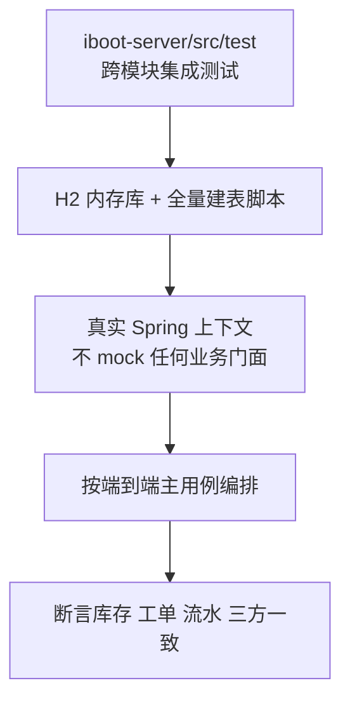

# 08 跨模块协作与端到端时序

- 版本：v1.0.0
- 定位：本文是联调与验收的依据。定义跨模块调用矩阵、五条端到端主链路的完整时序、批次追溯链路、测试基础设施与验收口径。
- 前置阅读：02 到 07

## 跨模块调用矩阵

行是调用方，列是被调方，格子里是走的门面。空格表示不允许调用。

| 调用方 → 被调方 | MDM | WMS | MES | BPM | system / infra |
| --- | --- | --- | --- | --- | --- |
| **MDM** | — | | | | `AdminUserApi` `CodeRuleApi` `FileApi` |
| **WMS** | `MaterialApi` `WarehouseApi`（MDM 组织）`SupplierApi` `CustomerApi` `ProjectApi` `UomApi` | — | | `BpmProcessInstanceApi` + 监听 | `AdminUserApi` `CodeRuleApi` |
| **MES** | `MaterialApi` `BomApi` `RouteApi` `OpApi` `ResApi` `DefectCodeApi` `SkillApi` `TeamApi` `ProjectApi` | `InventoryApi` `InOrderApi` `OutOrderApi` `InventoryReservationApi` `InventoryLockApi` `BatchApi` `WarehouseApi` | — | `BpmProcessInstanceApi` + 监听 | `AdminUserApi` `CodeRuleApi` `FileApi` |
| **APS** | `MaterialApi` `ResApi` `CalendarApi` `ChangeoverApi` | `InventoryApi` | `ProdOrderApi` `WorkOrderApi` `OpTaskApi` | | `AdminUserApi` `CodeRuleApi` |
| **BPM** | | | | — | `AdminUserApi` `DeptApi` |

三条不可协商的约束：

1. **禁止跨模块 SQL JOIN**。MES 的 SQL 里不许出现 `JOIN wms_inv_balance`，WMS 的 SQL 里不许出现 `JOIN system_users`。跨库 JOIN 会把两个模块焊死在同一个数据库上，将来微服务拆分无处下手。
2. **补全逻辑写在 Service 而非 Controller**。Excel 导出复用 Service 的分页结果，写在 Controller 会丢字段。
3. **批量门面，不许 N+1**。取用户名用 `AdminUserApi.getUserMap(ids)` 一次拿回，不许在循环里逐个查。

## 链路一：采购到货入库



不合格分支：结论 `REJECTED` 时生成处置单，按类型走退供（`PO_RETURN_OUT`）、让步（审批后 `QUALITY_CHANGE`）或报废（`SCRAP_OUT`）。

## 链路二：生产主流程

这是最长的一条链路，拆成三段时序。

### 2.1 下达与齐套



### 2.2 领料与开工



### 2.3 报工到完工入库



## 链路三：销售出库



OQC 不合格时：换批（重新分配批次重检）或让步接收（审批后发货）。

## 链路四：盘点



## 链路五：排程闭环



## 批次追溯链路

追溯只做查询与导出，不做看板。五张事实表提供全部数据：

| 表 | 提供的事实 |
| --- | --- |
| `wms_inv_txn` | 每笔出入库与移库，含批次、库位、来源单据 |
| `wms_batch` | 批次主档，含供应商、供应商批次、炉批号、生产日期 |
| `mes_wip_txn` | 在制流转轨迹，含工序、状态变更 |
| `mes_material_req` / `_line` | 哪个工单领了哪个批次 |
| `mes_qc_task` | 检验结论与检验方案版本 |

### 正向追溯

从原料批次出发：这批料用到哪些产品上、发给了哪些客户。


### 反向追溯

从成品批次出发：这批产品用了哪些原料批次、来自哪些供应商。



追溯查询的实现要求：

1. **一次查询拉出完整链路**，不许让用户逐层点开。
2. 跨模块取数走门面批量方法，不做跨库 JOIN。
3. 支持导出 Excel，客户审核时要交材料。
4. 起点支持批次号、工单号、销售单号三种。

## 幂等键全表

按模块列出全部需要幂等的动作与键格式。格式见 01。

| 模块 | 动作 | 幂等键 | 落地路径 |
| --- | --- | --- | --- |
| WMS | 创建入库单 | `{src}:{bizNo}:CREATE_IN:0` | `wms_in_order.idempotency_key` |
| WMS | 入库过账 | `{src}:{bizNo}:CREATE_IN:0:POST` | `wms_inv_txn.idempotency_key` |
| WMS | 创建出库单 | `{src}:{bizNo}:CREATE_OUT:0` | `wms_out_order.idempotency_key` |
| WMS | 出库过账 | `{src}:{bizNo}:CREATE_OUT:{lineNo}:POST` | `wms_inv_txn.idempotency_key` |
| WMS | 转移过账 | `{src}:{bizNo}:TRANSFER:{lineNo}:POST` | `wms_inv_txn.idempotency_key` |
| WMS | 预留 | `{src}:{bizNo}:RESERVE:{lineNo}` | `wms_inv_reservation.idempotency_key` |
| WMS | 冻结 | `{src}:{bizNo}:FREEZE:{lineNo}` | `wms_inv_lock.idempotency_key` |
| WMS | 单据提交 / 取消 | `{src}:{bizNo}:SUBMIT:0` / `CANCEL:0` | `wms_command_record`（待建） |
| WMS | 到货确认 | `UI:{arrivalNo}:ARRIVAL_CONFIRM:0` | `wms_command_record`（待建） |
| WMS | 盘点差异过账 | `UI:{countNo}:COUNT_DIFF_POST:{lineNo}` | `wms_inv_txn.idempotency_key` |
| MES | 创建需求 | `{src}:{srcNo}:CREATE_DEMAND:0` | `mes_prod_demand.idempotency_key` |
| MES | 工单下达 | `UI:{orderNo}:RELEASE:0` | `mes_command_record`（待建） |
| MES | 齐套检查 | `UI:{orderNo}:KIT_CHECK:0` | `mes_command_record`（待建） |
| MES | 领料申请 | `UI:{orderNo}:CREATE_REQ:0` | `mes_material_req.idempotency_key` |
| MES | 领料确认 | `MES:{reqNo}:ISSUE_CONFIRM:{lineNo}` | `mes_command_record`（待建） |
| MES | 工序开工 / 完工 / 跳序 | `UI:{taskNo}:START:0` / `FINISH:0` / `SKIP:0` | `mes_command_record`（待建） |
| MES | 报工 | `UI:{taskNo}:REPORT:{seq}` | `mes_prod_report.idempotency_key` |
| MES | 在制流水 | 派生自触发动作的键 | `mes_wip_txn.idempotency_key` |
| MES | 生成质检任务 | `MES:{bizNo}:QC_CREATE:{triggerPoint}` | `mes_qc_task.idempotency_key` |
| MES | 处置执行 | `MES:{dispositionNo}:EXECUTE:0` | `mes_disposition.idempotency_key` |
| APS | 版本发布下达 | `APS:{versionNo}:APPLY_SCHEDULE:0` | `aps_command_record` |

已有 `idempotency_key` 列的表继续用列上的唯一索引判重，不推翻已经工作的机制。没有落库载体的状态推进型动作走命令记录表。

`aps_command_record` 与 `ApsCommandService` 已实现，`wms_command_record` 与 `mes_command_record` 照它建。

## 测试基础设施

### 现有测试的局限

各模块的 `BaseDbUnitTest` 用 `@MockitoBean` 掉对方门面，验证的是"本模块调用了门面"，不是"闭环真的成立"。MES 领料的模块内测试里，WMS 的预留与过账全是 mock 返回值，库存实际没动。

因此需要跨模块集成测试：在 `iboot-server/src/test` 建，H2 加载全量建表脚本，跑真实跨模块调用。



### 端到端主用例清单

| # | 用例 | 断言要点 |
| --- | --- | --- |
| 1 | 需求到工单下达 | `bom_version` / `route_version` 已锁；作业工单与工序任务已展开；`prev/next` 串联正确 |
| 2 | 齐套（含损耗率、虚拟件、倒冲件） | `PHANTOM` 不产生需求但子件产生；`BACKFLUSH` 不计入；损耗率按公式算 |
| 3 | 领料三段 | 预留后可用量降；过账后现存降；预留被 `CONSUMED`；可用量不重复下降 |
| 4 | 开工门禁五项 | 每项单独构造失败场景，逐条拦截并返回对应错误码 |
| 5 | 报工推进三级 | 工序累加；作业工单取本段末道；生产工单取末道；不重复计数 |
| 6 | IQC 两种模式 | `PRE_INBOUND` 检验前库存为 0；`POST_INBOUND_PENDING` 库存为 `QC_PENDING` 且合格后转 `QUALIFIED` |
| 7 | FQC 拦不合格 | 不合格数不进完工入库；无处置时完工入库被拦 |
| 8 | 处置六种类型 | 每种的库存与工序后果逐一断言（见 05 的对照表） |
| 9 | 完工入库 | 成品批次已注册；入库单 `biz_type=PROD_FINISH_IN`；成品库余额增加 |
| 10 | 工单关闭 | 剩余预留已释放；倒冲件已反冲；需求置 `DONE` |

### 幂等用例

每个领域命令重复提交两次，断言：

1. 返回同一个结果（同一个 ID 或同一条流水）
2. 表里只有一条记录
3. 库存余额只变化一次

覆盖两条路径：命令记录表与已有 `idempotency_key` 列。

### 账实一致用例

任意一段业务跑完后执行两个断言：

```text
断言 1：sum(wms_inv_txn) 按 9 维度推导的余额 = wms_inv_balance 逐维度值
断言 2：可用量 = 合格现存 - 预留 - 冻结
```

断言 1 的推导方式：按维度分组，`IN` 方向的 `qty` 相加，`OUT` 方向的 `qty` 相减，`MOVE` 与 `STATUS` 按来源目标维度分别处理。

### 状态机用例

三个状态机的全部合法迁移逐条通过，非法迁移抛对应错误码。用例数量约等于迁移表的条数：

| 状态机 | 合法迁移数（约） |
| --- | --- |
| 生产工单 8 态 | 12 |
| 作业工单 6 态 | 9 |
| 工序任务 9 态 | 16 |

### 回归基线

```text
mvn -pl iboot-module-mdm,iboot-module-wms,iboot-module-mes,iboot-module-aps -am test
```

必须全绿。`iboot-module-infra` 已知的 `CodegenEngine*Test` 失败属既有问题，本轮不处理。

前端验收：`pnpm typecheck` 与 `pnpm build` 通过；作业导向页面在 1440 与 1920 两种宽度下表格不撑宽；动作按钮按权限正确隐藏。

## 交付物

### 库结构与初始数据

新建 `sql/deploy/` 目录，与芋道原生脚本隔离，内含：

| 文件 | 内容 |
| --- | --- |
| `01-schema.sql` | 全量表结构快照 |
| `02-menu.sql` | 菜单、按钮权限 |
| `03-role.sql` | 角色与授权 |
| `04-dict.sql` | 字典类型与字典数据 |
| `05-code-rule.sql` | 编码规则（MDM 18 条 + WMS + MES + APS） |
| `06-wms-strategy.sql` | 仓储策略样例 |
| `07-qc-rule.sql` | 质检规则与检验方案样例 |
| `08-aps-strategy.sql` | 排程策略样例 |
| `README.md` | 版本号、执行顺序、变更记录 |

导出流程写成可重复执行的脚本，禁止手工拼 SQL。

数据库变更全程走 dbx MCP（连接 `芋道-dev`，库 `ruoyi-vue-pro-20260817`），最后一次性导出快照，中间不向 `sql/` 增量写脚本。

### 移动端接口契约

`dev-docs/移动端接口契约.md` 固定七个扫码动作的路径、入参、幂等键格式，**不写 app Controller 代码**：

| 动作 | 对应领域动作 |
| --- | --- |
| 收货 | `confirmArrival` |
| 上架 | `confirmInOrder` |
| 拣选 | 出库分配与拣选确认 |
| 领料确认 | `confirmMaterialReq` |
| 开工 | `startOpTask` |
| 报工 | `submitReport` |
| 完工 | `finishOpTask` |

契约定稿的价值：后续做 app 时不需要重新设计接口，直接按契约实现 `controller/app` 包。

## 验收口径总表

| 维度 | 验收标准 |
| --- | --- |
| 写入路径唯一 | `rg` 搜不到任何 Controller 经 codegen Service 改库存余额或工单状态 |
| 幂等 | 每个领域动作都有幂等键，重复提交不产生第二笔事实 |
| 账实一致 | `sum(wms_inv_txn)` 推导余额与 `wms_inv_balance` 逐维度相等 |
| 可用量正确 | 无虚占，领料确认后可用量不二次下降 |
| 状态机 | 状态只能由动作推进，表单无 `status` 字段 |
| 追溯 | 任一成品批次一次查询拉出完整上下游链路 |
| 质量门禁 | 五检验点规则驱动，不合格无处置时下游被拦 |
| 排程闭环 | 改交期后重排、发布、车间看到新计划，无手工干预 |
| 审批 | 五类高风险动作未经审批无法产生事实，回调重复投递不产生第二笔过账 |
| 测试 | 四模块测试全绿，端到端主用例通过 |
| 交付 | 空库执行 `sql/deploy/` 后可直接进入试点配置 |
