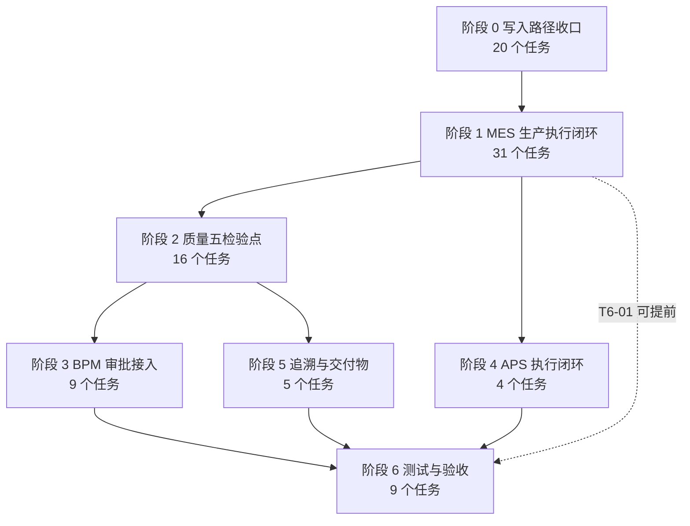

# 00 任务总览与执行规则

- 版本：v1.0.0
- 日期：2026-09-04
- 定位：`dev-docs/开发任务安排/` 系列的入口。本文定义任务编号、标记填写规范、并行分组、依赖规则与统一验收口径。
- 上游依据：`dev-docs/业务流程/01` 到 `08`
- 适用对象：被指派执行单个任务的 AI，以及做审查的人

## 文档清单

| 文件 | 阶段 | 任务数 | 主题 |
| --- | --- | --- | --- |
| 00-任务总览与执行规则 | — | — | 编号、标记、并行分组、验收口径 |
| 01-阶段0-写入路径收口 | 0 | 20 | 命令幂等表、单据动作、Controller 收口、DO 去重 |
| 02-阶段1-MES生产执行闭环 | 1 | 31 | 状态机、七个动作、门面委托、动作端点、作业页 |
| 03-阶段2-质量五检验点 | 2 | 16 | 规则解析、五检验点挂载、处置六联动 |
| 04-阶段3-BPM审批接入 | 3 | 9 | pom 依赖、五个接入点、权限放行 |
| 05-阶段4-APS执行闭环 | 4 | 4 | 状态推进、投影验证、缺料对账、风格整理 |
| 06-阶段5-追溯与交付物 | 5 | 5 | 追溯查询、部署脚本、移动端契约 |
| 07-阶段6-测试与验收 | 6 | 9 | 集成测试基础设施、端到端用例、账实一致 |

合计 94 个任务。

## 任务编号

格式 `T{阶段号}-{两位序号}`，例如 `T0-01`、`T1-15`。编号一经分配不变，即使任务被合并或取消也不复用。

## 两个标记的填写规范

每个任务末尾固定两行：

```text
【自查：待填写】
【审查：待审查】
```

### 【自查：xxx】由执行任务的 AI 填写

任务做完后，把 `待填写` 替换为实际情况，必须包含四项：

| 项 | 要求 |
| --- | --- |
| 改动清单 | 实际改动的文件路径，新增/修改/删除分别标注 |
| 验证结果 | 执行了什么命令，输出是什么。测试要写通过数与失败数 |
| 偏差说明 | 与任务描述不一致的地方及原因。没有偏差写"无偏差" |
| 遗留问题 | 未完成或需后续处理的点。没有写"无遗留" |

写法示例：

```text
【自查：完成。
改动：新增 iboot-module-wms/src/main/java/.../service/command/WmsCommandService.java 与 Impl；
新增表 wms_command_record（dbx 执行，8 列 + 唯一索引 uk_idempotency_key）。
验证：mvn -pl iboot-module-wms -am test 通过，21 个测试类全绿；
新增 WmsCommandServiceImplTest 3 个用例通过。
偏差：无偏差。
遗留：无遗留。】
```

**禁止**只写"已完成"三个字。自查内容是审查的输入，写不清楚等于没做。

### 【审查：xxx】由审查方填写

审查方在收到通知后填写，取值为以下三种之一：

| 取值 | 含义 | 后续 |
| --- | --- | --- |
| `通过` | 符合任务描述与验收标准 | 依赖它的任务可以开工 |
| `通过并附整改项：...` | 主体合格，有非阻断问题 | 整改项挂到下一个相关任务 |
| `退回：...` | 有阻断问题 | 原 AI 按退回原因重做，重做后重新填自查 |

审查方在填写前会实际读代码、跑命令，不以自查内容为准。

## 执行规则

### 通用红线

任何任务都不许违反，违反即退回：

| # | 红线 |
| --- | --- |
| 1 | **一个业务事实只有一条写入路径**。库存余额只能经 `WmsInventoryService.post` 改，工单状态只能由动作推进 |
| 2 | 跨模块只走 `api` 门面，**禁止跨库 JOIN**，禁止 DO 与 Mapper 跨模块暴露 |
| 3 | 跨模块补全逻辑写在 Service 而非 Controller（Excel 导出复用 Service 分页结果） |
| 4 | 状态取值一律引枚举类，**禁止字符串字面量** |
| 5 | 批量门面取数，**禁止 N+1** |
| 6 | 数据库变更全程走 dbx MCP（连接 `芋道-dev`，库 `ruoyi-vue-pro-20260817`），**不向 `sql/` 增量写脚本**，阶段 5 统一导出 |
| 7 | **波次管理（`wms_wave` / `wms_wave_line` / `WaveService` / `views/wms/wave`）本轮完全不动**，只在 T0-05 隐藏菜单 |
| 8 | 前端列表一律 `useVbenVxeGrid`，新增编辑一律 `useVbenModal` + `useVbenForm`，禁止手写 `el-table`，禁止行内即时追加式交互 |
| 9 | 外键字段用选择器（`RelationSelect` / `ApiTreeSelect`），禁止 `InputNumber` 暴露主键 |
| 10 | 提交信息用中文，格式 `type(scope): 中文描述` |

### 文件所有权

任务按"独占文件"划分，同一批文件只属于一个任务。**如果发现要改的文件属于别的任务，停下来在自查里说明，不要直接改。**

跨任务共享的文件只有三类，改动方式有约定：

| 共享文件 | 约定 |
| --- | --- |
| `enums/ErrorCodeConstants.java` | 只允许**追加**错误码，不改已有行。错误码段位见各阶段文档 |
| `pom.xml` | 只在指定任务里改 |
| 菜单与权限初始数据 | 只在指定任务里改，用 dbx |

### 开工前必读

执行任务前按顺序读：

1. 本文（00）
2. 任务所在阶段文档的开头部分
3. 任务条目本身
4. 任务里 `依据` 一栏点到的业务流程文档章节
5. `CLAUDE.md` 与 `dev-docs/` 下相关规范

**不读依据直接写代码是退回的主要原因。**业务流程文档里已经把公式、状态迁移、字段含义写清楚了，凭常识猜会与其他任务对不上。

### 依赖与并行

每个任务标注 `依赖`。依赖任务的【审查】为 `通过` 后才能开工。

同一"并行组"内的任务互不依赖，可以同时派给多个 AI。并行组在各阶段文档开头列出。

跨阶段不并行：阶段 N 的全部任务审查通过后才进入阶段 N+1。例外是阶段 6 的 T6-01（测试基础设施），它可以与阶段 1 并行准备。

### 验证要求

每个任务完成前必须自行验证，不许把"没编译过的代码"交出去：

| 改动范围 | 必须执行 |
| --- | --- |
| 单个后端模块 | `mvn -pl iboot-module-{模块} -am test` |
| 多个后端模块 | `mvn -pl iboot-module-mdm,iboot-module-wms,iboot-module-mes,iboot-module-aps -am test` |
| 前端 | `pnpm typecheck`（在 `iboot-ui/iboot-ui-admin-vben`） |
| 表结构变更 | dbx 查 `information_schema` 确认列与索引已生效 |

`iboot-module-infra` 已知的 42 个 `CodegenEngine*Test` 失败属既有问题，**本轮不处理，不要试图修**。

### 测试要求

新增领域动作必须带测试：

| 动作类型 | 最少用例 |
| --- | --- |
| 状态推进动作 | 合法迁移 1 个 + 非法迁移 1 个 + 幂等重复提交 1 个 |
| 库存过账动作 | 正常过账 1 个 + 可用量不足拦截 1 个 + 幂等 1 个 |
| 校验链 | 每个校验项各 1 个失败用例 |
| 规则解析 | 命中 1 个 + 未命中 1 个 + 多条按优先级 1 个 |

测试继承 `BaseDbUnitTest`，放 `src/test/java`，包结构与生产代码一致。

## 阶段依赖图



阶段 0 与 1 完成即可演示完整生产闭环；加上阶段 2 具备试点上线条件；阶段 3 到 5 补齐合规、计划驱动与可交付性。

## 错误码段位分配

追加错误码时按段位取号，避免多个 AI 撞号：

| 模块 | 段位 | 已用到 |
| --- | --- | --- |
| WMS 单据动作 | `1_066_00x_xxx` | 见 `iboot-module-wms/.../enums/ErrorCodeConstants.java` |
| MES 生产执行 | `1_067_00x_xxx` | 见 `iboot-module-mes/.../enums/ErrorCodeConstants.java` |
| MES 质量子域 | `1_067_1xx_xxx` | 同上 |
| APS | `1_065_00x_xxx` | 见 `iboot-module-aps/.../enums/ErrorCodeConstants.java` |

开工前先读现有文件确认最大号，从最大号 +1 开始追加。**在自查里写明本任务用了哪些号**，方便审查方检查是否撞号。

## 任务条目格式

各阶段文档里每个任务的固定结构：

```text
### T{n}-{nn} 任务标题

- 依赖：T0-01（或"无"）
- 依据：dev-docs/业务流程/03-WMS仓储库存流程.md 的"过账动作"章节
- 独占文件：
  - 具体路径
- 做什么：
  1. 步骤
- 不做什么：
  - 明确排除的范围
- 验收：
  - 可执行的判定标准

【自查：待填写】
【审查：待审查】
```

`不做什么` 一栏是防止任务膨胀与重叠的关键，执行时严格遵守。看到相邻问题记在自查的"遗留问题"里，不要顺手改。
